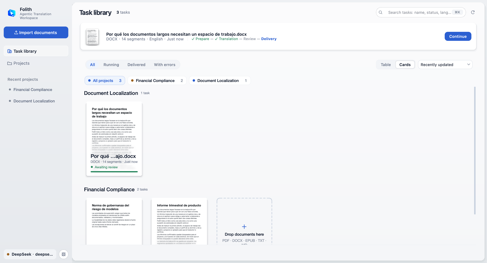
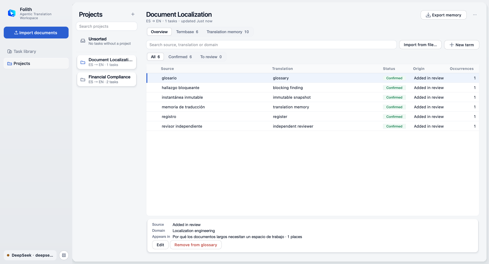
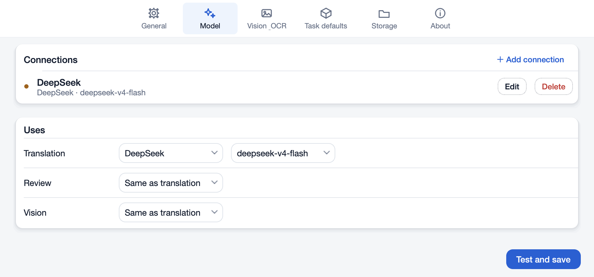
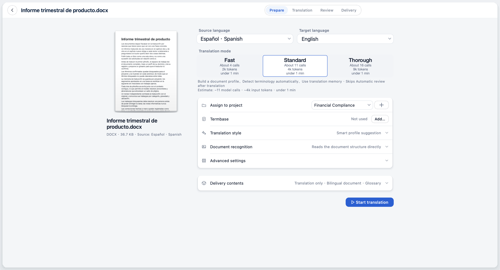
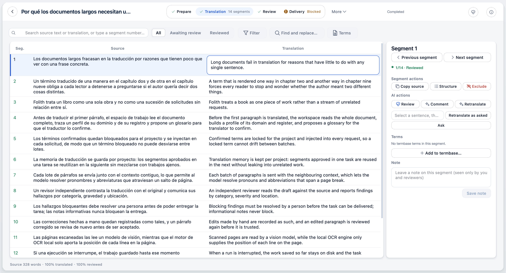
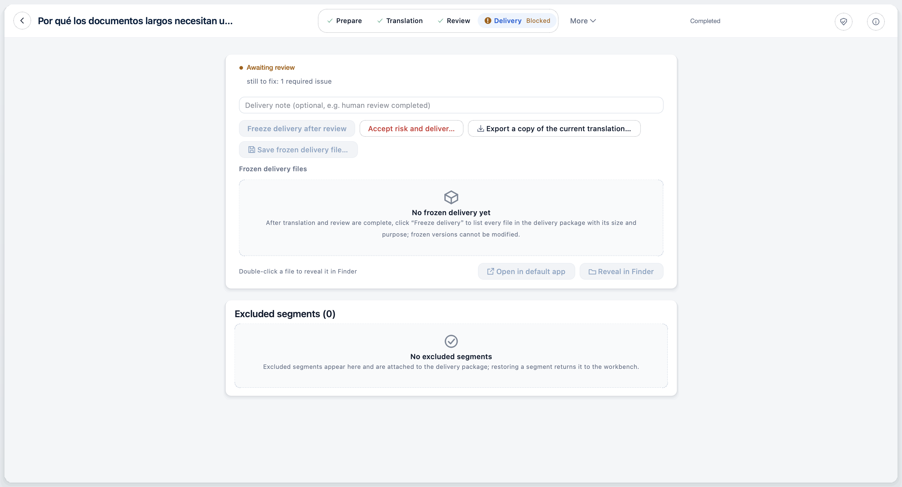
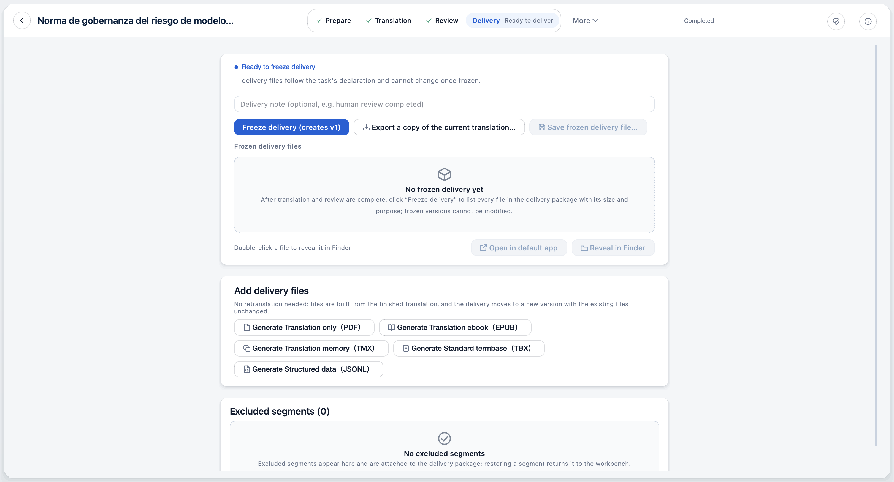
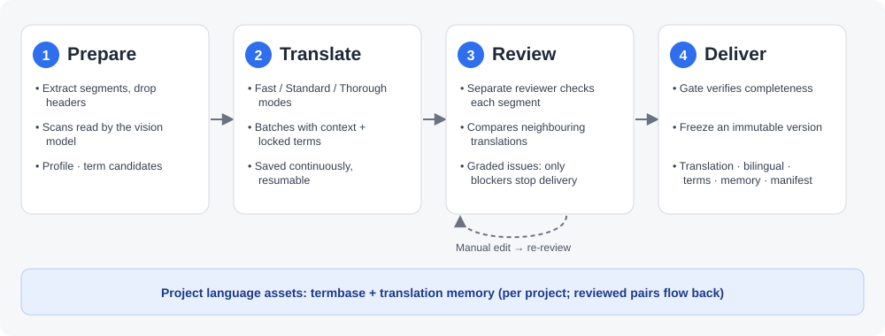

# Folith · 译页

<p align="center">
  
</p>

<p align="center">
  <strong>A translation workspace for long documents and professional localization</strong>
</p>

<p align="center">
  <a href="https://github.com/xueyang-dev/Folith/releases/tag/v0.7.2"></a>
  
  <a href="LICENSE"></a>
</p>

<p align="center">
  <a href="README.md">简体中文</a> | <strong>English</strong> | <a href="README.ru.md">Русский</a> | <a href="README.es.md">Español</a>
</p>

> The Simplified Chinese [README](README.md) is the maintained version. This page is a translation of it; if they differ, the Chinese one wins. The app's interface is in Simplified Chinese by default, so labels below are given as they appear in the English UI (an experimental locale).

---

**Folith · 译页** (Folith, "translated pages") is a desktop translation workbench for books, white papers, academic monographs and other long documents. It treats a document as one complete job: read the whole text first and build a profile and glossary, then translate in batches with context. An independent reviewer checks every segment, and segments you edit by hand are reviewed again. Once the delivery gate passes, everything is frozen into a traceable delivery package.

Translating one passage is easy. The hard part is using the same wording in chapter nine as in chapter two, keeping a record of every change, and being able to say where a delivered file came from. That is what Folith is built for.

---

## 📸 Screenshots

### Task library
Tasks are grouped by project. Each card shows a thumbnail of the first source page, the segment count, the languages and the current stage. Filter by status, search the full text, and resume an interrupted task in one click.

<p align="center">
  
</p>

### Projects: termbase and translation memory
The termbase and translation memory are kept per project. Confirmed terms are used automatically in new tasks; sentence pairs that pass review enter the project's translation memory and never leak into unrelated projects. XLSX / TBX / TMX import and export are supported.

<p align="center">
  
</p>

### Settings: model connections
Add connections under Settings → Model, and pick which one is used for translation, review and vision.

<p align="center">
  
</p>

### Preparing a task
After import, the prepare page lets you pick source and target language and a translation mode. Each mode card shows its estimated calls, tokens and time before you start.

<p align="center">
  
</p>

### Translation workbench
Source and translation side by side, segment by segment; the step bar at the top shows Prepare → Translation → Review → Delivery. The right-hand panel offers actions for the current segment: review, comment, re-translate on instruction, ask a question, add to the termbase, annotate.

<p align="center">
  
</p>

### Delivery gate
While unreviewed segments or blocking issues remain, delivery is stopped and the reason is shown. You can still export a working copy of the current translation.

<p align="center">
  
</p>

### Frozen delivery
After review, the result is frozen into an immutable delivery version with a manifest. PDF, EPUB, TMX, TBX and JSONL can be generated afterwards from the finished translation without translating again.

<p align="center">
  
</p>

> Screenshots are generated by `scripts/qt_showcase_screenshots.py` from synthetic demo documents; they contain no real user files.

---

## 🚀 Install

### macOS desktop client (recommended)

Download `Folith-Qt-0.7.2-macos-arm64.dmg` from the [v0.7.2 release](https://github.com/xueyang-dev/Folith/releases/tag/v0.7.2) and drag it into Applications.

- Requirements: macOS 15.7.5 or later, Apple Silicon.
- This build is unsigned and not notarized. The first time, right-click Folith in Applications → Open, and allow it once. **Do not** turn Gatekeeper off globally.
- Tesseract (English, Simplified Chinese, Arabic) is bundled, so there is nothing else to install.
- Verify (optional): the Release page publishes `SHA256SUMS.txt`. Compare it with `shasum -a 256 Folith-Qt-0.7.2-macos-arm64.dmg` in Terminal. This confirms the file is intact and unmodified; it is not a signature.
- After launching, add a model connection in Settings (see Quick start below).

### Windows x64 desktop client

Download one of these from the [v0.7.2 release](https://github.com/xueyang-dev/Folith/releases/tag/v0.7.2):

- **Installer (recommended):** `Folith-Setup-0.7.2-windows-x64.exe`. Run it, choose a folder, and launch Folith from the Start menu. It installs for the current user only and does not require administrator rights. Uninstalling removes the app only; tasks, terms, memory and settings stay in `%LOCALAPPDATA%\Folith`.
- **Portable:** `Folith-Qt-0.7.2-windows-x64.zip`. Right-click → Extract All, keep the extracted `Folith` folder together, and run `Folith\Folith.exe`. Do not run it from inside the ZIP preview.

CI automation has passed; manual acceptance of the final package on Windows 11 x64 remains pending. Windows 10 x64 is an unverified compatibility target. No Python, Git or developer tools are needed. Tesseract (English, Simplified Chinese, Arabic) is bundled; PaddleOCR and LibreOffice are not.

The Windows build is unsigned. SmartScreen may warn on first launch: choose **More info → Run anyway** after checking the publisher and the SHA-256 checksum. Do not disable Windows security globally.

### Run from source (developers)

```bash
git clone https://github.com/xueyang-dev/Folith.git
cd Folith
python -m pip install -e .
python -m folith.qt
```

Requires Python 3.10+; PySide6 is part of the dependencies. Optionally install [Tesseract OCR](https://github.com/tesseract-ocr/tesseract) to locate the lines of scanned pages. Without it, scanned pages go entirely to the vision model.

### Python package (for developers)

The package `foliothread` exists on PyPI (the code module is `folith`), but it is **not the recommended way to get the app**. PyPI still carries the 0.6.0 package with the legacy Streamlit UI; it is not updated by this GitHub release, and `folith` there does not start the desktop client. Use the DMG / Windows assets above or run from source.

---

## ⚡ Quick start

1. **Add a model connection**: open Settings → Model, press Add connection, choose a provider, enter the API key and model name, then press Test and save; the connection is saved only after the test passes.
2. **Import a document**: in the task library press Import document…, and pick a PDF / DOCX / EPUB / TXT / Markdown file.
3. **Pick a mode**: on the prepare page choose Fast, Standard or Thorough. Each card shows the estimated number of calls, input tokens and time for this document.
4. **Translate and review**: press Start translation. When it finishes, review segment by segment in the workbench and handle the items listed under Check & fix on the right.
5. **Freeze the delivery**: once the issues are resolved and the gate passes, press Freeze and save delivery…, choose where to save, and get the translation, bilingual copy, glossary, translation memory and delivery manifest.

---

## ⚡ Features

| Stage | What happens |
| :--- | :--- |
| **Prepare** | Extract segments and drop noise such as headers and footers; scanned pages are read by the vision model, and local Tesseract only supplies the position of each line; build a document profile and term candidates, and bring in project terms and translation memory |
| **Translate** | Batches by mode (Fast / Standard / Thorough), each carrying surrounding context and locked terms; progress is saved continuously and can be paused and resumed |
| **Review** | A separate reviewer model checks each segment against the source and can see neighbouring translations; edit by hand, re-translate on instruction, ask about a segment; edited segments are reviewed again |
| **Deliver** | The gate verifies completeness and blocking issues; freeze an immutable version; export translation, bilingual copy, terms, memory and manifest |


<p align="center">
  
</p>

- **📚 Long-document import**: PDF / DOCX / EPUB (no DRM) / TXT / Markdown.
- **🧠 Whole-book context**: a document profile and term extraction come first, so pronouns, abbreviations and terms line up across pages.
- **💎 Project-level language assets**: locked terms are injected into every request; translation memory reuses reviewed sentence pairs per project, cutting repeated calls.
- **🔍 Independent review and cross-segment checks**: review is done by a separate model, not the translator grading itself; segments are batched by sentence so one sentence is never split. Issues are graded by category and severity, and only blocking ones stop delivery.
- **🛡️ Human accountability**: manual edits are recorded faithfully and re-reviewed before being accepted; task state is saved continuously, so an interrupted task resumes from the last completed batch.
- **📦 Traceable delivery**: translation-only DOCX, bilingual DOCX, EPUB, PDF, glossary, TMX, JSONL and a `delivery_manifest.json`; a frozen version cannot be modified.
- **🎓 Academic mode** (off by default): exports the translation process, case comparisons and reflections as a practice report, for settings such as MTI (translation master's) assessment.

"Agentic" here means specifically: an independent reviewer role, re-translating a segment on your instruction, and asking the model about a segment. It does not change your document on its own; every change is confirmed by you and recorded.

---

## 🌍 Languages, formats and scale

**Target languages (12)**: Simplified Chinese, Traditional Chinese, English, Japanese, Korean, German, French, Spanish, Russian, Portuguese, Italian, Arabic.

**Source languages (17)**: English, Simplified Chinese, Traditional Chinese, Japanese, Korean, German, French, Spanish, Italian, Portuguese, Russian, Turkish, Arabic, Urdu, Persian, Uyghur, Hebrew. The source language also guides line positioning on scanned pages (the bundled Tesseract only ships English, Simplified Chinese and Arabic language data).

| | Formats |
| :--- | :--- |
| **Import** | PDF, DOCX, EPUB (no DRM), TXT, Markdown; up to 512 MB per file |
| **Delivery** | Translation-only DOCX, bilingual DOCX, EPUB (for PDF / DOCX tasks), original-layout PDF (PDF-sourced tasks only), the `delivery_manifest.json` manifest |
| **Language assets** | Glossary and translation memory: XLSX, TBX, TMX; JSONL |

**Document size**: there are no published benchmarks, and no promise about time or cost at any page count. For each document the prepare page estimates calls, input tokens and time for the three modes; rely on that.

---

## ⚙️ Models and providers

- **Built-in presets**: OpenAI, Gemini, DeepSeek, OpenRouter, SiliconFlow, Moonshot / Kimi, Zhipu / GLM, Qwen / DashScope, OpenCode Go.
- **Custom gateways**: any OpenAI-compatible gateway or local model server (vLLM / Ollama).
- **Several connections**: translation, review and vision can each use a different saved connection; the vision connection is only validated when a task contains scanned pages.
- **Model catalog**: OpenAI-compatible providers and Gemini can fetch the list of available models; whether a model actually works is decided by Test and save.
- **Reasoning effort**: supports reasoning models (such as DeepSeek-R1 and OpenAI o-series); thinking can be tuned or turned off.

---

## 📄 Formats, languages and size

| | Supported |
| :--- | :--- |
| **Import** | PDF (including scans) / DOCX / EPUB (no DRM) / TXT / Markdown |
| **Delivery files** | Translation-only DOCX, bilingual DOCX, EPUB (from PDF or DOCX sources), PDF (the layout-preserving PDF applies to PDF sources only), glossary, TMX, TBX, JSONL, `delivery_manifest.json` |
| **Source language** | Auto-detect, or pick one of 17: English, Simplified Chinese, Traditional Chinese, Japanese, Korean, German, French, Spanish, Italian, Portuguese, Russian, Turkish, Arabic, Urdu, Persian, Uyghur, Hebrew |
| **Target language** | 12: Simplified Chinese, Traditional Chinese, English, Japanese, Korean, German, French, Spanish, Russian, Portuguese, Italian, Arabic |
| **File size** | Up to 512 MB per file; split larger documents before importing |

No speed or scale benchmarks are published: quality and time depend on the document and the model you choose. The estimate on the prepare page is the most reliable guide before you start; for a given language pair, try a short sample chapter first.

---

## 🔒 Privacy and data

- **Who receives what**: document text and scanned page images are sent to the model provider(s) **you configure**, and are handled under their privacy terms. Make sure you are allowed to process the document that way.
- **Nothing else is uploaded**: the app itself has no telemetry, analytics or accounts. Apart from model providers, the only network request is reading the latest version info from GitHub when you press Check for Updates; nothing is downloaded or installed automatically.
- **Data stays on your machine**: tasks, terms, translation memory and settings live in the local data directory — macOS: `~/Library/Application Support/Folith/data`; Windows: `%LOCALAPPDATA%\Folith\data`.
- **How API keys are stored**: in a local JSON config file inside the data directory (permissions 0600, readable only by the current user). They are **not** in the system keychain and are not otherwise encrypted. Do not sync the data directory to shared locations or share it with others.

---

## 💰 Cost

Folith itself is free and open source. The model calls made while translating are billed by your provider to you, using your own API key. The prepare page estimates calls, input tokens and time for each of Fast / Standard / Thorough so you can compare before starting. The estimate is a guide; actual usage depends on the document and the model.

---

## ⚠️ Known limitations

- The DMG supports Apple Silicon and macOS 15.7.5 or later only; it is unsigned and not notarized.
- The Windows package is unsigned; manual acceptance of this final release on Windows 11 x64 is pending; Windows 10 x64 compatibility is unverified. ARM64 Windows, other Windows versions and a separate clean VM were not tested for this release.
- Windows manual acceptance items (native file panels, Chinese input method, sleep / wake, a real model service) are still manual; the automated frozen flow, OCR and install/uninstall checks are recorded in the release notes.
- EPUB files with DRM are not supported.
- Images inside tables and text boxes are not kept in the translated DOCX; the bilingual DOCX contains no images.
- Output is not written back into the original DOCX layout; new files are generated.
- Interface languages other than Simplified Chinese are experimental.
- Scanned pages are recognized by the vision model and can contain errors; check against the original page.
- Seven manual acceptance items (Finder double-click approval, system file panel, real model service, Chinese input method, Dock quit, sleep / wake, clean Mac) are still being verified after release; see the [release notes](docs/release-notes-0.7.2.md) (in Chinese).

---

## 🌐 Interface languages

The interface is Simplified Chinese by default. English, Español, Русский and العربية are experimental: the strings are complete, but they have not had an independent language review, and Arabic RTL has not been fully accepted. See [Appearance and multilingual boundaries](docs/i18n/README.md).

---

## ❓ FAQ

**macOS blocks the first launch?** The app is unsigned and not notarized. In Applications, right-click Folith, choose Open, then click Open in the dialog. This is needed only once. Do not turn Gatekeeper off globally.

**Test and save fails?** Check the API key, model name and endpoint. If a system proxy or VPN is on, it may return errors such as 502; try turning it off or exempting the provider's domain. For a custom gateway, make sure it is OpenAI-API compatible.

**A scanned page was recognized wrongly?** Recognition is done by the vision model and can be wrong. Compare with the original page in the workbench; you can switch to a stronger vision model by configuring a separate vision connection in Settings, then rescan.

**A task was interrupted?** Progress is saved continuously. Open the task in the library and press Continue translating; it resumes from the last completed batch, and batches that succeeded are not rerun.

**How do I update, uninstall or delete my data?** Check for Updates tells you whether a newer version exists; download it yourself from the Releases page. Dragging `Folith.app` to the Trash removes only the app; tasks and settings stay. To remove everything, quit the app and delete `~/Library/Application Support/Folith`, `~/Library/Logs/Folith` and `~/Library/Preferences/com.folith.QtDesktop.plist`. Export any translations and TMX / TBX you want to keep first.

### Feedback

- Bugs and suggestions: [GitHub Issues](https://github.com/xueyang-dev/Folith/issues)
- Email: xydev@outlook.sa (also reachable from Settings in the app)

---

## 🗺️ Roadmap

- [x] **v0.4.0**: unified branding, language assets and terminology hub, delivery gate, live draft recovery
- [x] **v0.6.0**: the native Qt desktop client becomes the main entry; EPUB / TXT / Markdown import; vision model as the primary reader of scanned pages; per-project terms and translation memory; multiple model connections; cross-segment review; translated DOCX keeps source images; appearance follows the system
- [x] **v0.7.1**: Windows x64 desktop stability update (installer + portable ZIP); truthful review coverage that never counts skipped segments as reviewed; Windows path, encoding, console-window and window-restore fixes; resumable interrupted tasks; workbench polling no longer repaints the whole grid and large tasks show loading feedback before a chunked fill; knowledge feedback off the serial commit path; measured concurrency tiers with corrected tooltips; name conflicts resolved with one choice in the drawer and the review page. 0.7.0 was published on 2026-10-22; this is a follow-up fix release
- [x] **v0.7.2**: candidate previews protect human translations; review decisions stay separate from text edits; TM promotion follows successful saves; profiling recovery, PDF navigation and theme refresh fixes. CI passed; final-package manual acceptance remains pending. See the [release notes](docs/release-notes-0.7.2.md)
- [ ] **Next**: code signing and notarization; Windows acceptance on more system versions and a clean VM; DOCX write-back preserving original layout and styles; fuzzy translation-memory matching; incremental translation across document versions

---

## 📖 Documentation

(Most documents are in Chinese.)

- [Desktop release notes](docs/release-notes-0.7.2.md)
- [Release plan](docs/release-plan.md)
- [Projects and long-term memory](docs/project-memory.md)
- [Translated EPUB / DOCX export](docs/epub-export.md)
- [OCR and vision reading](docs/ocr-subsystem.md)
- [Architecture and capability boundaries](docs/architecture-boundaries.md)
- [Changelog](CHANGELOG.md)
- [Contributing](CONTRIBUTING.md) (Chinese)

---

## 📄 License

Released under the [MIT License](LICENSE).
