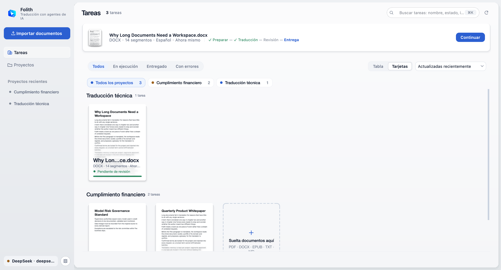
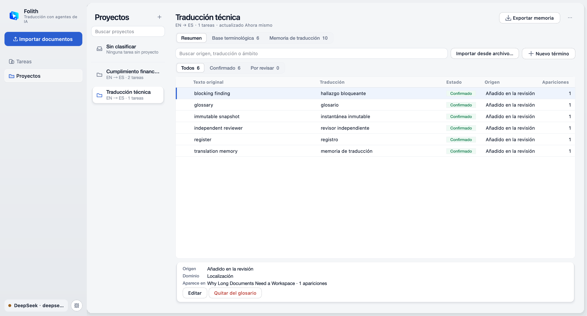
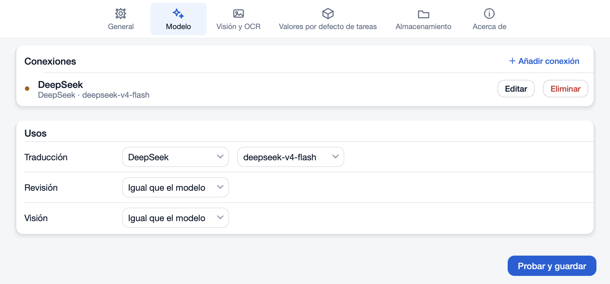
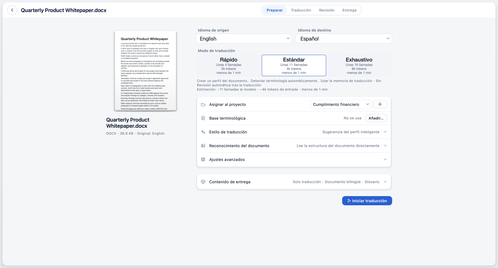
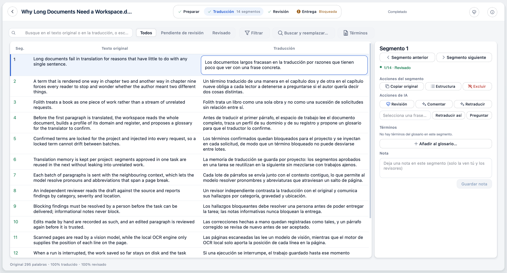
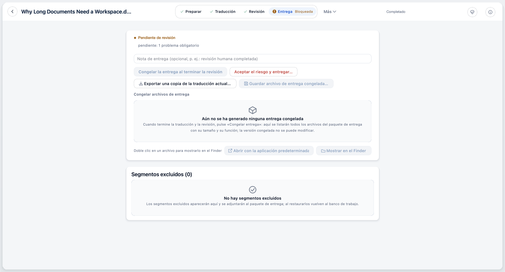
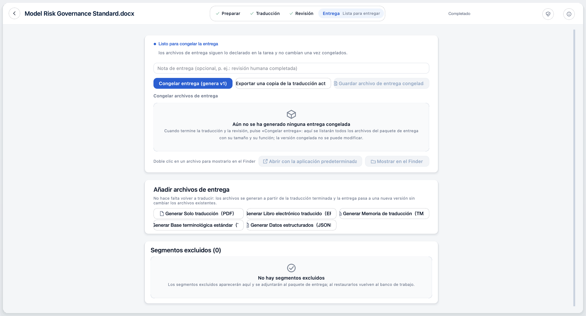
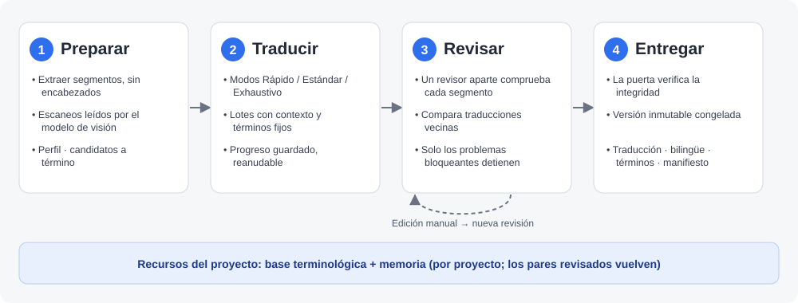

# Folith · 译页

<p align="center">
  
</p>

<p align="center">
  <strong>Un espacio de trabajo de traducción para documentos largos y localización profesional</strong>
</p>

<p align="center">
  <a href="https://github.com/xueyang-dev/Folith/releases/latest"></a>
  
  
  <a href="LICENSE"></a>
</p>

<p align="center">
  <a href="README.md">简体中文</a> | <a href="README.en.md">English</a> | <a href="README.ru.md">Русский</a> | <strong>Español</strong>
</p>

> La versión que se mantiene es el [README en chino simplificado](README.md). Esta página es una traducción; si difieren, prevalece la china. La interfaz de la aplicación está en chino simplificado por defecto, así que los nombres de los controles se dan como aparecen en la interfaz en español (una configuración regional experimental).

---

**Folith · 译页** («páginas traducidas») es un banco de trabajo de escritorio para traducir libros, informes técnicos, monografías académicas y otros documentos largos. Es de código abierto, prioriza el trabajo local y funciona en Windows y macOS. Trata un documento como un trabajo completo: importas un PDF / DOCX / EPUB / TXT / Markdown (escaneados incluidos), primero lee todo el texto y construye un perfil y un glosario, y después traduce por lotes con contexto. Un revisor independiente comprueba cada segmento y tú decides en cada caso. Cuando la puerta de entrega se supera, todo se congela en un paquete de entrega trazable.

Traducir un pasaje es fácil. Lo difícil es usar las mismas palabras en el capítulo nueve que en el dos, que tus propias ediciones nunca se sobrescriban, dejar constancia de cada cambio y poder explicar el origen de un archivo entregado. Folith está hecho para eso.

---

## 🎬 Folith en un minuto

https://github.com/user-attachments/assets/28519895-b8d0-415a-86f9-6a85635901a8

Un libro, desde la importación, pasando por la preparación, la traducción y la revisión humana, hasta la entrega, en un minuto. Las imágenes de la interfaz se capturaron fuera de pantalla desde el cliente de Folith con un libro de ejemplo sintético de dominio público (*Los hermanos Karamázov*) y no contienen archivos reales de usuarios; las tomas marcadas como «Illustration» son explicaciones animadas.

---

## 📸 Capturas de pantalla

### Biblioteca de tareas
Las tareas se agrupan por proyecto. Cada tarjeta muestra una miniatura de la primera página original, el número de segmentos, los idiomas y la etapa actual. Puedes filtrar por estado, buscar en todo el texto y reanudar una tarea interrumpida con un clic.

<p align="center">
  
</p>

### Proyectos: base terminológica y memoria de traducción
La base terminológica y la memoria de traducción se guardan por proyecto. Los términos confirmados se usan automáticamente en las tareas nuevas; los pares de oraciones que superan la revisión entran en la memoria del proyecto y no se mezclan con proyectos ajenos. Se admite importar y exportar XLSX / TBX / TMX.

<p align="center">
  
</p>

### Ajustes: conexiones de modelo
Las conexiones se añaden en Ajustes → Modelo; ahí también eliges cuál se usa para traducción, revisión y visión.

<p align="center">
  
</p>

### Preparar una tarea
Tras importar, la página de preparación permite elegir idioma de origen y de destino y el modo de traducción. Cada tarjeta de modo muestra, antes de empezar, las llamadas, los tokens y el tiempo estimados.

<p align="center">
  
</p>

### Banco de traducción
Original y traducción lado a lado, segmento a segmento; la barra de pasos superior muestra Preparar → Traducción → Revisión → Entrega. El panel derecho ofrece acciones para el segmento actual: revisar, comentar, retraducir, retraducir según tus indicaciones, hacer una pregunta, añadir a la base terminológica, anotar. En las tareas de PDF puedes abrir la página original: al seleccionar un segmento, se localiza y resalta en ella.

<p align="center">
  
</p>

### Puerta de entrega
Mientras queden segmentos sin revisar o problemas bloqueantes, la entrega se detiene y se explica el motivo. Aun así puedes exportar una copia de trabajo de la traducción actual.

<p align="center">
  
</p>

### Entrega congelada
Tras la revisión, el resultado se congela en una versión de entrega inmutable con su manifiesto. Después se pueden generar PDF, EPUB, TMX, TBX y JSONL a partir de la traducción terminada, sin volver a traducir.

<p align="center">
  
</p>

> Las capturas las genera `scripts/qt_showcase_screenshots.py` con documentos de demostración sintéticos; no contienen archivos reales de usuarios.

---

## 🚀 Instalación

Todos los paquetes de escritorio están en la página de la [última versión](https://github.com/xueyang-dev/Folith/releases/latest); `<versión>` en los nombres de archivo de abajo es el número de esa versión. La misma página publica `SHA256SUMS.txt` para comprobar la descarga. Esto confirma que el archivo está íntegro y no ha sido sustituido; no equivale a una firma.

### Cliente de escritorio para macOS

Descarga `Folith-Qt-<versión>-macos-arm64.dmg`, ábrelo y arrastra Folith a Aplicaciones.

- Requisitos: macOS 15.7.5 o posterior en Apple silicon (serie M). Los Mac con Intel no son compatibles.
- El paquete no está firmado ni notarizado. La primera vez, haz clic derecho en Folith dentro de Aplicaciones → Abrir y permítelo una sola vez. **No** desactives Gatekeeper de forma global.
- Tesseract (inglés, chino simplificado, árabe) viene incluido, así que no hay que instalar nada más.
- Verificación (opcional): ejecuta `shasum -a 256 Folith-Qt-<versión>-macos-arm64.dmg` en Terminal y compáralo con `SHA256SUMS.txt`.
- Tras abrirla, añade una conexión de modelo en Ajustes (ver Inicio rápido más abajo).

### Cliente de escritorio para Windows x64

- **Instalador (recomendado):** `Folith-Setup-<versión>-windows-x64.exe`. Ejecútalo, elige una carpeta e inicia Folith desde el menú Inicio. Se instala solo para el usuario actual y no requiere permisos de administrador. Al desinstalar se elimina solo la aplicación; las tareas, términos, memoria y ajustes se conservan en `%LOCALAPPDATA%\Folith`.
- **Portátil:** `Folith-Qt-<versión>-windows-x64.zip`. Haz clic derecho → Extraer todo, mantén junta la carpeta `Folith` extraída y ejecuta `Folith\Folith.exe`. No lo ejecutes desde la vista previa del ZIP.

No hace falta Python, Git ni herramientas de desarrollo. Tesseract (inglés, chino simplificado, árabe) viene incluido; PaddleOCR y LibreOffice no. La plataforma principal es Windows 11 x64; Windows 10 x64 es un objetivo de compatibilidad no verificado y no hay versión para ARM64.

La compilación para Windows no está firmada. SmartScreen puede mostrar un aviso la primera vez: comprueba la suma SHA-256 y elige **Más información → Ejecutar de todas formas**. No desactives la seguridad de Windows de forma global.

### Ejecutar desde el código fuente (desarrolladores)

```bash
git clone https://github.com/xueyang-dev/Folith.git
cd Folith
python -m pip install -e .
python -m folith.qt
```

Requiere Python 3.10+; PySide6 forma parte de las dependencias. Opcionalmente, instala [Tesseract OCR](https://github.com/tesseract-ocr/tesseract) para localizar las líneas de las páginas escaneadas. Sin él, las páginas escaneadas pasan por completo al modelo de visión.

### Paquete de Python (para desarrolladores)

El paquete `foliothread` existe en PyPI (el módulo del código se llama `folith`), pero **no es la forma recomendada de obtener la aplicación**. PyPI sigue con la versión 0.6.0 y la interfaz Streamlit antigua; no se actualiza junto con las versiones de GitHub y el comando `folith` de allí no inicia el cliente de escritorio. Usa los paquetes de macOS / Windows de arriba o ejecuta desde el código fuente.

---

## ⚡ Inicio rápido

1. **Añade una conexión de modelo**: abre Ajustes → Modelo, pulsa Añadir conexión, elige un proveedor, introduce la clave de API y el nombre del modelo y pulsa Probar y guardar; la conexión solo se guarda si la prueba tiene éxito.
2. **Importa un documento**: en la biblioteca de tareas pulsa Importar documento… y elige un archivo PDF / DOCX / EPUB / TXT / Markdown.
3. **Elige un modo**: en la página de preparación, Rápido, Estándar o Exhaustivo. Cada tarjeta muestra el número estimado de llamadas, los tokens de entrada y el tiempo para este documento.
4. **Traduce y revisa**: pulsa Iniciar traducción. Al terminar, revisa segmento a segmento en el banco y atiende los elementos de Revisar y corregir, a la derecha.
5. **Congela la entrega**: cuando los problemas estén resueltos y la puerta se supere, pulsa Congelar y guardar entrega…, elige dónde guardar y obtendrás la traducción, la copia bilingüe, el glosario, la memoria de traducción y el manifiesto.

---

## ✨ Características

| Etapa | Qué ocurre |
| :--- | :--- |
| **Preparar** | Extrae segmentos y descarta ruido como encabezados y pies; las páginas escaneadas las lee el modelo de visión y Tesseract local solo da la posición de cada línea; genera el perfil del documento y candidatos a término, e incorpora los términos y la memoria del proyecto |
| **Traducir** | Lotes según el modo (Rápido / Estándar / Exhaustivo), cada uno con contexto circundante y términos bloqueados; el progreso se guarda continuamente y se puede pausar y reanudar |
| **Revisar** | Un modelo revisor distinto comprueba cada segmento frente al original y ve las traducciones vecinas; edición manual, retraducción según indicaciones, preguntas sobre un segmento; las retraducciones y sugerencias de revisión llegan como candidatos que aceptas o descartas; los segmentos editados se vuelven a revisar |
| **Entregar** | La puerta verifica la integridad y los problemas bloqueantes; se congela una versión inmutable; se exportan traducción, copia bilingüe, términos, memoria y manifiesto |


<p align="center">
  
</p>

- **📚 Importación de documentos largos**: PDF / DOCX / EPUB (sin DRM) / TXT / Markdown.
- **🧠 Contexto de todo el libro**: antes de traducir se hace un perfil del documento y una extracción de términos, de modo que pronombres, abreviaturas y términos concuerden entre páginas.
- **💎 Recursos lingüísticos por proyecto**: los términos bloqueados se inyectan en cada solicitud; la memoria de traducción reutiliza pares de oraciones revisados dentro del proyecto y reduce llamadas repetidas.
- **🔍 Revisión independiente y comprobaciones entre segmentos**: la revisión la hace un modelo aparte, no el traductor evaluándose a sí mismo; los lotes se agrupan por oraciones, así que una oración nunca se parte. Los problemas se clasifican por categoría y gravedad, y solo los bloqueantes detienen la entrega.
- **🛡️ Traducciones protegidas**: las retraducciones y sugerencias de revisión se muestran como candidatos junto al texto actual y las diferencias, y solo lo sustituyen si las aceptas; el reemplazo por lotes omite por defecto las traducciones editadas o confirmadas a mano. Las decisiones de revisión (problema confirmado, corrección confirmada, conservar la traducción actual) se registran por separado de la edición del texto.
- **🧾 Auditable y reanudable**: las ediciones manuales se registran fielmente y se revisan de nuevo antes de aceptarse; una decisión de revisión entra en la memoria de traducción del proyecto solo después de guardarse; el estado de la tarea se guarda continuamente, y una tarea interrumpida se reanuda desde el último lote completado.
- **📍 Página original a la vista**: en las tareas de PDF el banco de trabajo puede mostrar la página original; al seleccionar un segmento se localiza y resalta, así que los escaneados se pueden cotejar línea a línea.
- **📦 Entrega trazable**: DOCX solo con traducción, DOCX bilingüe, EPUB, PDF, glosario, TMX, JSONL y un manifiesto `delivery_manifest.json`; una versión congelada no se puede modificar.
- **🎓 Modo académico** (desactivado por defecto): exporta el proceso de traducción, la comparación de casos y la reflexión como informe de prácticas, para contextos como la evaluación de másteres de traducción (MTI).

Aquí «agéntico» significa concretamente: un rol de revisor independiente, retraducir un segmento según tus indicaciones y preguntar al modelo sobre un segmento. No cambia tu documento por su cuenta; cada cambio lo confirmas tú y queda registrado.

---

## 🌍 Idiomas, formatos y escala

| | Compatible |
| :--- | :--- |
| **Importación** | PDF (incluidos escaneados) / DOCX / EPUB (sin DRM) / TXT / Markdown; hasta 512 MB por archivo, divide los documentos más grandes antes de importarlos |
| **Archivos de entrega** | DOCX solo con la traducción, DOCX bilingüe, EPUB (de fuentes PDF o DOCX), PDF (el PDF que conserva la maquetación solo se aplica a fuentes PDF), glosario, TMX, TBX, JSONL, el manifiesto `delivery_manifest.json` |
| **Recursos lingüísticos** | Glosario y memoria de traducción: importación y exportación XLSX, TBX, TMX; JSONL |
| **Idioma de origen** | Detección automática o uno de 21: English, 简体中文, 繁體中文, 日本語, 한국어, Deutsch, Français, Español, Italiano, Português, Русский, Nederlands, Polski, Українська, Tiếng Việt, Türkçe, العربية, فارسی, עברית, اردو, ئۇيغۇرچە |
| **Idioma de destino** | 21: 简体中文, 繁體中文, English, 日本語, 한국어, Deutsch, Français, Español, Русский, Português, Italiano, Nederlands, Polski, Українська, Tiếng Việt, Türkçe, العربية, فارسی, עברית, اردو, ئۇيغۇرچە |

El idioma de origen también guía la ubicación de líneas en las páginas escaneadas (el Tesseract incluido solo trae datos de inglés, chino simplificado y árabe; los paquetes faltantes fallan explícitamente en lugar de recurrir silenciosamente al inglés). Véase [Especificación de compatibilidad y validación de idiomas de traducción](docs/translation-languages.md). No se publican mediciones de velocidad ni de escala, ni hay promesas de tiempo o coste para ningún número de páginas: la calidad y el tiempo dependen del documento y del modelo que elijas. Para cada documento, la página de preparación estima llamadas, tokens de entrada y tiempo para los tres modos; guíate por eso y, para un par de idiomas concreto, prueba antes con un capítulo corto.

> **Alcance de la validación lingüística:** Estas son opciones del catálogo. Los nuevos pares aún no han completado la traducción con modelos reales, la revisión independiente ni la validación en lectores; #10 sigue abierto. Las pruebas de componentes no equivalen a una aprobación de calidad.

---

## ⚙️ Modelos y proveedores

- **Ajustes preconfigurados**: OpenAI, Gemini, DeepSeek, OpenRouter, SiliconFlow, Moonshot / Kimi, Zhipu / GLM, Qwen / DashScope, OpenCode Go.
- **Pasarelas propias**: cualquier pasarela compatible con la API de OpenAI o servidor de modelos local (vLLM / Ollama).
- **Varias conexiones**: traducción, revisión y visión pueden usar cada una una conexión guardada distinta; la de visión solo se valida si la tarea contiene páginas escaneadas.
- **Catálogo de modelos**: los proveedores compatibles con OpenAI y Gemini pueden obtener la lista de modelos disponibles; que un modelo funcione de verdad lo decide Probar y guardar.
- **Esfuerzo de razonamiento**: admite modelos de razonamiento (como DeepSeek-R1 y la serie o de OpenAI); el razonamiento se puede ajustar o desactivar.

---

## 🔒 Privacidad y datos

- **Quién recibe qué**: el texto del documento y las imágenes de las páginas escaneadas se envían a los proveedores de modelos **que tú configures**, y se tratan según sus condiciones de privacidad. Asegúrate de que puedes procesar el documento de ese modo.
- **No se sube nada más**: la aplicación no tiene telemetría, analítica ni cuentas. Aparte de los proveedores de modelos, la única petición de red es leer la información de la última versión en GitHub cuando pulsas Buscar actualizaciones; no se descarga ni instala nada automáticamente.
- **Los datos se quedan en tu equipo**: tareas, términos, memoria de traducción y ajustes están en el directorio de datos local — macOS: `~/Library/Application Support/Folith/data`; Windows: `%LOCALAPPDATA%\Folith\data`.
- **Cómo se guardan las claves de API**: en un archivo de configuración JSON local dentro del directorio de datos (permisos 0600, legible solo por el usuario actual). **No** están en el llavero del sistema y no tienen cifrado adicional. No sincronices el directorio de datos en lugares compartidos ni lo compartas con otras personas.

---

## 💰 Coste

Folith es gratuito y de código abierto. Las llamadas a modelos que se hacen al traducir las factura tu proveedor, con tu propia clave de API. La página de preparación estima llamadas, tokens de entrada y tiempo para cada modo (Rápido / Estándar / Exhaustivo) para que puedas compararlos antes de empezar. La estimación es orientativa; el consumo real depende del documento y del modelo.

---

## ⚠️ Limitaciones conocidas

- El paquete de macOS solo es compatible con Apple silicon y macOS 15.7.5 o posterior; no está firmado ni notarizado.
- El paquete de Windows no está firmado; no se ha verificado la compatibilidad con Windows 10 x64, Windows en ARM64 ni máquinas virtuales limpias.
- Algunos elementos de aceptación manual de los paquetes finales (paneles de archivos del sistema, método de entrada chino, suspensión / reactivación, aprobación del primer arranque, un servicio de modelo real, etc.) pueden completarse después de la publicación; lo verificado y lo pendiente de cada versión figura en las [notas de la versión](docs/release-notes-0.8.0.md) (en chino) correspondientes.
- No se admiten EPUB con DRM.
- Las imágenes dentro de tablas y cuadros de texto no se conservan en el DOCX traducido; el DOCX bilingüe no contiene imágenes.
- No se reescribe la maquetación del DOCX original; se generan archivos nuevos.
- Los idiomas de interfaz distintos del chino simplificado son experimentales.
- Las páginas escaneadas las reconoce el modelo de visión y pueden contener errores; compáralas con la página original.

---

## 🌐 Idiomas de la interfaz

La interfaz está en chino simplificado por defecto. English, Español, Русский, العربية, Français y Deutsch son experimentales: los textos están completos, y el reflejo completo de la interfaz y la exportación RTL en árabe han pasado la aceptación (véase [Informe de aceptación de árabe](docs/arabic-acceptance-2026-10-26.md)); la revisión independiente por hablantes nativos para otros idiomas sigue en curso. Véase [Apariencia y límites multilingües](docs/i18n/README.md).

---

## ❓ Preguntas frecuentes

**¿macOS bloquea el primer arranque?** La aplicación no está firmada ni notarizada. En Aplicaciones, haz clic derecho en Folith, elige Abrir y vuelve a pulsar Abrir en el cuadro de diálogo. Solo hace falta una vez. No desactives Gatekeeper globalmente.

**¿Falla Probar y guardar?** Revisa la clave de API, el nombre del modelo y la dirección. Si hay un proxy del sistema o una VPN activa, puede devolver errores como 502; prueba a desactivarla o a excluir el dominio del proveedor. Con una pasarela propia, asegúrate de que sea compatible con la API de OpenAI.

**¿Una página escaneada se reconoció mal?** El reconocimiento lo hace el modelo de visión y puede equivocarse. Compara con la página original en el banco; puedes pasar a un modelo de visión más potente configurando una conexión de visión aparte en Ajustes y volver a escanear.

**¿Se interrumpió una tarea?** El progreso se guarda continuamente. Abre la tarea en la biblioteca y pulsa Continuar traducción; se reanuda desde el último lote completado y los lotes que tuvieron éxito no se repiten.

**¿Cómo actualizo, desinstalo o borro mis datos?** Buscar actualizaciones te avisa si hay una versión más reciente; descárgala tú mismo desde la [página de Releases](https://github.com/xueyang-dev/Folith/releases/latest). Exporta antes las traducciones y los TMX / TBX que quieras conservar.

- macOS: arrastrar `Folith.app` a la Papelera elimina solo la aplicación; las tareas y los ajustes se conservan. Para borrar todo, cierra la aplicación y elimina `~/Library/Application Support/Folith`, `~/Library/Logs/Folith` y `~/Library/Preferences/com.folith.QtDesktop.plist`.
- Windows: desinstalar la versión instalada desde Configuración → Aplicaciones, o borrar la carpeta de la versión portátil, elimina solo la aplicación. Para borrar todo, cierra la aplicación y elimina `%LOCALAPPDATA%\Folith`.

### Comentarios

- Errores y sugerencias: [GitHub Issues](https://github.com/xueyang-dev/Folith/issues)
- Correo: xydev@outlook.sa (también accesible desde Ajustes en la aplicación)

---

## 🗺️ Hoja de ruta

**Disponible hoy**: un cliente de escritorio nativo en Qt (instalador / portátil para Windows x64, macOS en Apple silicon); importación de PDF (incluidos escaneados) / DOCX / EPUB / TXT / Markdown; el modelo de visión como lector principal de páginas escaneadas; términos y memoria de traducción por proyecto; varias conexiones de modelo; revisión entre segmentos; candidatos que protegen las traducciones humanas; navegación por la página original; puerta de entrega y entregas congeladas. Los cambios de cada versión están en el [registro de cambios](CHANGELOG.md).

**Próximos pasos**:

- [ ] Firma de código y notarización
- [ ] Aceptación en más versiones de Windows y en una VM limpia
- [ ] Reescritura en el DOCX original conservando maquetación y estilos
- [ ] Coincidencias aproximadas en la memoria de traducción
- [ ] Traducción incremental entre versiones de un documento

---

## 📖 Documentación

(La mayoría de los documentos están en chino.)

- [Notas de la última versión y registro de aceptación](docs/release-notes-0.8.0.md)
- [Plan de publicación](docs/release-plan.md)
- [Proyectos y memoria a largo plazo](docs/project-memory.md)
- [Exportación de la traducción a EPUB / DOCX](docs/epub-export.md)
- [OCR y lectura con visión](docs/ocr-subsystem.md)
- [Arquitectura y límites de capacidad](docs/architecture-boundaries.md)
- [Registro de cambios](CHANGELOG.md)
- [Cómo contribuir](CONTRIBUTING.md) (en chino)

---

## 📄 Licencia

Publicado bajo la [licencia MIT](LICENSE).
