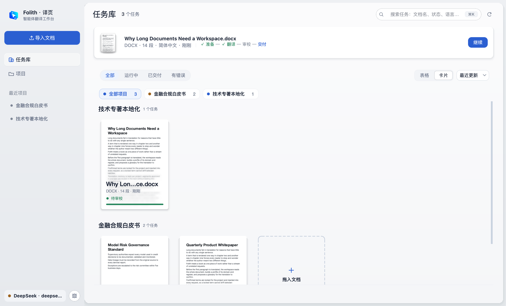
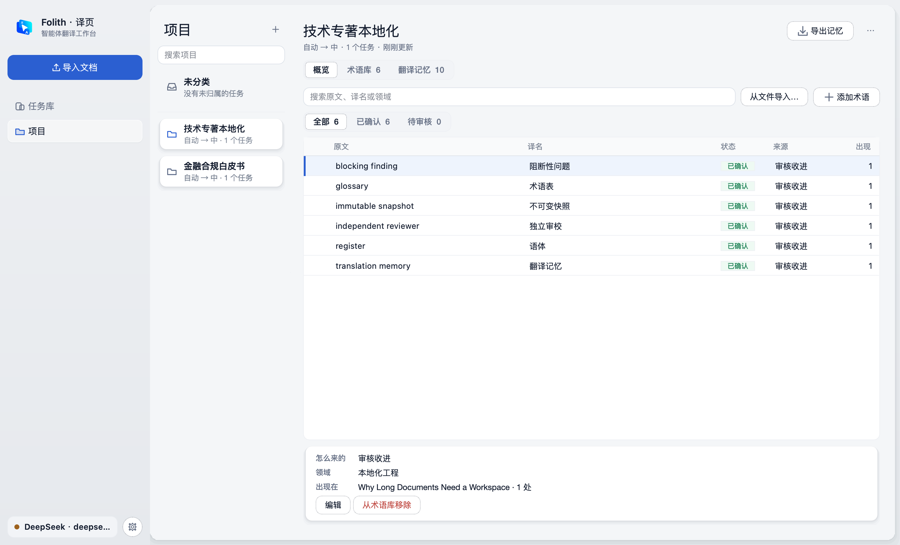
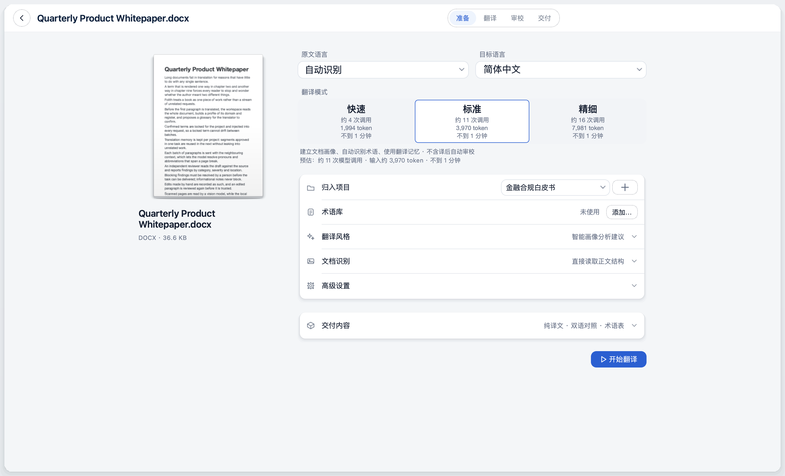
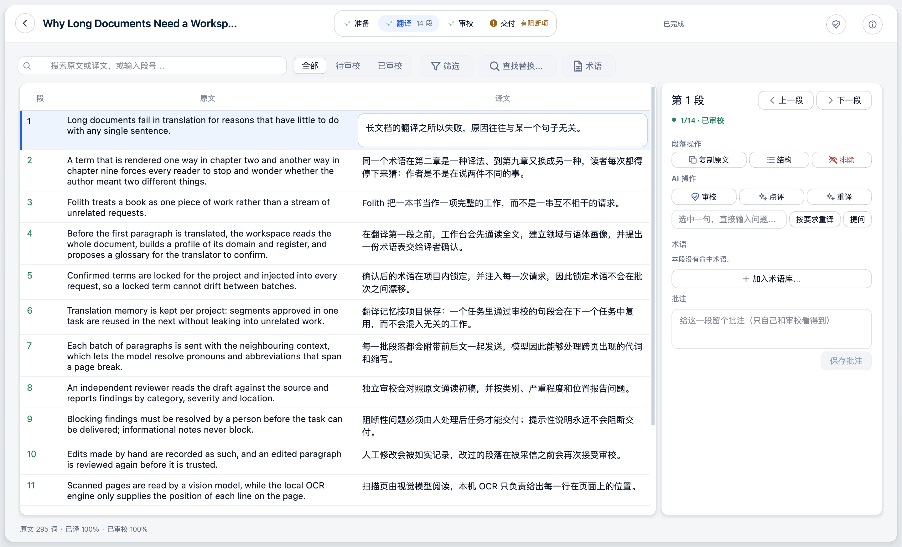
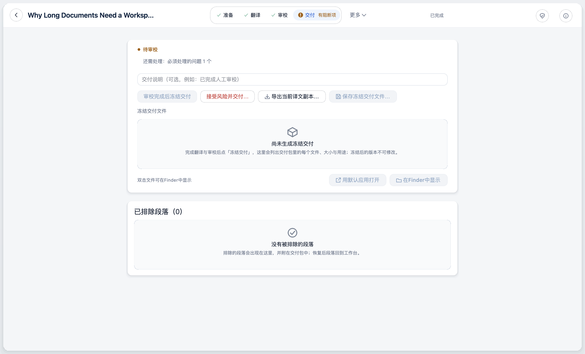
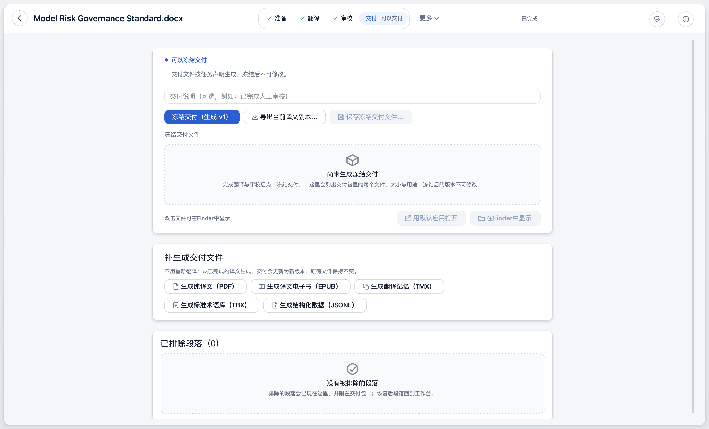
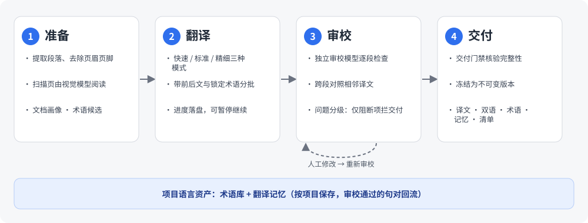

# Folith · 译页

<p align="center">
  
</p>

<p align="center">
  <strong>面向长文档与专业本地化的翻译工作台</strong>
</p>

<p align="center">
  <a href="https://github.com/xueyang-dev/Folith/releases/tag/v0.7.1"></a>
  
  <a href="LICENSE"></a>
</p>

<p align="center">
  <strong>简体中文</strong> | <a href="README.en.md">English</a> | <a href="README.ru.md">Русский</a> | <a href="README.es.md">Español</a>
</p>

> 简体中文 README 是持续维护的版本；其他语言版本由它翻译而来，如有出入以中文为准。

---

**Folith · 译页** 是一个面向书籍、白皮书、学术专著等长文档的桌面翻译工作台。它把一份文档当作一项完整的工作来做：先通读全文、建立画像和术语表，再带着上下文分批翻译；独立审校逐段检查，人工改过的段落会重新审校；最后在交付门禁通过后，冻结成可追溯的交付包。

一次请求翻一段很容易，难的是第九章和第二章用词一致、改过的地方有记录、交出去的文件能说清楚来源。Folith 就是为这件事做的。

---

## 📸 界面预览

### 任务库
所有任务按项目分组，卡片直接显示原文首页缩略图、段数、语言和当前阶段；可以按状态筛选、全文搜索，中断的任务一键继续。

<p align="center">
  
</p>

### 项目：术语库与翻译记忆
术语库和翻译记忆按项目保存。确认的术语在新任务中自动使用；通过审校的句对进入本项目的翻译记忆，不会混进无关项目。支持 XLSX / TBX / TMX 导入导出。

<p align="center">
  
</p>

### 设置：模型连接
在「设置 → 模型」里添加连接，并为翻译、审校、视觉分别选择用哪一条。

<p align="center">
  
</p>

### 译前准备
导入后先到准备页：选原文 / 目标语言和翻译模式，每种模式的预估调用次数、token 与耗时直接显示在卡片上，再决定是否开始。

<p align="center">
  
</p>

### 翻译工作台
原文与译文逐段对照，顶部步骤条显示「准备 → 翻译 → 审校 → 交付」进度。右侧是当前段落的操作：审校、点评、按要求重译、提问、加入术语库、批注。

<p align="center">
  
</p>

### 交付门禁
还有未审校段落或必须处理的问题时，交付被拦下并说明原因；也可以先导出当前译文副本。

<p align="center">
  
</p>

### 冻结交付
审校完成后冻结为不可变的交付版本，带交付清单；也可以从已完成的译文补生成 PDF、EPUB、TMX、TBX、JSONL，不必重新翻译。

<p align="center">
  
</p>

> 截图由 `scripts/qt_showcase_screenshots.py` 用合成的演示文档生成，不含真实用户文件。

---

## 🚀 安装

### macOS 桌面客户端（推荐）

从 [v0.7.1 Release](https://github.com/xueyang-dev/Folith/releases/tag/v0.7.1) 下载 `Folith-Qt-0.7.1-macos-arm64.dmg`，拖进「应用程序」。

- 系统要求：macOS 15.7.5 或更高，Apple Silicon。
- 当前版本未签名、未公证：第一次打开时，在「应用程序」里右键点 Folith → 打开，放行一次即可。**不要**全局关闭 Gatekeeper。
- 安装包已内置 Tesseract（英文、简体中文、阿拉伯文），不需要另装任何依赖。
- 校验（可选）：Release 页提供 `SHA256SUMS.txt`。在终端运行 `shasum -a 256 Folith-Qt-0.7.1-macos-arm64.dmg` 对比即可。这只能确认文件完整、没被替换，不等同于签名。
- 打开后在「设置」里添加模型连接，见下面的快速上手。

### Windows x64 桌面客户端

从 [v0.7.1 Release](https://github.com/xueyang-dev/Folith/releases/tag/v0.7.1) 下载：

- **安装版（推荐）**：`Folith-Setup-0.7.1-windows-x64.exe`。运行后选择安装目录，从开始菜单启动。只安装到当前用户，不需要管理员权限。卸载只移除应用；任务、术语、翻译记忆和设置保留在 `%LOCALAPPDATA%\Folith`。
- **便携版**：`Folith-Qt-0.7.1-windows-x64.zip`。右键「全部解压缩」，保持解压后的 `Folith` 文件夹完整，运行 `Folith\Folith.exe`。不要在压缩包预览里直接运行。

系统要求：Windows 10 或 Windows 11，x64。本次在 Windows 11 x64 上验收。不需要安装 Python、Git 或任何开发工具。已内置 Tesseract（英文、简体中文、阿拉伯文）；不包含 PaddleOCR 或 LibreOffice。

Windows 构建未签名。首次运行可能看到 SmartScreen 提示：核对发布者与 SHA-256 后，选择「更多信息 → 仍要运行」。不要全局关闭 Windows 安全防护。

### 从源码运行（开发者）

```bash
git clone https://github.com/xueyang-dev/Folith.git
cd Folith
python -m pip install -e .
python -m folith.qt
```

需要 Python 3.10+，PySide6 已包含在依赖里。可选：另装 [Tesseract OCR](https://github.com/tesseract-ocr/tesseract)，用于给扫描页定位每一行的位置；没有 Tesseract 时，扫描页会完全交给视觉模型处理。

### Python 包（面向开发者）

PyPI 上有发行包 `foliothread`（代码模块名为 `folith`），但它**不是获取应用的推荐方式**。PyPI 上仍是带旧 Streamlit 界面的 0.6.0，本次 GitHub 发布不更新 PyPI，那里的 `folith` 命令也不会启动桌面客户端。请使用上面的 macOS / Windows 产物或源码运行。

---

## ⚡ 快速上手

1. **添加模型连接**：打开「设置」→「模型」，点「添加连接」，选择服务商、填入 API Key 和模型名，点「测试并保存」；测试通过后连接才会保存。
2. **导入文档**：在任务库点「导入文档…」，选择 PDF / DOCX / EPUB / TXT / Markdown。
3. **选择模式**：在准备页选「快速」「标准」或「精细」。每张卡片会显示这份文档大约需要的调用次数、输入 token 和耗时。
4. **翻译并审校**：点「开始翻译」。翻译完成后在工作台逐段审校，处理右侧「检查与修复」里列出的问题。
5. **冻结交付**：问题处理完、门禁通过后，点「冻结并保存交付…」，选择保存位置，得到译文、双语对照、术语表、翻译记忆和交付清单。

---

## ⚡ 核心特性

| 阶段 | 做什么 |
| :--- | :--- |
| **准备** | 提取段落，排除页眉页脚等噪声；扫描页由视觉模型阅读，本机 Tesseract 只负责给出每一行的位置；生成文档画像、术语候选，并带入项目术语与翻译记忆 |
| **翻译** | 按模式（快速 / 标准 / 精细）分批，每一批都带着前后文和锁定术语；进度随时落盘，可暂停、继续 |
| **审校** | 独立的审校模型对照原文逐段检查，能看到相邻段的译文；人工编辑、按要求重译、对某一段提问；改过的段落重新审校 |
| **交付** | 门禁核验完整性与阻断问题；冻结为不可变版本；导出译文、双语、术语、记忆与交付清单 |


<p align="center">
  
</p>

- **📚 长文档导入**：PDF / DOCX / EPUB（无 DRM）/ TXT / Markdown。
- **🧠 全书上下文**：翻译前先做文档画像与术语抽取；跨页的代词、缩写和术语能对上。
- **💎 项目级语言资产**：术语锁定后注入每一次请求；翻译记忆按项目复用已审校的句对，减少重复调用。
- **🔍 独立审校与跨段检查**：审校由单独的模型完成，不是翻译模型给自己打分；按句分组成批，同一句不会被拆开。问题按类别和严重程度分级，只有阻断性问题会拦住交付。
- **🛡️ 人工责任闭环**：人工修改如实记录，改过的段落在采信前重新审校；任务状态随时落盘，中断后从最后完成的批次继续。
- **📦 可追溯的交付**：纯译文 DOCX、双语对照 DOCX、EPUB、PDF、术语表、TMX、JSONL，以及 `delivery_manifest.json` 交付清单；冻结后的版本不可修改。
- **🎓 学术模式**（默认关闭）：把翻译过程、案例对比与反思导出为实践报告，适合翻译硕士（MTI）等评估场景。

「智能体」在这里的具体含义是：独立的审校角色、按你的指示重译某一段、就某一段向模型提问。它不会自作主张地改你的文档，所有改动都由你确认并留有记录。

---

## 🌍 语言、格式与规模

**目标语言（12 种）**：简体中文、繁体中文、English、日本語、한국어、Deutsch、Français、Español、Русский、Português、Italiano、العربية。

**源语言（17 种）**：English、简体中文、繁体中文、日本語、한국어、Deutsch、Français、Español、Italiano、Português、Русский、Türkçe、العربية、اردو、فارسی、ئۇيغۇرچە、עברית。源语言也用于扫描页的版面定位（随包的 Tesseract 只含英文、简体中文、阿拉伯文语言包）。

| | 格式 |
| :--- | :--- |
| **导入** | PDF、DOCX、EPUB（无 DRM）、TXT、Markdown；单个文件不超过 512 MB |
| **交付** | 纯译文 DOCX、双语对照 DOCX、EPUB（来自 PDF / DOCX 的任务）、原版式 PDF（仅来自 PDF 的任务）、`delivery_manifest.json` 交付清单 |
| **语言资产** | 术语表与翻译记忆：XLSX、TBX、TMX；JSONL |

**文档规模**：目前没有公布的基准数据，不承诺某个页数下的耗时或费用。每份文档在准备页都会按三种模式给出调用次数、输入 token 与耗时的估算，以此为准。

---

## ⚙️ 模型与服务商

- **内置预设**：OpenAI、Gemini、DeepSeek、OpenRouter、SiliconFlow（硅基流动）、Moonshot / Kimi、Zhipu / GLM、Qwen / DashScope、OpenCode Go。
- **自定义网关**：任何兼容 OpenAI API 的网关或本地模型服务（vLLM / Ollama）。
- **多条连接**：翻译、审校、视觉可以各用一条已保存的连接；视觉连接只在任务含扫描页时才校验。
- **模型目录**：OpenAI 兼容服务商与 Gemini 可以自动获取可用模型；实际能否调用以「测试并保存」为准。
- **思考强度**：支持推理模型（如 DeepSeek-R1、OpenAI o 系列），可调节或关闭思考。

---

## 📄 格式、语言与规模

| | 支持 |
| :--- | :--- |
| **导入** | PDF（含扫描件）/ DOCX / EPUB（无 DRM）/ TXT / Markdown |
| **交付文件** | 纯译文 DOCX、双语对照 DOCX、EPUB（来源为 PDF 或 DOCX）、PDF（保留原版式的 PDF 只适用于 PDF 来源）、术语表、TMX、TBX、JSONL、`delivery_manifest.json` |
| **原文语言** | 自动识别，或手动选择 17 种之一：English、简体中文、繁体中文、日本語、한국어、Deutsch、Français、Español、Italiano、Português、Русский、Türkçe、العربية、اردو、فارسی、ئۇيغۇرچە、עברית |
| **目标语言** | 12 种：简体中文、繁体中文、English、日本語、한국어、Deutsch、Français、Español、Русский、Português、Italiano、العربية |
| **文件大小** | 单个文件上限 512 MB，超过请拆分后再导入 |

没有公布速度或规模基准：翻译质量与耗时取决于文档和你选的模型。准备页的预估是开始前最可靠的参考；语言对之间的质量差异请先用一小段样章自行验证。

---

## 🔒 隐私与数据

- **发给谁**：文档文本、扫描页图片会发送给**你自己配置的**模型服务商，由对方处理，适用对方的隐私条款。请先确认文档允许这样处理。
- **不上传其他内容**：应用本身没有遥测、统计或账号系统。除了模型服务商，唯一的网络请求是你点「检查更新」时读取 GitHub 上的最新版本信息，不会自动下载或安装。
- **数据在本机**：任务、术语、翻译记忆和设置保存在本机数据目录——macOS：`~/Library/Application Support/Folith/data`；Windows：`%LOCALAPPDATA%\Folith\data`。
- **API Key 怎么存**：保存在数据目录里的本地 JSON 配置文件中（权限 0600，仅当前用户可读），**不在系统钥匙串里**，也没有额外加密。请不要把数据目录同步到公共位置或分享给他人。

---

## 💰 费用

Folith 本身免费开源。翻译产生的模型调用费用由你和模型服务商结算，使用的是你自己的 API Key。准备页会按「快速 / 标准 / 精细」三种模式分别估算这份文档大约需要的调用次数、输入 token 与耗时，开始前可以对比；估算只是参考，实际用量取决于文档和所选模型。

---

## ⚠️ 已知限制

- DMG 仅支持 Apple Silicon 和 macOS 15.7.5 或更高；未签名、未公证。
- Windows 构建支持 x64 Windows 10/11；本次只在 Windows 11 x64 上验证，且未签名。未测试 ARM64 Windows、其他 Windows 版本或独立干净虚拟机。
- Windows 的人工验收项（系统文件面板、中文输入法、睡眠 / 唤醒、真实模型服务）仍需人工完成；自动化冻结流程、OCR 与安装 / 卸载检查记录在发布说明中。
- 不支持有 DRM 的 EPUB。
- 表格和文本框里的图片不会保留到译文 DOCX；双语对照 DOCX 不含图片。
- 不会写回原 DOCX 的版式，导出的是新生成的文件。
- 简体中文以外的界面语言属于实验功能。
- 扫描页由视觉模型识别，可能出错，请对照原页检查。
- 7 项人工验收（Finder 双击放行、系统文件面板、真实模型服务、中文输入法、Dock 退出、睡眠 / 唤醒、干净 Mac）尚在发布后继续验证，详见 [发布说明](docs/qt-beta/release-notes.md)。

---

## 🌐 界面语言

界面默认简体中文。English、Español、Русский、العربية 为实验功能，界面文案已齐全，但尚未完成独立语言审阅和完整的阿拉伯语 RTL 验收。详见 [外观与多语言边界](docs/i18n/README.md)。

---

## ❓ 常见问题

**第一次打开被系统拦住？** 应用未签名、未公证。在「应用程序」里右键点 Folith，选「打开」，在弹窗中再点一次「打开」。只需一次。不要全局关闭 Gatekeeper。

**「测试并保存」失败？** 检查 API Key、模型名和接口地址是否正确。如果你开着系统代理或 VPN，代理可能返回 502 之类的错误，可以先关闭代理再试，或把服务商域名加入直连。自定义网关请确认兼容 OpenAI API。

**扫描页识别错了？** 识别由视觉模型完成，可能出错。先在工作台用原页对照核对；可以换一个更强的视觉模型，在「设置」里单独配置视觉连接后重新扫描。

**任务中断了怎么办？** 进度会随时落盘。在任务库里打开该任务，点「继续翻译」，会从最后完成的批次接着做，成功的批次不会重跑。

**怎么更新、卸载、清除数据？** 点「检查更新」会提示是否有新版本，新版本需自行到 Release 页下载。把 `Folith.app` 拖进废纸篓只卸载应用，任务和设置保留。要完全清除，退出应用后删除 `~/Library/Application Support/Folith`、`~/Library/Logs/Folith` 和 `~/Library/Preferences/com.folith.QtDesktop.plist`；删除前请先导出需要保留的译文与 TMX / TBX。

### 反馈

- 问题与建议：[GitHub Issues](https://github.com/xueyang-dev/Folith/issues)
- 邮件：xydev@outlook.sa（也可以在应用「设置」里找到入口）

---

## 🗺️ 路线图

- [x] **v0.4.0**：统一品牌、语言资产与术语中心、交付门禁、草稿实时容灾
- [x] **v0.6.0**：Qt 原生桌面客户端成为主入口；EPUB / TXT / Markdown 导入；扫描页以视觉模型为主；项目内的术语与翻译记忆；多条模型连接；跨段审校；译文 DOCX 保留原文图片；外观跟随系统
- [x] **v0.7.1**：Windows x64 桌面客户端首次发布（安装版 + 便携版）；审校覆盖如实统计，跳过不再算作通过；Windows 路径、编码、子进程控制台与窗口恢复修复；中断任务可续跑；工作台轮询不再整表重绘、打开大任务先给加载反馈再分片填充；知识反馈移出串行提交关键路径；并发档位实测与提示文案订正；名称冲突可在抽屉与审校页一次选定统一写法。0.7.0 从未单独发布，其内容并入本版
- [ ] **下一步**：代码签名与公证；在更多 Windows 版本和干净虚拟机上验收；DOCX 原格式写回（保留原始排版与样式）；翻译记忆模糊匹配；文档跨版本增量翻译

---

## 📖 文档

- [桌面端发布说明](docs/qt-beta/release-notes.md)
- [发布计划](docs/release-plan.md)
- [项目与长期记忆](docs/project-memory.md)
- [译文 EPUB / DOCX 导出](docs/epub-export.md)
- [OCR 与视觉阅读](docs/ocr-subsystem.md)
- [架构与能力边界](docs/architecture-boundaries.md)
- [变更日志](CHANGELOG.md)
- [参与贡献](CONTRIBUTING.md)

---

## 📄 许可证

本项目基于 [MIT License](LICENSE) 开源。
