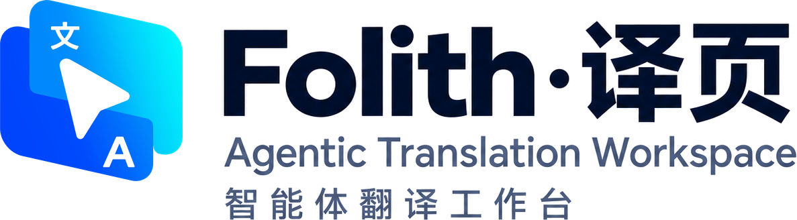
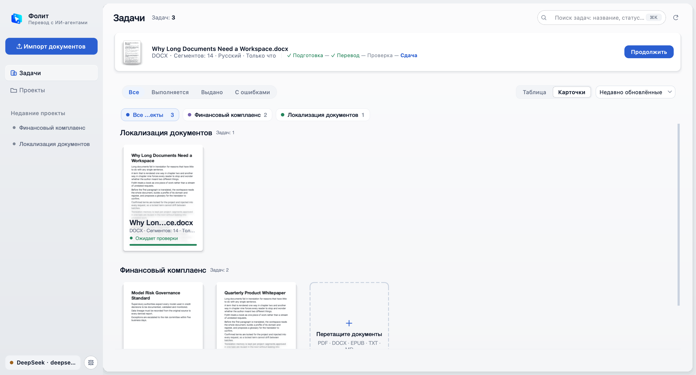
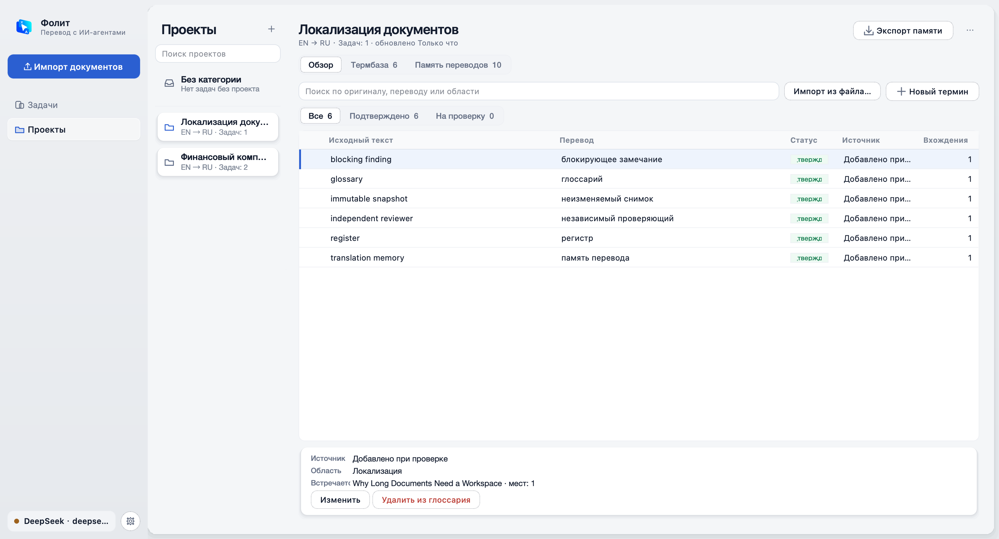
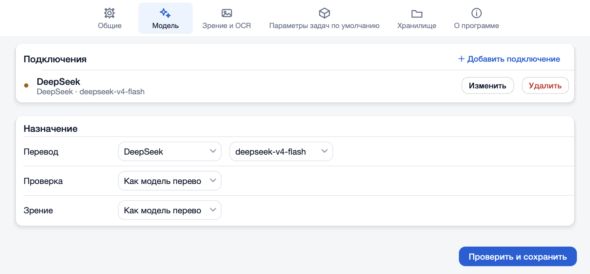
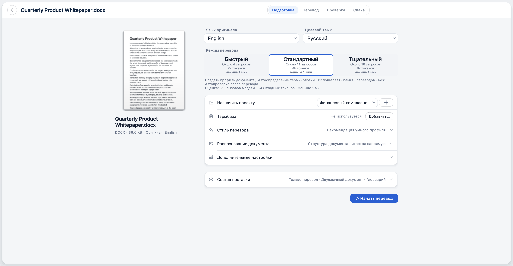
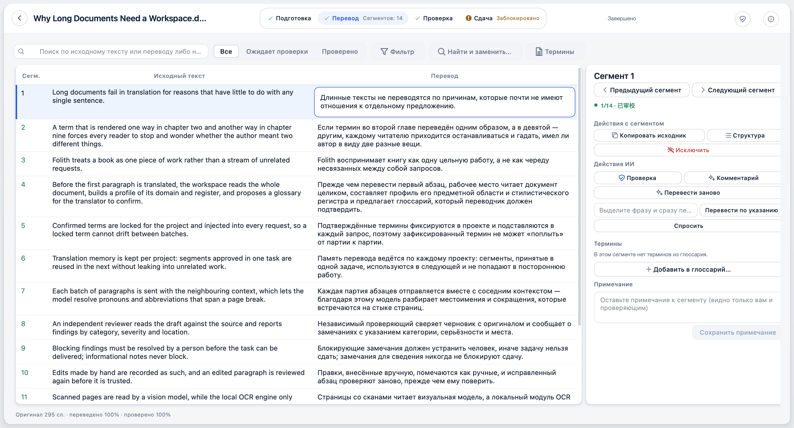
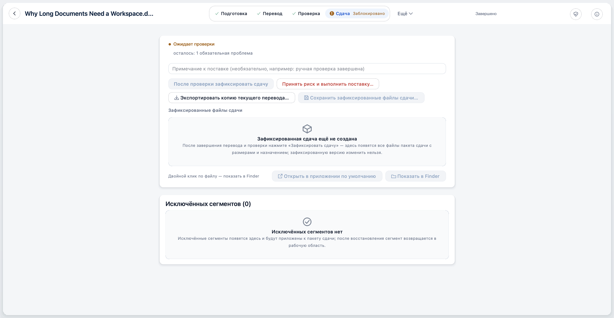
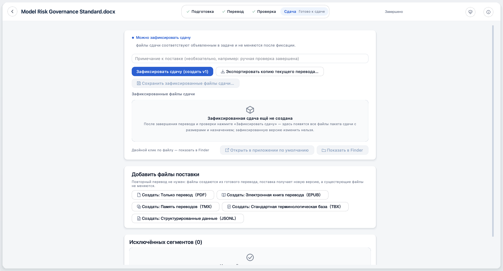
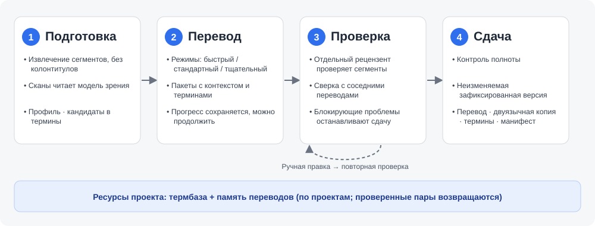

# Folith · 译页

<p align="center">
  
</p>

<p align="center">
  <strong>Рабочее пространство для перевода длинных документов и профессиональной локализации</strong>
</p>

<p align="center">
  <a href="https://github.com/xueyang-dev/Folith/releases/latest"></a>
  
  
  <a href="LICENSE"></a>
</p>

<p align="center">
  <a href="README.md">简体中文</a> | <a href="README.en.md">English</a> | <strong>Русский</strong> | <a href="README.es.md">Español</a>
</p>

> Поддерживаемая версия — [README на упрощённом китайском](README.md). Эта страница — её перевод; при расхождениях верна китайская версия. По умолчанию интерфейс приложения китайский, поэтому названия элементов ниже даны так, как они выглядят в русской локали (экспериментальной).

---

**Folith · 译页** («переведённые страницы») — настольное приложение для перевода книг, white paper, академических монографий и других длинных документов. Оно с открытым исходным кодом, работает локально в первую очередь и доступно для Windows и macOS. Документ рассматривается как единая работа: после импорта PDF / DOCX / EPUB / TXT / Markdown (включая сканы) сначала читается весь текст, строятся профиль и глоссарий, затем перевод идёт пакетами с контекстом. Независимый рецензент проверяет каждый сегмент, а решение по каждому замечанию принимаете вы. Когда проходит контроль сдачи, результат фиксируется в прослеживаемый пакет.

Перевести один фрагмент нетрудно. Трудно, чтобы в девятой главе термины совпадали со второй, чтобы ваши правки не перезаписывались, каждое изменение было записано, а по сданному файлу можно было объяснить его происхождение. Folith создан именно для этого.

---

## 🎬 Folith за одну минуту

https://github.com/user-attachments/assets/28519895-b8d0-415a-86f9-6a85635901a8

Одна книга — от импорта через подготовку, перевод и проверку человеком до сдачи — примерно за минуту. Кадры интерфейса сняты в фоновом режиме из клиента Folith на синтетическом примере общественного достояния («Братья Карамазовы») и не содержат реальных пользовательских файлов; кадры с пометкой «Illustration» — анимированные пояснения.

---

## 📸 Скриншоты

### Библиотека задач
Задачи сгруппированы по проектам. Карточка показывает миниатюру первой страницы оригинала, число сегментов, языки и текущий этап. Можно фильтровать по статусу, искать по тексту и продолжать прерванную задачу одним щелчком.

<p align="center">
  
</p>

### Проекты: термбаза и память переводов
Термбаза и память переводов хранятся по проектам. Подтверждённые термины автоматически применяются в новых задачах; пары предложений, прошедшие проверку, попадают в память переводов проекта и не смешиваются с чужими проектами. Поддерживается импорт и экспорт XLSX / TBX / TMX.

<p align="center">
  
</p>

### Настройки: подключения к моделям
Подключения добавляются в «Настройки → Модель»; там же выбирается, какое из них используется для перевода, проверки и зрения.

<p align="center">
  
</p>

### Подготовка задачи
После импорта на странице подготовки выбираются язык оригинала, язык перевода и режим. На карточке каждого режима до запуска видны ориентировочные число вызовов, токены и время.

<p align="center">
  
</p>

### Рабочее место переводчика
Оригинал и перевод рядом, сегмент за сегментом; полоса шагов сверху показывает «Подготовка → Перевод → Проверка → Сдача». Справа — действия для текущего сегмента: проверить, прокомментировать, перевести заново, перевести заново по указанию, задать вопрос, добавить в термбазу, оставить заметку. Для задач из PDF можно открыть исходную страницу: выбранный сегмент находится и подсвечивается на ней.

<p align="center">
  
</p>

### Контроль сдачи
Пока остаются непроверенные сегменты или блокирующие проблемы, сдача остановлена, причина объясняется. Рабочую копию текущего перевода при этом можно экспортировать.

<p align="center">
  
</p>

### Зафиксированная сдача
После проверки результат фиксируется как неизменяемая версия с манифестом. PDF, EPUB, TMX, TBX и JSONL можно создать позже из готового перевода без повторного перевода.

<p align="center">
  
</p>

> Скриншоты создаются скриптом `scripts/qt_showcase_screenshots.py` на синтетических демонстрационных документах и не содержат реальных файлов пользователей.

---

## 🚀 Установка

Все установочные пакеты лежат на странице [последнего релиза](https://github.com/xueyang-dev/Folith/releases/latest); `<версия>` в именах файлов ниже — номер этого релиза. На той же странице опубликован `SHA256SUMS.txt` для проверки загрузки. Это подтверждает, что файл цел и не подменён, но не заменяет подпись.

### Настольный клиент для macOS

Скачайте `Folith-Qt-<версия>-macos-arm64.dmg`, откройте его и перетащите Folith в «Программы».

- Требования: macOS 15.7.5 или новее на Apple silicon (серия M). Mac с Intel не поддерживаются.
- Пакет не подписан и не нотаризован. При первом запуске щёлкните Folith в «Программах» правой кнопкой → «Открыть» и разрешите запуск один раз. **Не отключайте** Gatekeeper глобально.
- Tesseract (английский, упрощённый китайский, арабский) встроен, больше ничего ставить не нужно.
- Проверка (необязательно): выполните в Терминале `shasum -a 256 Folith-Qt-<версия>-macos-arm64.dmg` и сравните с `SHA256SUMS.txt`.
- После запуска добавьте подключение к модели в «Настройках» (см. «Быстрый старт» ниже).

### Настольный клиент для Windows x64

- **Установщик (рекомендуется):** `Folith-Setup-<версия>-windows-x64.exe`. Запустите, выберите папку и открывайте Folith из меню «Пуск». Устанавливается только для текущего пользователя, права администратора не нужны. Удаление убирает только приложение; задачи, термины, память и настройки остаются в `%LOCALAPPDATA%\Folith`.
- **Портативная версия:** `Folith-Qt-<версия>-windows-x64.zip`. Правый щелчок → «Извлечь всё», не разделяйте извлечённую папку `Folith` и запускайте `Folith\Folith.exe`. Не запускайте из предпросмотра ZIP.

Python, Git и инструменты разработчика не нужны. Tesseract (английский, упрощённый китайский, арабский) встроен; PaddleOCR и LibreOffice не входят. Основная целевая платформа — Windows 11 x64; Windows 10 x64 — непроверенная цель совместимости, сборки для ARM64 нет.

Сборка для Windows не подписана. При первом запуске SmartScreen может показать предупреждение: сверьте SHA-256 и выберите «Подробнее → Выполнить в любом случае». Не отключайте защиту Windows глобально.

### Запуск из исходников (для разработчиков)

```bash
git clone https://github.com/xueyang-dev/Folith.git
cd Folith
python -m pip install -e .
python -m folith.qt
```

Нужен Python 3.10+; PySide6 входит в зависимости. По желанию установите [Tesseract OCR](https://github.com/tesseract-ocr/tesseract), чтобы находить положение строк на отсканированных страницах. Без него сканы целиком передаются модели зрения.

### Пакет Python (для разработчиков)

На PyPI есть пакет `foliothread` (модуль в коде называется `folith`), но это **не рекомендуемый способ получить приложение**. На PyPI по-прежнему версия 0.6.0 со старым интерфейсом Streamlit; она не обновляется вместе с релизами на GitHub, и команда `folith` оттуда не запускает настольный клиент. Используйте пакеты для macOS / Windows выше или запуск из исходников.

---

## ⚡ Быстрый старт

1. **Добавьте подключение к модели**: откройте «Настройки» → «Модель», нажмите «Добавить подключение», выберите провайдера, введите API-ключ и название модели и нажмите «Проверить и сохранить»; подключение сохраняется только после успешной проверки.
2. **Импортируйте документ**: в списке задач нажмите «Импортировать документ…» и выберите файл PDF / DOCX / EPUB / TXT / Markdown.
3. **Выберите режим**: на странице подготовки — «Быстрый», «Стандартный» или «Тщательный». На каждой карточке указаны ориентировочное число вызовов, входные токены и время для этого документа.
4. **Переведите и проверьте**: нажмите «Начать перевод». После завершения проверьте текст по сегментам в рабочем месте и разберите пункты справа в «Проверка и исправление».
5. **Зафиксируйте сдачу**: когда проблемы устранены и контроль пройден, нажмите «Зафиксировать и сохранить сдачу…», выберите место — получите перевод, двуязычную копию, глоссарий, память переводов и манифест.

---

## ✨ Возможности

| Этап | Что происходит |
| :--- | :--- |
| **Подготовка** | Извлечение сегментов, отсев колонтитулов и прочего шума; сканы читает модель зрения, а локальный Tesseract лишь определяет положение каждой строки; профиль документа, кандидаты в термины, подключение терминов проекта и памяти переводов |
| **Перевод** | Пакеты по режиму («Быстрый» / «Стандартный» / «Тщательный»), каждый с окружающим контекстом и закреплёнными терминами; прогресс сохраняется постоянно, можно приостановить и продолжить |
| **Проверка** | Отдельная модель-рецензент сверяет каждый сегмент с оригиналом и видит соседние переводы; ручная правка, перевод заново по указанию, вопрос по сегменту; новые переводы и предложения проверки приходят как кандидаты, которые вы принимаете или отклоняете; исправленные сегменты проверяются повторно |
| **Сдача** | Контроль проверяет полноту и блокирующие проблемы; фиксация неизменяемой версии; экспорт перевода, двуязычной копии, терминов, памяти и манифеста |


<p align="center">
  
</p>

- **📚 Импорт длинных документов**: PDF / DOCX / EPUB (без DRM) / TXT / Markdown.
- **🧠 Контекст всей книги**: перед переводом строятся профиль документа и список терминов, поэтому местоимения, сокращения и термины согласуются между страницами.
- **💎 Языковые ресурсы проекта**: закреплённые термины добавляются в каждый запрос; память переводов использует проверенные пары предложений в рамках проекта и сокращает повторные вызовы.
- **🔍 Независимая проверка и межсегментный контроль**: проверку выполняет отдельная модель, а не сам переводчик; пакеты формируются по предложениям, так что одно предложение не разрывается. Проблемы классифицируются по категории и серьёзности, сдачу останавливают только блокирующие.
- **🛡️ Защищённый перевод**: новые переводы и предложения проверки показываются как кандидаты рядом с текущим текстом и разницей и заменяют его только после вашего согласия; массовая замена по умолчанию пропускает переводы, отредактированные или подтверждённые вручную. Решения проверки (замечание подтверждено, исправление подтверждено, оставить текущий перевод) записываются отдельно от правки текста.
- **🧾 Проверяемость и возобновление**: ручные правки записываются как есть и перед принятием проверяются заново; решение проверки попадает в память переводов проекта только после успешного сохранения; состояние задачи сохраняется постоянно, прерванная задача продолжается с последнего завершённого пакета.
- **📍 Исходная страница рядом**: для задач из PDF рабочее место показывает исходную страницу; выбранный сегмент находится и подсвечивается на ней, поэтому сканы можно сверять построчно.
- **📦 Прослеживаемая сдача**: DOCX только с переводом, двуязычный DOCX, EPUB, PDF, глоссарий, TMX, JSONL и манифест `delivery_manifest.json`; зафиксированную версию изменить нельзя.
- **🎓 Академический режим** (по умолчанию выключен): выгружает процесс перевода, сравнение случаев и рефлексию в виде практического отчёта — для оценивания, например в магистратуре по переводу (MTI).

«Агентность» здесь означает конкретно: отдельная роль рецензента, перевод сегмента заново по вашему указанию и вопросы модели по сегменту. Приложение не меняет документ само: каждая правка подтверждается вами и записывается.

---

## 🌍 Языки, форматы и объём

| | Поддерживается |
| :--- | :--- |
| **Импорт** | PDF (включая сканы) / DOCX / EPUB (без DRM) / TXT / Markdown; до 512 МБ на файл, более крупные документы разделите перед импортом |
| **Файлы сдачи** | DOCX только с переводом, двуязычный DOCX, EPUB (из PDF или DOCX), PDF (PDF с сохранением вёрстки — только для источников PDF), глоссарий, TMX, TBX, JSONL, манифест `delivery_manifest.json` |
| **Языковые ресурсы** | Глоссарий и память переводов: импорт и экспорт XLSX, TBX, TMX; JSONL |
| **Язык оригинала** | Автоопределение или один из 21: English, 简体中文, 繁體中文, 日本語, 한국어, Deutsch, Français, Español, Italiano, Português, Русский, Nederlands, Polski, Українська, Tiếng Việt, Türkçe, العربية, فارسی, עברית, اردو, ئۇيغۇرچە |
| **Язык перевода** | 21: 简体中文, 繁體中文, English, 日本語, 한국어, Deutsch, Français, Español, Русский, Português, Italiano, Nederlands, Polski, Українська, Tiếng Việt, Türkçe, العربية, فارسی, עברית, اردو, ئۇيغۇرچە |

Язык оригинала также используется для разметки строк на сканах (встроенный Tesseract содержит только английский, упрощённый китайский и арабский; при отсутствии языкового пакета возникает явная ошибка, без негласного отката на английский). См. [Спецификация поддержки и валидации языков перевода](docs/translation-languages.md). Опубликованных замеров скорости и объёма нет, и нет обещаний по времени или стоимости для какого-либо числа страниц: качество и время зависят от документа и выбранной модели. Для каждого документа страница подготовки оценивает вызовы, входные токены и время для трёх режимов — ориентируйтесь на это, а для конкретной языковой пары сначала попробуйте небольшую главу.

> **Границы проверки языков:** Это доступные пункты каталога. Новые языковые пары ещё не прошли проверку перевода реальными моделями, независимого рецензирования и качества в программах чтения; #10 остаётся открытым. Компонентные тесты не подтверждают качество перевода.

---

## ⚙️ Модели и провайдеры

- **Встроенные пресеты**: OpenAI, Gemini, DeepSeek, OpenRouter, SiliconFlow, Moonshot / Kimi, Zhipu / GLM, Qwen / DashScope, OpenCode Go.
- **Свои шлюзы**: любой шлюз, совместимый с OpenAI API, или локальный сервер моделей (vLLM / Ollama).
- **Несколько подключений**: для перевода, проверки и зрения можно выбрать разные сохранённые подключения; подключение для зрения проверяется только если в задаче есть сканы.
- **Каталог моделей**: у OpenAI-совместимых провайдеров и Gemini список моделей можно получить автоматически; работоспособность модели определяет «Проверить и сохранить».
- **Глубина рассуждений**: поддерживаются модели с рассуждением (например, DeepSeek-R1 и серия o от OpenAI); рассуждение можно настроить или отключить.

---

## 🔒 Конфиденциальность и данные

- **Кто что получает**: текст документа и изображения отсканированных страниц отправляются тем провайдерам моделей, **которых вы настроили**, и обрабатываются по их условиям. Убедитесь, что вам разрешено так обрабатывать документ.
- **Больше ничего не отправляется**: в самом приложении нет телеметрии, аналитики и учётных записей. Кроме провайдеров моделей единственный сетевой запрос — чтение сведений о последней версии на GitHub, когда вы нажимаете «Проверить обновления»; ничего не скачивается и не устанавливается автоматически.
- **Данные остаются у вас**: задачи, термины, память переводов и настройки лежат в локальной папке данных — macOS: `~/Library/Application Support/Folith/data`; Windows: `%LOCALAPPDATA%\Folith\data`.
- **Как хранятся API-ключи**: в локальном JSON-файле настроек внутри папки данных (права 0600, читается только текущим пользователем). Они **не** в системной связке ключей и дополнительно не шифруются. Не синхронизируйте папку данных в общие места и не передавайте её другим.

---

## 💰 Стоимость

Сам Folith бесплатен и открыт. Вызовы моделей при переводе оплачиваются вами провайдеру по вашему API-ключу. Страница подготовки оценивает число вызовов, входные токены и время для режимов «Быстрый» / «Стандартный» / «Тщательный», чтобы можно было сравнить до запуска. Оценка ориентировочная; фактический расход зависит от документа и модели.

---

## ⚠️ Известные ограничения

- Пакет для macOS поддерживает только Apple silicon и macOS 15.7.5 или новее; он не подписан и не нотаризован.
- Пакет для Windows не подписан; совместимость с Windows 10 x64, Windows на ARM64 и чистыми виртуальными машинами не проверена.
- Часть пунктов ручной приёмки финальных пакетов (системные файловые панели, китайский метод ввода, сон / пробуждение, разрешение первого запуска, реальный сервис модели и т. п.) может завершаться уже после публикации; что проверено и что нет, записано в [примечаниях к выпуску](docs/release-notes-0.7.2.md) (на китайском) для соответствующей версии.
- EPUB с DRM не поддерживаются.
- Изображения внутри таблиц и текстовых полей не переносятся в переведённый DOCX; двуязычный DOCX не содержит изображений.
- Вёрстка исходного DOCX не перезаписывается; создаются новые файлы.
- Языки интерфейса, кроме упрощённого китайского, экспериментальные.
- Сканы распознаются моделью зрения и могут содержать ошибки; сверяйте с исходной страницей.

---

## 🌐 Языки интерфейса

По умолчанию интерфейс на упрощённом китайском. English, Español, Русский, العربية, Français и Deutsch — экспериментальные: тексты полные, зеркалирование интерфейса и экспорт RTL для арабского языка прошли приёмку (см. [Отчёт о приёмке арабского языка](docs/arabic-acceptance-2026-10-26.md)); независимая вычитка носителями для остальных языков продолжается. См. [Оформление и границы многоязычности](docs/i18n/README.md).

---

## ❓ Частые вопросы

**macOS блокирует первый запуск?** Приложение не подписано и не нотаризовано. В «Программах» щёлкните Folith правой кнопкой, выберите «Открыть», затем ещё раз «Открыть» в диалоге. Нужно один раз. Не отключайте Gatekeeper глобально.

**«Проверить и сохранить» не проходит?** Проверьте API-ключ, название модели и адрес. Если включён системный прокси или VPN, он может возвращать ошибки вроде 502; отключите его или добавьте домен провайдера в исключения. Для своего шлюза убедитесь, что он совместим с OpenAI API.

**Скан распознан неверно?** Распознаёт модель зрения, и она может ошибаться. Сверьтесь с оригиналом страницы в рабочем месте; можно перейти на более сильную модель, настроив отдельное подключение для зрения в «Настройках», и пересканировать.

**Задача прервалась?** Прогресс сохраняется постоянно. Откройте задачу в списке и нажмите «Продолжить перевод»: работа продолжится с последнего завершённого пакета, успешные пакеты заново не выполняются.

**Как обновить, удалить программу или данные?** «Проверить обновления» сообщит о новой версии; скачайте её со [страницы релизов](https://github.com/xueyang-dev/Folith/releases/latest) сами. Заранее экспортируйте нужные переводы и TMX / TBX.

- macOS: перетаскивание `Folith.app` в Корзину удаляет только приложение; задачи и настройки остаются. Чтобы удалить всё, закройте приложение и удалите `~/Library/Application Support/Folith`, `~/Library/Logs/Folith` и `~/Library/Preferences/com.folith.QtDesktop.plist`.
- Windows: удаление установленной версии через «Параметры → Приложения» или удаление папки портативной версии убирает только приложение. Чтобы удалить всё, закройте приложение и удалите `%LOCALAPPDATA%\Folith`.

### Обратная связь

- Ошибки и предложения: [GitHub Issues](https://github.com/xueyang-dev/Folith/issues)
- Почта: xydev@outlook.sa (также доступна из «Настроек» в приложении)

---

## 🗺️ Дорожная карта

**Уже есть**: нативный настольный клиент на Qt (установщик / портативная версия для Windows x64, macOS на Apple silicon); импорт PDF (включая сканы) / DOCX / EPUB / TXT / Markdown; модель зрения как основной способ чтения сканов; термины и память переводов внутри проекта; несколько подключений к моделям; межсегментная проверка; кандидаты, защищающие ручной перевод; навигация по исходной странице; контроль сдачи и зафиксированные пакеты. Что менялось в каждом релизе, см. в [журнале изменений](CHANGELOG.md).

**Дальше**:

- [ ] Подпись кода и нотаризация
- [ ] Приёмка на других версиях Windows и чистой ВМ
- [ ] Запись обратно в DOCX с сохранением исходной вёрстки и стилей
- [ ] Нечёткий поиск по памяти переводов
- [ ] Инкрементальный перевод между версиями документа

---

## 📖 Документация

(Большинство документов на китайском.)

- [Примечания к последнему выпуску и запись приёмки](docs/release-notes-0.7.2.md)
- [План выпуска](docs/release-plan.md)
- [Проекты и долговременная память](docs/project-memory.md)
- [Экспорт перевода в EPUB / DOCX](docs/epub-export.md)
- [OCR и чтение моделью зрения](docs/ocr-subsystem.md)
- [Архитектура и границы возможностей](docs/architecture-boundaries.md)
- [Журнал изменений](CHANGELOG.md)
- [Участие в проекте](CONTRIBUTING.md) (на китайском)

---

## 📄 Лицензия

Распространяется по [лицензии MIT](LICENSE).
