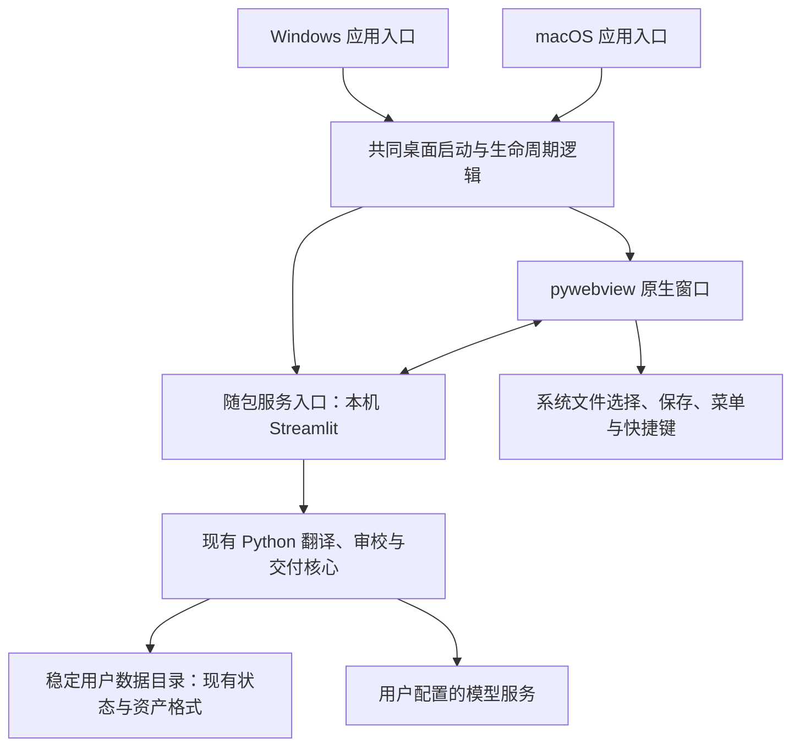

# Folith · 译页：Windows / macOS 客户端化规划

**Desktop Roadmap v1.1 — Engineering Hardening** · 2026-10-03。依据当前本地工作树（含未提交实现）与官方资料审计修订；文中待做事项不代表已发布能力。本轮只修改路线图，不实现 D0 或构建安装包。

## 1. 建议结论

**统一产品、核心、界面与数据格式，分别构建 Windows 和 macOS 安装包。**

近期采用现有 **Python + Streamlit + pywebview** 路线，把“安装 Python 后运行启动器”推进为“安装应用后双击使用”。先通过 D0 验证 frozen runtime 的真实任务链；**业务代码统一优先于打包工具统一**，Windows 验证 PyInstaller，macOS 在 PyInstaller / py2app 之间作实测决策。

首批建议支持 Windows 11 x64 与 Apple Silicon MacBook。Intel Mac 作为随后补充的独立构建，必须有对应环境验收；Windows ARM64 不纳入首批承诺。macOS 最低版本、Python 运行时与依赖版本由首轮构建验证确定，发布页只列实际验收的系统。

先保留现有界面，客户端化不以重写翻译内核、DOCX 保真写回或更换前端为前提。桌面里程碑与现有 v0.5.0 / TM V2 / CAT 内核计划分别跟踪，不重新占用已有版本号。

## 2. 当前基础与真实差距

| 当前事实 | 对客户端化的含义 | 代码依据 |
| --- | --- | --- |
| 已有三平台入口；pywebview 缺失或窗口异常会回退浏览器 | 可以沿用界面与核心；浏览器回退不能算桌面验证通过 | [gui.py](../gui.py)、[pyproject.toml](../pyproject.toml) |
| 启动脚本依赖用户安装 Python，首次运行创建环境并下载依赖 | 目前仍是源码启动体验；客户端需要随包携带运行时与依赖 | [start.bat](../start.bat)、[start.command](../start.command)、[start.sh](../start.sh) |
| 服务子进程通过 `sys.executable -m streamlit` 启动 | 冻结后需调整服务入口；不能直接把当前启动器打包就宣称完成 | [gui.py](../gui.py) 的 `main()` |
| 从 8501 起探测最多 20 个端口；`wait_ready()` 只检查 HTTP 200 | 尚无随机端口、子进程身份握手或应用单实例控制 | [gui.py](../gui.py) 的 `pick_port()` / `wait_ready()` |
| 默认输出目录为相对路径 `outputs`，已有 `FOLITH_OUTPUT_DIR` 配置 | 桌面入口应在导入核心前指定稳定的绝对数据目录 | [core.py](../core.py) 的 `OUTPUT_DIR` |
| worker 在 Streamlit 服务进程中以后台线程执行；关闭原生窗口后启动器终止服务 | 需要明确任务停止、检查点保存、编辑保存与退出次序 | [core.py](../core.py) 的 `start_job_worker()`、[gui.py](../gui.py) |
| 当前暂停保留内存与 lease，等待同一 worker 继续 | 暂停不能直接作为“保存后退出”的实现 | [core.py](../core.py) 的 `_runtime_pause_checkpoint()` |
| 状态原子写入并回放 journal；已到服务端的编辑可落盘为草稿，正式提交另走保存路径 | 复用现有恢复；尚未失焦的输入不能据此宣称已保存，草稿不等于交付真值 | [job_repository.py](../folith/storage/job_repository.py)、[state_journal.py](../folith/storage/state_journal.py)、[app.py](../app.py) 的 `_translation_editor_changed()` / `_commit_translation_row()` |
| 上传、下载由 Streamlit 控件承担 | 浏览器里的成功记录不能替代 WebView 内的打开与保存验收 | [app.py](../app.py) 的 `file_uploader` / `download_button` |
| 默认仅监听 `127.0.0.1`，LAN 需要显式开启；任务已有系统文件锁 | 复用现有网络边界和任务互斥，不另建一套任务真值 | [gui.py](../gui.py)、[folith/job_lock.py](../folith/job_lock.py) |
| API Key 保存在本地 JSON，代码尝试设置 `0600` 权限 | 首版文档准确说明存储方式；跨机导出必须排除凭据 | [core.py](../core.py) 的 `save_provider_config()` |
| OCR 已有显式 `ara` / RTL 配置；新任务缺语言包会报错；Tesseract 已查常见 GUI 路径，LibreOffice 仍只查 PATH | 不重复开发已有发现逻辑；补随包工具定位、语言数据与 LibreOffice 桌面发现 | [ocr_language.py](../folith/ocr_language.py)、[core.py](../core.py) 的 `_find_tesseract()` / `run_libreoffice_render_qa()` |
| 当前 CI 为 Ubuntu 业务回归及 wheel / sdist 检查；依赖声明是版本范围，未有桌面冻结构建 | 固定实际构建版本并补两端验证；wheel 通过不能证明桌面通过 | [release-gate.yml](../.github/workflows/release-gate.yml)、[pyproject.toml](../pyproject.toml)、[requirements.txt](../requirements.txt) |

原稿的主要代码事实仍成立；本次补足身份检查、草稿 / journal 恢复、Arabic OCR 和工具发现的边界，不将已有能力列为重建任务。现有恢复、审校、术语、TM 和交付门禁继续复用。

PyInstaller 官方说明冻结后的 `sys.executable` 指向应用启动程序，而非 Python 解释器；这是调整服务入口的依据。[运行时说明](https://pyinstaller.org/en/stable/runtime-information.html)

## 3. 共用架构

共同维护的内容：

- `core.py` 与 `folith/` 的业务能力，唯一译文真值、人工决策、状态恢复和交付语义。
- `app.py` 与现有 UI、主题、语言资源；两端采用同一功能与文案版本。
- 桌面启动顺序、服务就绪判断、错误反馈、退出逻辑与数据目录规则。
- 一份发行依赖版本清单、资源清单、验收用例与发布说明。

分别维护的内容：窗口引擎依赖、少量系统操作、CPU 架构、安装包、代码签名与平台验收。平台分支只放在桌面和打包边界，不散落进翻译流水线。

### 3.1 启动和服务入口

桌面启动顺序为：确定数据目录 → 初始化日志与实例身份 → 启动服务 → 核验本次服务身份和就绪 → 打开窗口。失败显示原因和日志入口，并回收本次创建的进程。

冻结构建采用明确的内部服务模式，例如 `--serve`，只启动 Streamlit，不递归创建窗口；源码 CLI 保留解释器启动路径。D0 固定并验证随包 Streamlit 启动逻辑与动态资源，不能假设内部启动 API 跨版本稳定。

**Desktop Instance Identity / Control Plane：只解决 Launcher ↔ 本次 Streamlit Service。** D0 首选验证父子进程专用本机 IPC 通道（如匿名管道），避免另建 HTTP 服务：

1. 每个新实例生成随机 `instance_id`、`startup_token`；记录 `launcher_pid`、实际 `service_pid`、实际 `port`、`app_version`、`build_id`。token 仅用于本次控制通道，不进业务数据库、URL、命令行、日志或诊断包。
2. 服务仅绑定 `127.0.0.1`，由 OS 分配随机可用端口并保持绑定；服务完成自身 Streamlit 启动后，经专用通道返回 `ready` 及上述身份。当前本地安装的 Streamlit 1.64.0 使用 Starlette / Uvicorn，支持绑定端口 `0` 后回读实际端口；D0 必须在选定 frozen 版本验证该启动钩子，不能按旧 Tornado 实现凭空加路由。
3. Launcher 核对 token / instance、进程归属、版本 / build、绑定端口和存活后才打开窗口；`service_pid` 是实际运行 Streamlit 的 PID，不能默认等于 `Popen.pid`，D0 核对所选 packager 的 bootloader / 服务进程关系。[PyInstaller 进程说明](https://pyinstaller.org/en/stable/advanced-topics.html#bootloader) HTTP 健康检查只补充可访问性；握手超时、身份不符或进程退出均失败。
4. 通道只承载身份 / 存活确认、停止请求与停止确认；断开和子进程退出可识别 stale instance。D1 增加应用级系统锁与窗口唤起；不能把任务锁当应用锁，也不能仅凭残留 metadata、PID 或旧端口连接 / 杀死旧服务。只回收本次持有的进程及其子进程，验证 Launcher 异常退出后的清理。

保留框架跨源和请求保护；桌面仍是单用户本机应用，不扩大为认证系统、通用 RPC / REST、OAuth、daemon / background agent 或遥测后端。D0 若不能证明 `ready` 来自实际绑定该端口的服务，必须记录阻断，而非退回 HTTP 200。

### 3.2 数据目录与旧数据接入

建议桌面默认目录：

| 用途 | Windows | macOS |
| --- | --- | --- |
| 任务、项目、配置 | `%LOCALAPPDATA%\Folith\data` | `~/Library/Application Support/Folith/data` |
| 应用诊断日志 | `%LOCALAPPDATA%\Folith\logs` | `~/Library/Logs/Folith` |
| 用户交付文件 | 用户选择的保存位置 | 用户选择的保存位置 |

临时文件 / 可删缓存与任务资产分开，清缓存不能删除源文件、检查点或交付快照；安装目录、`.app` 内部和临时解包目录不保存用户数据。

桌面入口在导入 `core` 之前设置绝对 `FOLITH_OUTPUT_DIR`，利用已有能力；明确设置的用户数据路径优先。源码运行保持现有约定。

D1 提供“接入旧数据目录”：用户选择现有 `outputs/`，停止旧实例后复制并保留原目录；包含源文件、state、journal、编辑草稿与任务资产，不能只复制 `state.json`。核对可读后才切换，失败不覆盖；不扫描磁盘或建立通用迁移框架。

升级只更新应用、保留数据；实际改变格式时再设计对应备份 / 兼容处理，不预建多版本迁移体系。

### 3.3 退出、恢复与长任务

首版行为：**最小化时任务继续；退出时保存并停止；重开后由用户恢复。** 不承诺关窗后托盘 / 后台常驻。

- 无任务、无未保存编辑：直接退出并回收服务。
- 有未保存的编辑：先同步 WebView 中尚未失焦的 textarea，提供保存后退出与返回编辑；取得实际落盘确认后才退出，失败不能显示“已保存”。
- 有运行任务：停止安排新操作，有界等待当前操作，复用检查点与 journal；worker 停止并释放锁后再提交编辑和停止服务，不绕过现有运行中写入互斥。
- 等待超过上限：明确提供继续等待或强制退出；强制退出只承诺已经落盘的结果可恢复，当前请求可能重试和重复计费。
- 崩溃、强制结束或断电：复用现有 interrupted / stalled 识别与检查点恢复，不能把未完成的任务标成完成。

完整“保存并停止”属 D1；暂停后直接杀进程不算完成。D0 已须验证正常及小任务运行中停止确实回收，不扩展全部异常场景。

睡眠不保证计算继续；唤醒后识别断连 / 任务状态，提供继续或重试。

### 3.4 文件、外部依赖与凭据

真实窗口中沿用可靠的上传下载；必要时只补原生文件选择 / 保存连接，以及“打开交付文件”“显示所在文件夹”，复用既有交付门禁。

随包提供 Python、依赖与界面资源，首次启动不执行 pip。PDF 文本层 / DOCX 本地处理可离线；模型功能仍需网络与用户配置的服务，不宣称默认离线大模型。

**Beta OCR 基线调整为 `eng`、`chi_sim`、`ara`。** 当前已有 Arabic OCR / RTL 场景；官方 `tessdata_fast` 的 `ara.traineddata` 当前约 1.37 MB，语言包本身不足以成为排除理由，引擎、原生库与字体体积仍需构建测量。[官方 Arabic 数据文件](https://github.com/tesseract-ocr/tessdata_fast/blob/main/ara.traineddata)

- D0 可用已安装且版本已记录的 Tesseract / 三个语言包，分别验证三语言真实扫描件，以及 Arabic 分段、Unicode、RTL、字体、光标、混合中英阿编辑 / 导出；D1 验证状态保存 / 重开。
- D2 目标随包提供 Tesseract 与这三个经两端验收的语言包，固定数据版本与许可记录；不默认打入可选 PaddleOCR。若某平台未完成 bundling 或验收，发布页逐项写明实际语言及外部安装要求，缺包明确报错，不静默改用 `eng`，不宣称所有 OCR 语言开箱即用。

LibreOffice 保持可选，缺失保留 NOT_RUN；D2 补 Applications / Windows 安装位置发现并验证桌面 PATH。Tesseract 已有常见路径发现，待补的是随包引擎及语言数据定位。

首版保留本地 JSON 凭据，排除其进入交付、项目转移和诊断导出；不同机器重新配置 API Key。Keychain / Credential Manager 属 D4。

### 3.5 Build / Runtime Diagnostics（D1）

D1 起在本地诊断页或日志提供：Folith app version、build id / commit、data schema version、Python / Streamlit / pywebview 版本、OS / OS version / architecture、desktop packaging backend、user data directory、log directory。版本取自实际随包运行时，构建记录必须能定位源码与依赖。

当前数据格式没有统一的 job-state schema 版本：应如实记录 `job_state=unversioned`，以及现有 `runtime=2`、`journal=1`、`translation_drafts=1`；后续从对应常量读取，不为诊断新建状态格式或迁移体系。

诊断包包含上述构建信息和必要错误摘要；导出时隐去路径中的用户名 / 项目名，排除 API Key、startup token、provider 配置、环境变量全文和文档内容。不要直接打包整个数据目录或未经筛选的日志；不建立遥测系统。

## 4. Windows 线路

目标为 `Folith-<version>-windows-x64-setup.exe`。建议 PyInstaller 目录构建便于排查资源，D2 用 Inno Setup 提供安装入口。[PyInstaller 构建模式](https://pyinstaller.org/en/stable/operating-mode.html)、[Inno Setup](https://jrsoftware.org/isinfo.php)

| 阶段 | Windows 专项工作 | 完成条件 |
| --- | --- | --- |
| D0 | PyInstaller 目录原型，明确 WebView2 渲染器；普通桌面 / 开始菜单快捷方式启动 | 第 6 节真实切片通过；不是仅开发环境可启动 |
| D2 | WebView2 与实际 pythonnet / .NET 依赖；按用户安装、入口、卸载、Ctrl、缩放与文件集成 | 无 Python 的普通账户可安装使用；升级 / 卸载默认保留数据 |
| D3 | 签署应用与安装器并加时间戳 | 下载的签名产物经 Windows 11 x64 实机验收 |

必须检测 WebView2 Runtime，不能以安装 Edge 代替。首批缺失时调用官方在线 bootstrapper；有明确离线需求再提供 standalone installer。[Microsoft 分发说明](https://learn.microsoft.com/en-us/microsoft-edge/webview2/concepts/distribution)

签名不保证消除 SmartScreen / 杀毒提示，记录实际下载体验；开发自签名不能替代正式分发证书。

## 5. MacBook / macOS 线路

目标为 `Folith-<version>-macos-arm64.dmg`，内含 `Folith.app`，拖入 Applications 后启动；首批 Apple Silicon 原生构建，Rosetta / universal2 不替代 Intel 验收。

macOS 使用 WKWebView，Windows 使用 WebView2；同一界面的控件、输入法、CSS 与文件行为须分端验证。[pywebview 引擎说明](https://pywebview.flowrl.com/guide/web_engine.html)

| 阶段 | macOS 专项工作 | 完成条件 |
| --- | --- | --- |
| D0 | arm64 `.app`、PyObjC / WebKit / 资源收集；Finder 与 Applications 启动 | 第 6 节真实切片及下述 packager 决策完成 |
| D2 | DMG、应用标识、Dock / 菜单 / Cmd、工具定位 | 普通用户不依赖 Terminal、系统 Python 或 Homebrew 完成主流程 |
| D3 | Developer ID、Hardened Runtime、notarytool、公证 staple | 浏览器下载的签名 / 公证产物在干净 Mac 验收 |

**D0 必须选择 Option A：macOS → PyInstaller，或 Option B：macOS → py2app。** 先测试 A；若它持续产生 PyObjC 收集、资源或 bundle 问题，以同一切片验证 B，不能为工具统一堆补丁。B 通过后只改变平台打包边界，不视为业务架构失败。pywebview 冻结指南推荐 py2app，PyInstaller 支持 macOS bundle；两份文档都不能替代本项目实测。[pywebview 冻结指南](https://pywebview.flowrl.com/guide/freezing.html)、[PyInstaller macOS 说明](https://pyinstaller.org/en/stable/feature-notes.html)

决策记录覆盖 PyObjC dependency collection、WebKit、app bundle、resource loading、cold start、Finder launch、相同源码 / 固定依赖的重复构建，以及 signing / hardened runtime / notarization 可行性。D0 有凭据时做最小签名 / 公证探测；缺凭据明确标为未验证的外部条件，不声称已通过，实际下载产物验收仍在 D3。若发现根本兼容阻断，回到 packager / shell 决策。

站外分发须 Developer ID 与公证，不以关闭 Gatekeeper 作为安装方案；账户 / 证书等待不阻塞本地原型。[Apple Developer ID](https://developer.apple.com/developer-id/)、[Apple 公证流程](https://developer.apple.com/documentation/security/notarizing-macos-software-before-distribution)

## 6. 共同里程碑与顺序

| 里程碑 | 共用工作 | Windows 产物 | macOS 产物 | 进入下一步的条件 |
| --- | --- | --- | --- | --- |
| D0 — Architecture Spike | frozen 服务、身份握手、WebView 真实切片、进程回收、macOS packager 决策 | PyInstaller 目录原型 | 选定 packager 的 arm64 `.app` | 有证据的 Go / No-Go，非“生成了文件” |
| D1 — Lifecycle & Data Safety | 稳定目录、save & stop、崩溃恢复、应用单实例、旧数据接入、诊断 | 可恢复的开发构建 | 可恢复的开发构建 | 未失焦编辑保存、已落盘恢复、锁 / 进程清理通过 |
| D2 — Installable Beta | 安装卸载、随包运行时、依赖检测、文件集成、OCR 基线、LibreOffice 发现 | Windows x64 安装器 | Apple Silicon DMG | 无开发环境的干净机器以普通用户完成验收 |
| D3 — Public Distribution | 签名 / 公证 / 时间戳、真实下载验证、发布说明、可复现构建记录、支持系统声明 | 已签名安装器 | 已签名并公证 DMG | 第 8 节用户结果及实际发布物验收通过 |
| D4 — Product Evolution | 凭据库、更新器、完整项目转移、Intel / 其他架构、深入原生集成、必要时评估独立前端 | 按真实需求迭代 | 按真实需求迭代 | 每项有具体需求与验证目标，单独立项 |

### 6.1 D0 — Desktop Architecture Spike

要回答的是：**Python + Streamlit + pywebview + frozen runtime 是否值得继续？** 两端尽早使用同一批样本验证，不追求正式产品质量。D0 不优先做自动更新、漂亮安装器、完整 OCR bundling、旧数据迁移体系、凭据库、托盘、云同步、Intel Mac、Windows ARM 或 UI 大改。

最小真实流程：**启动应用 → 导入真实 PDF / DOCX → 小型任务 → 多句工作台 → 人工修改 → 提交编辑 → 按现有门禁完成审校与正式交付 → 保存 / 外部打开 → 正常退出 → 重开确认数据仍存在。** PDF、DOCX 各走一遍，不以直接预填 state 或绕过交付门禁代替。

| D0 必验项目 | 通过证据 |
| --- | --- |
| frozen Folith 启动本机 Streamlit；pywebview 打开当前实例；WebSocket / rerun / fragment | 仓库外原型完成握手、页面和多次交互；旧 Folith / 其他 localhost 服务不被误认；端口占用、启动失败可退出；不靠浏览器回退 |
| 中文 IME / 组合输入、长 textarea、多句切换与提交 | 在实际轮询 / rerun 中连续输入、粘贴、失焦和提交；与预期文字逐项比对，无丢字、丢状态；含 Arabic / 混合中英阿、RTL 光标与字体 |
| PDF、DOCX 导入及小型任务、正式交付 | 经 UI 跑现有 worker、人工编辑 / 审校与交付，导出文件包含修改；Arabic 扫描件实际执行 OCR，不能用 text-layer PDF 代替 |
| 文件保存 / 下载、外部打开、重开数据 | 文件名、中文 / 空格路径、保存位置和实际内容正确，交付文件可外部打开；重开后任务、编辑和交付可读 |
| 关窗回收 Streamlit / worker，无残留进程 | 正常切片及小任务运行中关窗，确认服务 / worker 实际退出、端口 / 锁释放、工具子进程无残留；失败阻断 GO，D1 再扩展暂停、未提交输入、长请求和崩溃矩阵 |
| 普通桌面启动与开发启动一致 | macOS Finder / Applications 与终端；Windows Start Menu / 普通桌面快捷方式与开发启动使用同一数据，脱离仓库 / venv 运行；D0 可手工建快捷方式，不必先做安装器 |
| macOS packager 稳定性 | 第 5 节 A / B 决策记录；重复构建、冷启动、资源和原生依赖验证；签名 / 公证外部条件另列 |

先用可控模型响应走完整任务链，再各做一次明确授权、范围受控的真实模型调用；前者不证明模型质量。记录硬件 / 系统、确切依赖、样本、关键编辑结果、冷启动 / 空闲占用 / 包体积和失败复现。OCR 测试因语言包 / 字体缺失或识别不成立而 skip，不算通过。

### 6.2 D0 Go / No-Go Decision

| 结果 | 判定与后续动作 |
| --- | --- |
| `GO — Windows / PyInstaller` | Windows 11 x64 切片通过，形成该平台通过记录 |
| `GO — macOS / PyInstaller` | Apple Silicon 切片通过，A 稳定，选定 A |
| `GO — macOS / py2app` | B 用相同切片验证通过，采用 B，业务 / UI / 数据仍共用 |
| `NO-GO — pywebview desktop shell` | 原生编辑、Streamlit 交互或文件流程存在持续阻断；按第 8 节重审 shell |
| `BLOCKED — specific technical blocker` | 明确阻断、复现、受影响平台与下一步验证；缺设备 / 凭据与已证实技术不兼容分开记录 |

输出简短决策记录，关联 build、测试证据、packager 和未验证项。**双端 D0 均通过（Windows GO + 一个 macOS GO）后，才进入大规模 D1 / D2。** 单端 GO、另一端 BLOCKED 时继续解决 spike 阻断，不宣称双端成立。第 5 节披露的外部证书等待不阻塞本地工程，仍阻塞 D3 发布。

### 6.3 工期边界

保留一名熟悉项目的开发者、范围冻结、两端设备可用时约 **4–7 周**：D0 原定 **3–5 个工作日作为 spike 时间盒**，D1 / D2 / D3 各约 1–2 周。身份握手和诊断分别纳入 D0 / D1，安装器从 D1 移到 D2；不额外并行扩展功能。时间盒结束必须交付决策，不要求带阻断强行 GO。此估算只适用于切片顺利成立；IME / fragment、冻结资源及 macOS packager 切换是最大不确定项，发生阻断时依据 D0 重新估算。Developer ID / 签名证书与设备等待、Intel Mac、Windows ARM、内核新功能和 UI 大改均不计入核心工期。

## 7. 第一批可执行任务

以下仅安排下一轮 D0，完整生命周期与安装工程按里程碑推进：

1. **固定实验输入**：记录源码 / build、Python 与确切依赖；准备真实小型 PDF、DOCX、Arabic 扫描件和预期编辑文本，使用独立稳定测试数据目录，不迁移用户旧数据。
2. **最小服务入口 / 身份握手**：按 3.1 验证内部服务模式、绑定端口与 ready；覆盖旧服务、无关 localhost 响应、启动失败。无法证明身份先停在此处。
3. **最小冻结资源**：收集 `app.py`、实际动态模块、Streamlit 静态资源 / metadata、`folith/resources`、所需原生引擎；按缺失补齐，不收集整个开发环境。Windows 用 PyInstaller，macOS 按第 5 节作 A / B 选择。
4. **原生垂直切片**：执行 6.1 的全部项目，观察 WebSocket / fragment、IME / 长文本 / RTL、提交、正式交付、文件动作和再次打开；失败保留最小复现与平台差异。
5. **退出可行性与决策**：确认正常及小任务运行中停止实际回收，列清 D1 复杂路径，交付各平台 Go / No-Go 记录。D0 通过后才扩展 D1 退出 / 崩溃矩阵；安装器、正式平台 CI 和 release 工程归 D2 / D3。

## 8. 验收与失败后的动作

D0 验收 frozen 原型；D2 / D3 验收**用户实际获得的安装包**。每个支持平台必须有对应记录，现有 Ubuntu / wheel gate 不替代桌面实机验收。

| 验收 | 要检测的失败 | 失败后的动作 |
| --- | --- | --- |
| 无 Python 的干净环境安装、启动 | 依赖系统 Python、开发目录、缺模块或缺资源 | 修复打包清单与服务入口，阻断相应平台分发 |
| 任意启动位置、普通账户、中文及空格路径 | 数据位置漂移、写入安装目录、路径拆分错误 | 修复目录与参数处理，阻断 Beta |
| PDF / DOCX 导入至编辑、审校、正式导出 | WebView 文件行为不可靠或桌面绕过交付门禁 | 修复文件动作，继续调用现有交付流程 |
| 输入法、长文本编辑、Ctrl / Cmd、RTL、缩放 | 组合输入被打断、编辑丢失、快捷键冲突、控件不可达 | 先定位；持续阻断触发下述停止条件 |
| 运行中退出、暂停后退出、强制结束后恢复 | 最新已保存结果丢失、锁未释放、伪完成、恢复不能继续 | 修复退出与恢复路径，阻断 Beta |
| 重复启动、Launcher / 服务异常退出 | 重复窗口、残留服务 / worker、误接旧或无关服务、残留锁 | 修复身份与生命周期，阻断 D1 完成 |
| 安装升级、卸载重装、接入旧 `outputs/` | 覆盖或删除任务资产、接入不完整 | 保留原数据，修复复制和安装卸载逻辑 |
| OCR 三语言、混合 RTL、有 / 无工具和语言包 | skip 冒充通过、语言缺失被降级、导出方向 / 文字损坏 | 修复或明确缩小相应平台发布范围，不虚报可用 |
| LibreOffice 有 / 无工具 | 终端可用而桌面不可用、NOT_RUN 被误报为通过 | 修复工具发现，保留未运行状态 |
| 离线启动、连接失败、睡眠唤醒 | 首次运行必须 pip、网络失败造成数据丢失 | 修复分发与状态处理，准确呈现需要网络的步骤 |
| 浏览器下载后的签名 / 公证安装包 | 本机开发构建可用而真实分发被阻断 | 修复链后重新下载验证；记录源码、固定依赖、工具 / OS / 架构与签名结果，不要求签名产物字节完全相同 |

### 8.1 Stop Conditions

若最小复现、浏览器 / WebView 对照和针对性修正后，仍持续出现 IME 不可用、长文本丢状态、fragment / rerun 异常、frozen Streamlit 动态资源无法稳定收集，或上传 / 保存只能依赖不可控 workaround，**停止堆补丁，回到 D0 决策**。时间盒内未能定位也记 BLOCKED，不无限续接普通开发任务。

macOS 原生依赖 / bundle / signing / hardened runtime / notarization 若存在根本阻断，先判断是否只需换 packager；换 py2app 必须重跑相同切片。若问题来自 pywebview shell 则 NO-GO，另行评估其他 shell；只有确认 Streamlit UI 本身的瓶颈才评估独立前端，不在 D0 开始重写 TypeScript UI。缺证书是外部等待，不据此判架构失败。

### 8.2 Desktop Phase Definition of Done

**Windows 与 Mac 用户能够安装 Folith，双击打开，在稳定本机数据目录完成导入、翻译、人工审校、正式交付、保存、退出，并可靠恢复已有项目；不需要安装 Python、开发环境或依赖 Terminal。** 正常退出不损坏数据；强制退出可恢复已落盘状态，未提交输入不虚报已保存。D3 使用实际签名 / 公证后从发布渠道下载验证的产物，Windows 有签名时间戳，macOS 有公证 / staple；生成 exe / DMG 本身不算完成。

## 9. 两台电脑之间的工作转移

共用格式不等于跨机同步；不让两台机器同时在网盘目录写活动任务。当前 `export_project_memory()` / `import_project_memory()` 已支持项目记忆与审校 TM 的 JSON 转移及冲突记录，但不携带完整任务源文件、检查点和交付资产，不能称为完整项目恢复。

D4 有明确需求再增加完整项目包：携带源文件、state / journal / 草稿、人工决策、术语、TM、研究资产与交付快照；排除凭据、活动锁和机器进程信息，导入后重建本机运行状态和文件引用。包含研究 / 报告任务验证，不改变现有记忆 JSON 的导入语义。

交付成果包不等于可恢复项目包；完整任务分叉先作为独立副本导入，不自动合并人工决策。只有验证后才承诺跨机接续，不阻塞本机 Beta。

## 10. 长期是否转向 Tauri / 独立前端

**近期不迁移 Tauri / Electron，不预建替换框架。** 只有实测大型编辑、组合输入、滚动或撤销重做持续存在瓶颈，才评估共享 TypeScript 前端 + Tauri + Python 核心。Tauri 可携带 Python sidecar，但不会自动转换 Streamlit 页面，换壳也不保证两端 WebView 一致。[Tauri sidecar 文档](https://v2.tauri.app/develop/sidecar/)

届时仅为实际需要的读取、编辑、审校、运行控制和交付形成接口，写操作仍由现有核心负责；先验证一个工作台再扩大范围。

## 11. 本次已确认与未验证范围

已核对 roadmap 与 `gui.py`、`app.py`、`core.py`、`folith/job_lock.py` 中的启动、worker、恢复、目录、上传下载、编辑提交、交付、OCR / LibreOffice 路径，以及 `pyproject.toml`、启动脚本和现有打包 / CI / release 检查；另查本地 Streamlit 1.64.0 启动实现和官方分发资料。代码事实与需要补足的边界见第 2 节。

本轮只修订本文件，未修改 production code、依赖、spec 或 CI，未实现 D0、构建冻结程序、生成安装器、签名 / 公证或运行产品测试。仍须真实构建 / 实机确定：冻结启动与身份钩子、WebView 的 IME / 长文本 / fragment / RTL / 文件行为及进程清理、macOS packager 与签名兼容、三语言 OCR 随包运行、干净机器 / 最低 OS / 实际下载体验、包体积和冷启动表现。

---

## 附录 A — D0 实测补充（2026-10-03，macOS arm64 / PyInstaller）

以下条目由 D0 实测证据确认，用于修订本文中不完整的实现假设；正文其余部分不变。
证据：`docs/desktop-d0/evidence-log.md`、`docs/desktop-d0/d0-decision.md`。

1. **§3.1.2 端口 0**：结论成立，但必须显式调用 `streamlit.web.bootstrap.load_config_options(flag_options=...)`。只注册 `_install_config_watchers` 不会应用本次 flag，`server.port` 会静默落回 8501，并可能与其他实例在 macOS `SO_REUSEADDR` 下共用同一端口。
2. **§3.1.2 / §5 进程关系**：PyInstaller **onedir**（macOS `.app`）下 `service_pid == Popen.pid`，未出现 bootloader 子进程分叉；onefile 未测。资源位于 `Contents/Resources`，`app.py` 作为数据文件由 Streamlit 按路径执行。
3. **§3.4 文件保存**：pywebview 的 `ALLOW_DOWNLOADS` 默认 `False`，原生窗口内的下载会被**静默取消**（无对话框、无文件）；必须在创建窗口前显式开启。开启后 macOS 走 `NSSavePanel` 模态对话框，因此"保存位置与文件内容正确"这一验收项无法脚本化，必须人工确认。
4. **§3.4 OCR 随包数据**：随包 tessdata 除 `*.traineddata` 外必须包含 `configs/`（至少 `configs/tsv`）与 `tessconfigs/`。缺失时 `--psm N tsv` 报 `read_params_file: Can't open tsv`，应用只会报"未生成带置信度的 OCR 文本"，错误信息具有误导性。
5. **§6.1 fragment**：`@st.fragment(run_every="2s")` 的隔离轮询在冻结服务 + 真实 WKWebView 下工作（运行中 12 秒观测：fragment 外的锚点节点存活 = 无整页 rerun，同时可见进度文本自行变化）。
6. **§6.1 真实模型调用**：该项需要用户明确授权（产生真实费用），可与架构 Go/No-Go 解耦；D0 结论由可控模型响应支撑。
7. **§3.3 运行中退出**：当前实现只停止服务，运行中的 worker 会继续调度后续批次，因此进程需**强制终止**才回收；journal 与状态未损坏（实测停止时 8 段译文已落盘、`delivery_status` 仍为 draft）。D1 必须按 §3.3 改为"停止调度 + 有界等待 + 复用检查点 / journal"。
8. **§14 桌面环境工具发现**：Finder 启动实测 `PATH=/usr/bin:/bin:/usr/sbin:/sbin`；Tesseract 因已有绝对 GUI 路径探测不受影响（PASS），LibreOffice 仍只查 PATH → §3.4 的 D2 发现项确有必要，本机 NOT_RUN 状态准确。
9. **§3.1 / §3.3 应用级退出**：macOS 标准退出（Cmd+Q / Dock 的 `quit` 事件）**不会**经过启动器的认证停止流程，launcher 被直接终止、服务靠 stdin EOF 兜底回收（无残留但握手未执行）。D1 必须实现应用级退出序列；另外服务意外退出必须显示原因与日志入口（D0 已修复为独立退出码 9 + 日志路径）。

