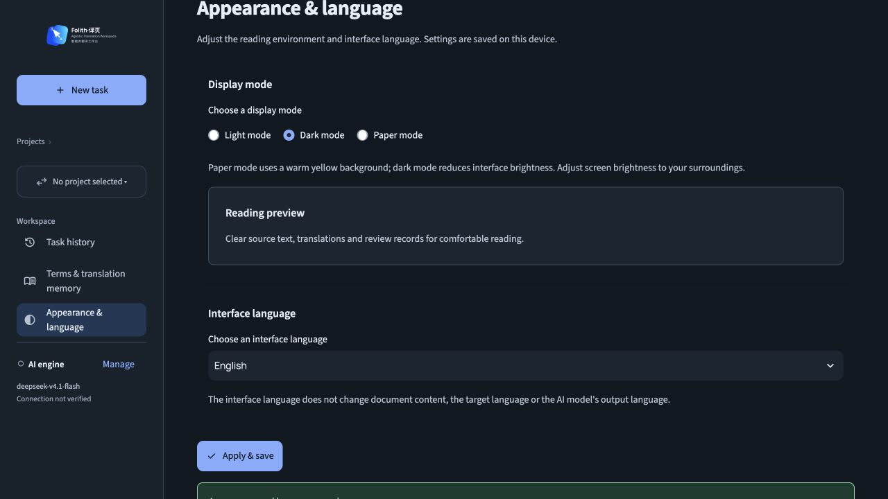
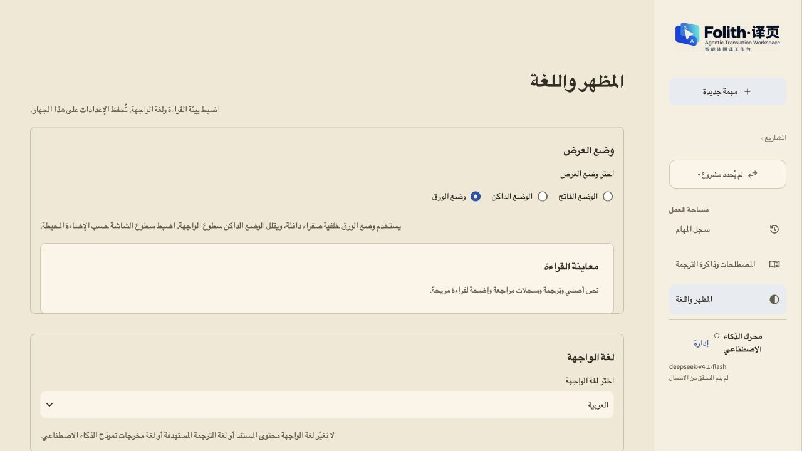
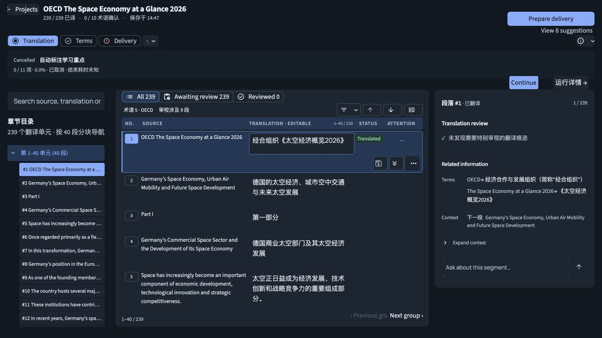

# Folith 外观与多语言支持

## 当前状态（2026-10-01）

外观与语言页面已接入侧栏，路由 `?view=appearance`。日间、夜间、暖黄色纸面三种显示模式可切换。设置保存在本机 `outputs/ui_preferences.json`，重启后恢复。已有中文默认界面，新增 English、Español、Русский、العربية 四个选项。

**全量本地化仍未完成。** 中文源资源 1,454 条；每个目标语言现有 535 条，尚缺 919 条。缺失文案显示中文原文。当前模型服务明确返回 `403 / INSUFFICIENT_BALANCE`，因此没有把缺失文案伪装成译文，也没有将报告标为 ready。用户已选择更换可用 AI 服务后继续全量翻译；等待新配置保存。

`localize-anything` 已运行 scan、glossary bootstrap、context、check、report。英文结构检查为 `fail`，919 个 blocking 缺译项；报告为 `incomplete`。其他三语有同样的资源缺项。结构检查通过之前尚未启动独立语言审阅；现有译文不是人工签核或正式发布译文。

## 架构与边界

- `folith/ui/preferences.py`：独立本机设置读写与设置页。显示偏好不会写入任务、模型配置或译文。
- `folith/ui/themes.py`：三种阅读环境，保留已有 Folith 设计系统。旧 CSS 固定颜色按颜色角色接入主题，新样式应直接用 `--tp-*` 变量。阿拉伯语使用 RTL 导航、标题和表单，双语网格保留独立布局及每段文字方向。
- `folith/ui/i18n.py`：无额外运行时依赖的 JSON 目录、显式 `tr()`、选择项 `localized_formatter()`、静态 HTML 片段 `html_literal()`。资源缓存随文件更新时间刷新。选择项格式化函数捕获渲染时的语言，返回值仍是原始枚举/标识。
- `folith/resources/locales/zh-CN.json`：唯一源目录；源文案作为 gettext 风格的身份键。`en.json`、`es.json`、`ru.json`、`ar.json` 使用相同键。目录随 wheel 打包。
- `.localize-anything/source-references.json`：通过显式 `--write-references` 导出，不进入包目录，提供显式文案调用的位置；另有通过展示映射引用的源条目。

范围包括显式 UI 操作文案、提示、静态 HTML 文本、导航、新建任务、翻译/审校/交付工作区和语言资产。已接入显示边界的资源可逐条补齐，无需再次更改交互逻辑。

文档原文/译文、项目及文件名称、用户术语、风格规则、生成内容、模型及后端动态诊断、导出文件内容不属于界面目录。现有品牌图片内的中英文保留；Streamlit 自带的上传器、菜单、表格等框架文案由依赖提供。不得据 JSON 检查通过就宣称这些内容已本地化。旧的拼接状态、数量统计和后端派生展示文案仍需后续页面覆盖检查，尤其应改成完整句式模板，避免仅翻译碎片造成语序问题。

“纸面模式”仅指暖色阅读配色，不承诺医学护眼效果。第一版不包含自动随系统切换或自动检测浏览器语言。

## 文案维护

新增界面文案时，先加入中文源目录及四个目标目录，再用显式翻译调用：

```python
from folith.ui.i18n import tr
st.button(tr("保存"), key="save_button")
st.caption(tr("第 {v0} 段", v0=index + 1))
```

使用完整文案和具名占位符，不拼接翻译后句子。修改源文案时同步移动/删除旧键，原生检查会报告缺译、多余键、占位符错误及未入目录的新调用。选择框的选项和业务状态保持原始值，只翻译 `format_func` 的展示结果。用户提供的项目名称、术语、原文、译文和占位符值不能传给 `tr()` 或 HTML 片段翻译器。

`html_literal()` 只能处理**插值前的静态源码片段**。它对目标文案进行 HTML 转义；用户数据应单独转义后插值，不能把已渲染 HTML 整体交给翻译器。

```bash
python3 scripts/check_ui_locales.py --allow-incomplete
python3 scripts/check_ui_locales.py --write-references .localize-anything/source-references.json
python3 -m pytest tests/ui_preferences_test.py -q
```

严格检查在当前未补齐状态下会返回非零，这是真实的缺译信息。CI 使用 `--allow-incomplete`，按 `experimental-missing.json` 中逐键记录的已知缺译允许实验功能，新增缺译、资源丢失、额外键和占位符错误仍失败；补译不要求更新基线即可通过。检查默认只读，引用索引仅在显式指定输出时生成。

## 使用 Localize Anything

项目保留 `.localize-anything/project-memory.json` 的产品范围、风格和保留规则，以及 canonical Glossary。`scripts/localize_ui.py` 直接委托同级 `localize-anything` 或 `~/Dev/localize-anything` 的 CLI，不复制其工作流，也不把工具加入 Folith 的运行依赖。维护工具要求 Python 3.11+（应用运行本身仍按原来的 Python 要求）。默认定位同级仓库；其他机器使用 `--tool-root /path/to/localize-anything`。

配置新的可用模型并在 Folith AI 引擎页面保存后，可补齐缺项：

```bash
python3 scripts/translate_ui_catalogs.py
python3 scripts/check_ui_locales.py
```

生成命令只发送界面目录，不读取或发送文档内容。它保留已有译文，检查批次返回数量、语言字段和占位符；不完整批次先重试，再逐条处理，仍失败则停止，不发布半个目录。凭据从已有 AI 引擎配置读取，不写入本地化产物。

对每个语言分别运行标准流程（下例为西班牙语）：

```bash
python3 scripts/localize_ui.py scan --locale es
python3 scripts/localize_ui.py glossary --locale es
python3 scripts/localize_ui.py context --locale es
python3 scripts/localize_ui.py check --locale es
python3 scripts/localize_ui.py review --locale es
# 将 review-packet.json 交给未生成草稿的独立审阅上下文。
python3 scripts/localize_ui.py review --locale es --findings /path/to/es-review.json
python3 scripts/localize_ui.py report --locale es
```

Project Memory 当前目标语言必须与命令一致，工具会拒绝混用。切换语言之前保留该语言的审阅及报告产物；CLI 输出按语言保存到 `.localize-anything/cli-output/<locale>/`。锁定译名和人工确认仍走 Localize Anything 的原有规则，不将自动生成或代理审阅冒充人工确认。

## 验证记录

设置持久化、损坏偏好回退、四语具名占位符、语言切换后原始选择值、HTML 与文档内容分离、批次生成完整性已有回归测试。工作台保存、语言资产、路由、项目导航、任务概览和 AI 侧栏相关回归已运行；语言包装后涉及的源码检查已更新为识别翻译调用。

真实浏览器已检查英文夜间设置页、阿拉伯语纸面设置页和英文夜间翻译工作台，发现并修复了深色品牌图混合、按钮对比度、长语言标签和模式选中状态问题。没有修改真实译文、调用任务生成或创建交付版本。

未完成：全部目标资源、独立语言审阅、完整页面语义与视觉覆盖、阿拉伯语所有复杂表格/长文案、真实屏幕阅读器和所有设备尺寸验证。






