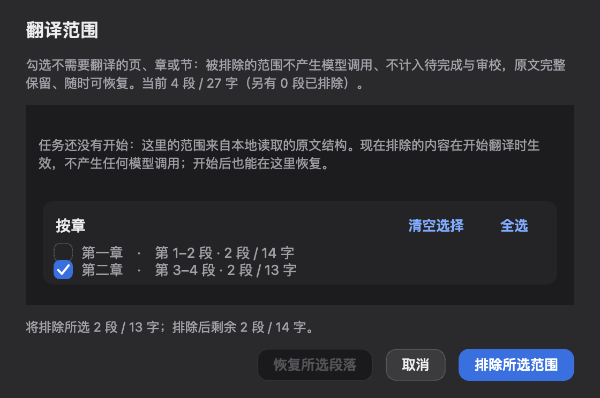
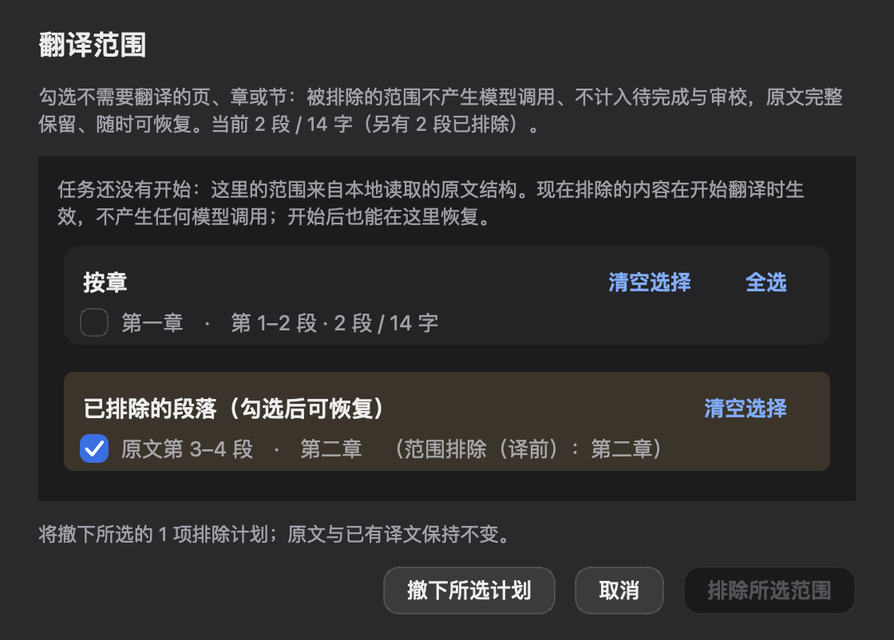

# Translation scope before preparation — issue #28

The follow-up to #160 adds the preparation-page entry and applies a source-outline
exclusion plan before the translation work set is created. It reuses #27's local
parser and the existing `excluded_segments` ledger. No #99 retrospective changes
are included.

## Working path

1. Import DOCX, EPUB, Markdown/text or a PDF with locally identifiable text.
2. Open **原文结构 → 翻译范围…** before starting the task. Local parsing requires no
   provider connection. Select a range; inspect source paragraph/character counts.
3. The task saves an exclusion plan with source coordinates and boundary text.
   It does not pretend that translation units or excluded translation pairs exist.
   Planned ranges are visible, removable and subtracted from cached estimates.
4. When extraction and segmentation finish, resolve all selected ranges against
   the original sequence before removing any units. Source-cleanup mappings and
   paragraph ranges connect raw paragraphs to actual translation units.
5. Excluded units enter the existing ledger, stay out of translation requests and
   appear as user skips in the delivery manifest. A skip never becomes a translation
   or review approval. Source extraction/cleanup itself is a separate preparation
   operation; no claim of free PDF OCR/VLM/cleanup is made here.
6. Restore through the same scope dialog. If translation has since produced pairs,
   source-only records return as empty, unreviewed target slots; existing targets
   retain their source association. They still require translation before delivery.

## Guarded cases

- Multiple selected ranges are resolved before one descending removal pass.
- Automatic structural exclusions can precede the plan; shifted paragraph ranges
  remain the mapping source.
- Cleanup that merges selected and retained raw paragraphs does not authorize
  deleting the retained text. Such plans remain unapplied and stop the pipeline
  before profiling/translation model calls.
- Boundary mismatches are not guessed. The plan and audit are preserved, and merely
  retrying stays blocked. Open the scope dialog to exclude the appropriate extracted
  units and withdraw the unapplied plan, or explicitly withdraw it to allow translation
  of the original scope.
- A plan does not silently shift an existing bilingual positional contract.
- Empty working lists after exclusion retain ledger recovery records.
- Scope mutations serialize state reads/writes; parsing reloads authoritative state
  instead of saving an older dialog snapshot over newer task data.

## Verification

`tests/translation_scope_test.py` includes real DOCX bytes passed through
`run_job_pipeline` with a deterministic offline provider. It asserts the excluded
chapter never enters a model prompt, the manifest records user skips, and restoration
keeps `paras` and `pairs` aligned without changing the existing translations. It also
covers multiple entries, cleanup mappings/partial overlaps, restore-all, estimates
before and after cache population, stale snapshots and refused late application.

`tests/qt_client_window_test.py::test_setup_scope_button_opens_real_dialog_and_saves_a_plan`
drives the real preparation button and modal dialog. Shared Qt CI runs that test,
the scope engine tests and preparation panel tests on macOS and Windows.

Native scripted evidence:

```sh
QT_QPA_PLATFORM=cocoa python scripts/scope_workflow_evidence.py --output docs/evidence/scope-workflow-macos
```

On Windows use `QT_QPA_PLATFORM=windows`; the Shared Qt Windows CI job runs the
same script and uploads `scope-workflow-windows` screenshots plus `evidence.json`.
The [Windows record](evidence/scope-workflow-windows/README.md) includes a successful
native Windows run and its exact source head/workflow. The local [macOS record](evidence/scope-workflow-macos/evidence.json) uses Cocoa,
real widgets and an isolated, generated two-chapter DOCX. It verifies exclusion,
withdrawal, estimates, the real pipeline, the skip manifest and restoration. These
are scripted native-source runs: no paid provider, human-operated study, installed
release or original-package DOCX fidelity acceptance is claimed.



