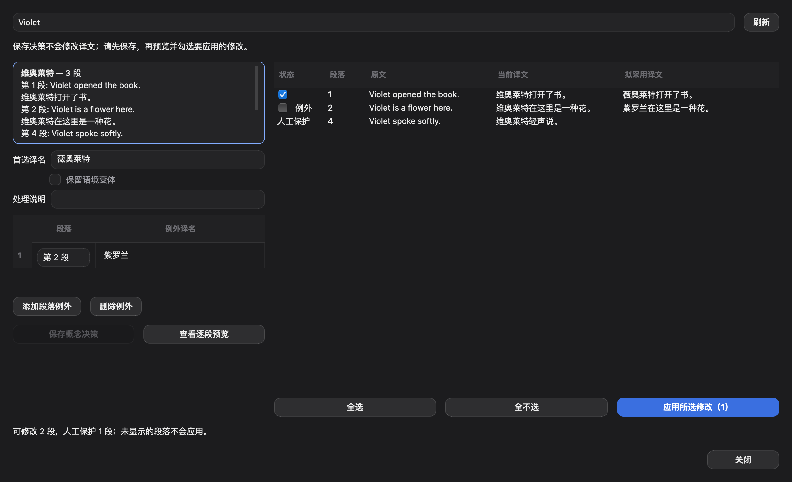

# 概念决策与逐段预览的 Qt 操作闭环

2026-10-25，基于 main `d949f34`。本次补齐 #96/#97 原实现明确留下的 Qt 操作界面，与 #124–#128 的词条编辑工作流共存。

## 操作路径

审校页 → **概念决策**（空队列时入口也可用）→ 选择概念、查看竞争译名及频次/原文证据 → 选择或填写首选译名、保留语境变体、添加段落例外 → **保存概念决策** → **查看逐段预览** → 勾选要修改的段 → **应用所选修改**。

- 保存概念决策只写已有 `concept_decisions` / entity registry；不改译文、不批准段落。
- 低置信度分组明确显示建议状态；不同原文形式可显式拆分，复用已有拆分契约。
- 例外段在界面显示从 1 开始的段号，提交时映射为已有的 `segment:<index>`；已有章节例外原样保留，本界面只新增/编辑段落例外。
- 逐段展示原文、当前译文和拟采用译文；人工保护段可见、不可勾选。最多显示 500 个可修改段，未显示段永不进入本次应用。
- 编辑决策字段即作废预览；应用前在任务锁内重读并比较决策、预览和段落基线。内容、身份、保护或审校状态变化时拒绝应用，提示刷新后重新预览。
- 暂存和采用复用 #92/#94 候选事务，origin 为 `concept_revision`，不另建批量写入/撤销状态。结果逐项显示，并保留采用记录；修改段需要重新审校。
- 读取、决策保存、预览和应用均按需在后台任务运行，不加入工作台轮询或默认整书预扫；没有模型调用。

## 随操作链补齐的既有接线

1. 原预览先排除全局首选译名，导致“已使用首选译名的段落”无法改用段落例外。现在按每段实际目的译名决定替换项。
2. 将已有概念决策传入当前一致性队列与管线最终检测；保留变体和已满足的段落例外不会重复报警，新的漂移仍带继承决策出现。保存决策和采用后的既有一致性刷新复用同一读取路径。

## 验证与边界

- 相关引擎、候选事务、术语、一致性、Qt 审校/队列/抽屉和 Translation Core 测试：**262 passed**。
- 新窗口串联测试通过实际审校按钮、真实对话框与后台任务完成保存 → 例外预览 → 取消一段 → 应用 → 重读持久化状态；同时断言人工保护、未选段不变。
- 最终界面在 `QT_QPA_PLATFORM=cocoa` 下的新 Qt 测试：**3 passed**。
- `check_ui_locales.py`：0 errors；`qt_i18n_coverage.py --strict`：五语言均 1428/1428。目录保留 #134 已准备的新增文案（含十条既有缺译），概念文案单独插入，避免重复翻译和目录末尾的合并冲突。
- 新测试已加入共享 Windows/macOS Qt CI 清单。

原生截图与机器可读记录在 [evidence/concept-workflow](evidence/concept-workflow/)。复现：

```sh
QT_QPA_PLATFORM=cocoa venv/bin/python scripts/concept_workflow_evidence.py
```



这些是 macOS Cocoa 下的脚本化操作和合成样本证据，**不是人工操作验收**。真实 Windows 客户端验收、职业译员真实样本和每百条发现的效率对比仍未执行；本次不能据此宣称整个 v0.7.3 已验收。

## 与 PR #134 的边界

#134 负责术语词条编辑及词条驱动的全文修订；本次负责概念决策、继承/例外和概念驱动预览。沿用同一工作台与候选事务，不复制 #134 的 TermEditDialog / TermReplaceDialog，不修改该 PR 分支。
