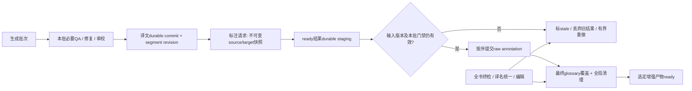

# Folith Translation Optimization — Phase 2

研究日期：2026-10-26（UTC+3）。本阶段完成版本核对、最新 main 隔离回放、标注调度反事实实验、故障恢复探针及请求参数检查。没有修改生产代码、默认值、用户任务、配置、译文、TM 或交付门禁；没有付费 API 调用。

本报告的核心结论：**批次减少和标注队列都有已测的优化空间，但尚无证据证明真实模型下质量调整后的吞吐已经提高。** 标注预取还暴露出明确的恢复代价，因此不能直接推广“更快”的研究生成器。

## 1. Current Runtime Reconciliation

### 1.1 四个版本，不能混称“当前版本”

| 对象 | 已核实身份 | 本次如何处理 |
|---|---|---|
| Phase 1 audited HEAD | `c8d6ac1707e0bada4eaf63ff9e9292c0c845178c` | 10 月19日的0.6开发线 |
| 当前本地 HEAD | 同上；分支 `feat/0.6-native-workbench` | 保留全部已有本地修改，没有checkout/pull/merge |
| 历史真实 Dots runtime | `git:cfe2f4f`、0.7.0 | 运行记录身份；构建记录不覆盖未提交修改，源码+观测交叉核对 |
| 研究开始时远程 main | **`0a2f29a1230147caa3ff64506e3c3c97d2fc3424`**，10月26日 | `ls-remote`与fetch确认；`git archive`到临时目录，运行该快照产品代码 |

历史runtime是该main的祖先；本地HEAD**不是**该main的祖先，是分叉开发线，不能简单描述为“本地落后几个提交”。当前正在使用的已安装桌面artifact身份未建立，不能用源码checkout版本代替它；本次能验证的是历史runtime和固定main快照。

开始时的17个tracked文件修改及多项untracked内容全部保留。Phase 1报告、脚本、证据仍是本地可用文件，未假定它们已在远程main。临时main只额外放入研究脚本和测试，未改动其产品实现。

证据： [reconciliation.json](translation-phase2-evidence/reconciliation.json)、[research.json](translation-phase2-evidence/research.json)。main源码链接均固定提交：[core.py](https://github.com/xueyang-dev/Folith/blob/0a2f29a1230147caa3ff64506e3c3c97d2fc3424/core.py)。

### 1.2 Capability Matrix

“仍存在”指当前main；当前本地HEAD与audited HEAD相同。

| Capability | Audited HEAD / 当前本地HEAD `c8d6ac1` | Historical Runtime `cfe2f4f` | Verified main `0a2f29a` | 差异裁定 |
|---|---|---|---|---|
| Translation batching | 核心新任务默认paragraph；桌面显式batch参数选sentence | 保存的真实任务sentence、6项/4800字符 | 同一入口规则；paragraph仍为2000字符/20项 | **仍存在**：入口隐式选择不一致；恢复兼容本身合理 |
| Effective concurrency | fallback1；快速6，标准/精细4；剩余批数限幅 | 正文4；反馈池另有并发 | 同样限幅与预设；正文线程池有效 | **设计正确**，不是并发配置失效 |
| Async knowledge feedback | 提交路径同步observe | 并发>1时独立池、按序合并 | 已有独立池与背压；并发1保留同步连续性 | main **已解决同步阻塞**；本地线仍不同，不重复实现 |
| Review overlap | 默认关；generated/stable显式选择，适用并发≤1 | 同类设计；Dots实际关闭review | 仍默认关；不透明的generated语义未自动推广 | **设计不同但不必然缺陷** |
| Annotation scheduling | 两路上限；按序yield；durable commit后补队 | 实测93批、两路；存在空槽 | 同一补队规则，尚未completion-driven | **仍存在**，也承担失败费用边界 |
| Request pooling | 按线程/连接身份复用 | 请求走已复用transport | 同一池与清理边界 | **正确实现，保留** |
| Reasoning control | default不发开关；translation/annotation共用translator mode，auxiliary另设；review不继承 | Dots default，有reasoning内容 | 同一text路径控制；不是按preset自动低推理 | 开关可发出；网关执行情况**缺证据** |
| Runtime instrumentation | logical/HTTP attempt、batch timing、usage、profiler、合并遥测 | requests.jsonl可配对421个调用 | 已增加用途标签，仍有logical/attempt/batch追踪；TTFT仍缺 | **部分已改进**；稳定operation细分与服务端指标仍缺 |

`section_scheduler.py`仍未接入生产；没有为了研究把它接上。线程池有效，未重写asyncio。

### 1.3 Qt → Settings → JobConfig → Runtime

main的真实配置传递为：

1. `qt/setup_panel.py`保存预设、`translation_concurrency`、`batch_profile`。
2. `qt/adapter.py::apply_task_setup/settings_sources/pipeline_kwargs`把任务选择交给共享Settings；provider配置本次以空fixture替代，未读取用户凭证。
3. `application/settings.py`保留保存的任务级决策；`batch_profile`派生batch_size/max_batch_chars。
4. `JobConfig.to_pipeline_kwargs()`总会输出两个batch参数，没有`batch_strategy`字段。
5. `core.py:12693`的实际赋值表达式：已保存策略优先；否则有既有pairs或显式batch参数即选择sentence；仅其他新核心调用使用paragraph默认。
6. `translate_stage`按已保存策略装箱；paragraph分支直接调用2000/20默认参数，**并不使用传入的sentence max_batch_chars**。

本次执行真实Qt-free adapter、Settings和JobConfig，随后执行从该main AST提取的实际策略赋值表达式；没有重新手写一套解析器。结果：

| 预设 | 并发 | 参数：项数 / 字符 | 最终策略 | Review / Feedback |
|---|---:|---:|---|---|
| 快速 | 6 | 6 /4800 | sentence | 关 /关 |
| 标准 | 4 | 4 /2400 | sentence | 关 /开 |
| 学术增强（UI精细） | 4 | 4 /2400 | sentence | 开 /开 |

这不是用户显式选择了sentence策略，而是UI的批次大小选择与核心兼容规则发生耦合。旧任务保持原拆分、已有pairs不换计划是正确保护；新任务让参数存在性隐式决定策略则应显式化。**值得新增内部typed batch_strategy配置，但第一步只表达既有行为，不切换生产默认，不迁移历史计划。**

未做真实Qt窗口操作；已测adapter/contract，不将其称为UI实机验收。

## 2. Verified Phase 1 Findings

读取了[Phase 1报告](translation-bottleneck-audit.md)、其三个JSON证据、相关benchmark/profiling代码，以及历史[知识反馈](../knowledge-feedback-efficiency-pass.md)、[翻译效率](../translation-efficiency-pass.md)、[持久化](../persistence-performance-round7-journal.md)、[review overlap语义裁定](../reviewer-overlap-semantics.md)、历史annotation replay。旧文档的“默认值”与“exact token”措辞均不覆盖实际代码/计量来源。

延续确认：Dots真实任务160,006字符、921单元，首次自动流水线8591.790s；前置约1030.6s、翻译/修复/反馈约2159.4s、标注约5401.7s。正文161批、并发4。local QA约0.435s，state_commit约0.628s，不是该任务主瓶颈；不再重复持久化重写研究。

**本轮细分也修正了一项Phase 1归因：** auxiliary失败并非全部发生在前置准备。逐请求batch_id/时间边界显示：understanding桶2次timeout、knowledge feedback 1次connection error；另有正文3次失败，总失败仍为6。Phase 1关于“反馈没有逻辑失败、前置3次”的表述不成立，应以本报告细分为准。

另外，当前保存的921项中有**5项因source-quality quarantine保持空译**，并有blocking findings；这些不是本次batch回放新引入的漏译。仅用“pairs数921”判定整书可交付会错。历史completed worker、annotation milestone和当前`annotations_status=partial`也不能替代质量门禁。

证据不足仍保持不足：没有服务端队列、TTFT、prefill/decode分段或中转账单；没有新真人盲评，没有真实provider批次/思考模式A/B。

## 3. Batching A/B Results

### 3.1 假设与实验控制

假设：保留语义单元/自然段边界与逐segment映射，扩大每次正文净负载，可少付固定prompt开销。Request减少、API latency下降、质量改善是三个不同命题。

在固定main快照上运行真实`translate_stage`：同一历史源文/19条术语条目及其状态、同一目标语言、保存的document profile/synopsis/semantic units/paragraph ranges、fixed context策略、并发4、相同QA。provider在进程内返回历史reference；knowledge extractor返回空观察，不发网络。冷回放关闭TM/exact cache以隔离批次影响，另测TM与resume。每组3次，seed20261026交错顺序，保存了实际顺序。

限制：保存的实体/画像来自任务后状态，不能冒充真实开跑时的初始知识；reference来自最终译文而非原始模型初译。模型忽略上下文语义，因此此实验验证请求组织、输入体积、对齐与本地QA一致性，**不验证真实模型生成质量或吞吐**。不同并发执行时序下previous_target可见性仍不同；输入字符出现小范围波动，明确报告范围。

### 3.2 已测结果

| Variant | 策略 / 上限 | 批次数（相对A） | generation输入字符中位数（范围） | /4 token粗估中位数 | 每请求输出JSON均字符 |
|---|---|---:|---:|---:|---:|
| A | 当前该任务基线：sentence 6项/4800 | 161 | 699,312（698,340–699,312） | 174,898 | 362.5 |
| B | paragraph 20项/2000 | 108（−32.9%） | 542,464（541,018–542,464） | 135,659 | 540.4 |
| C | paragraph 20项/4000 | 58（−64.0%） | 376,826（本轮三次相同） | 94,226 | 1006.2 |
| D | paragraph 20项/6000，探索 | 57（−64.6%） | 372,808（372,394–372,808） | 93,222 | 1023.9 |

输入字符相对A减少约**22.4% /46.1% /46.7%**；这是实际渲染payload计数。token列仅沿用字符/4估算，**没有真实tokenizer/provider输入tokens改善的测量**。C每批输出均长约A的2.78倍；所有组输出JSON累计58,362字符，是固定reference决定的，不能推导真实模型输出长度或推理成本。

这是历史任务的6项/4800基线，不是标准预设4项/2400的基线；不能把历史configured=4并发误写为4项批次。

每组：921项顺序与reference逐项相同；其中916项有历史非空译文、5项为既有隔离空项；0协议fallback；本地findings均为blocking5、actionable12、informational35。没有新增空项或错位，**也没有“质量全通过”**。回放repair次数7–8是固定reference触发的本地流程，不能替代真实repair rate。

TM实验：C计划仍58批，按每7项播种的语言作用域TM实际复用131项，模型处理单元从916降至785，最终映射/译文和findings保持一致。Resume实验：在C第29批边界保存496个prefix单元及其findings，续跑29批；最终921项和52条findings的severity分布保持一致。未对已开译的A任务换成C计划；这不是历史任务自动改批的验证。

### 3.3 可以与不可以推出什么

- 已证实请求数和固定输入体积有显著减少空间；4k→6k只再少1批，20项/自然段/语义边界成为主要约束。**停止继续扩大字符上限的默认探索，不推广6k。**
- 单请求生成时间是否非线性增长、重试/截断是否抵消收益、总API秒数是否下降：未测。零延迟回放的本地wall约0.8–1.2s不是云模型速度预测，不作加速倍数。
- JSON成功率仅在固定reference回放中为100%；长批真实协议可靠性、文学语气、指代和跨章专名仍待盲评。
- paragraph不等于合并segment：输出仍逐ID对应，改变的是装箱及段落分组提示；这种提示本身可能改变译法，不能视为语义透明优化。

**Decision：Paragraph batching = EXPERIMENT FURTHER；Larger batches（4k）= EXPERIMENT FURTHER。6k当前DEFER。** 内部显式策略配置可先做行为保持的工程改进，不能以此默认开启paragraph。

## 4. Reasoning and Model Role Analysis

### 4.1 Role-Level Cost Model

重新读取同一个真实run的421条model_call；不把state账本遗漏的annotation角色算丢。understanding桶按前置auxiliary与terminology开始边界识别，涵盖画像/概要等；repair按同batch的repair span识别。历史没有稳定子操作ID，因此不能进一步精确拆每个画像/摘要调用。

| 角色 | requests / failed | latency mean /P50 /P95 s | 提供商输入 /输出tokens | prompt字符 | reasoning字符 | HTTP attempts |
|---|---:|---:|---:|---:|---:|---:|
| Understanding/profile/synopsis | 21 /2 | 93.558 /68.586 /227.788 | 47,676 /70,095 | 195,758 | 149,671 | 27 |
| Terminology extraction | 1 /0 | 44.531 /44.531 /44.531 | 1,354 /4,468 | 5,855 | 11,287 | 1 |
| Translation generation | 164 /3 | 44.841 /36.386 /101.426 | 306,299 /556,993 | 707,233 | 1,447,575 | 173 |
| Translation repair | 11 /0 | 34.207 /20.781 /198.553 | 13,738 /19,072 | 30,222 | 35,640 | 12 |
| Semantic / targeted review | 0 | 不适用，配置关闭 | 不适用 | 不适用 | 不适用 | 0 |
| Knowledge feedback | 131 /1 | 40.527 /35.973 /60.034 | 89,637 /525,980 | 245,382 | 1,348,129 | 134 |
| Automatic annotation | 93 /0 | 102.067 /102.739 /156.129 | 132,211 /910,480 | 320,861 | 2,736,298 | 96 |
| Other：OCR/cleanup/report等 | 本run无对应调用 | 不把其他任务混入 | 未观察 | 未观察 | 未观察 | 未观察 |

usage覆盖：understanding19/21、translation161/164、knowledge130/131，其余所列调用完整；失败usage未知，不填0。**reasoning_tokens所有角色均为未知，reasoning_chars不是tokens。** annotation+knowledge占已报告completion tokens约68.8%、reasoning字符约71.3%，优先值得测试。

缓存：translation报告cached66,048 tokens（字段覆盖126/164调用），annotation20,480（40/93）；其他角色未返回该字段。不能把字段缺失视为cache miss，不能据此给全量命中率。历史正文TM/exact执行缓存记录为0命中。上下文复用可观察到固定system及profile/相邻上下文重复发送；Phase 1正文净原文仅约23%，但没有证明其余77%都可删或provider都重新prefill。

角色质量作用：理解/术语决定全书语境与命名约束；generation产生正文；repair修复可定位缺陷；review提供语义复核及候选验证；knowledge影响后续术语/实体；annotation产生学习/对照说明，不修改正文。不得用后两者输出token很多就认定“无效”。

### 4.2 实际请求参数实验

本次在main上用fake OpenAI SDK截获`core.call_llm`实际传给SDK的request，未发HTTP；覆盖自定义relay、Dots模型名和4个角色。

| thread模式 | Translation | Annotation | Auxiliary | Reviewer |
|---|---|---|---|---|
| provider_default | 无thinking字段 | 无thinking字段 | 无thinking字段 | 无thinking字段 |
| translator/auxiliary均thinking_disabled | 发`thinking.type=disabled` | 发同一开关 | 发同一开关 | **仍不继承** |

Dots未知模型名不收到`reasoning_effort`。已知reasoning family的low/medium/high能力白名单与thinking开关是不同机制；不能把模型名字包含DeepSeek当官方端点支持证明。review显式参数另行调用可独立验证，但现有继承策略故意不把translator mode覆盖review。

main目前`reasoning_mode`/`auxiliary_reasoning_mode`属于内部runtime参数/环境配置，JobConfig没有对应普通UI字段。Annotation与translation共享translator模式：**产品里直接改translator mode不是annotation-only A/B。** 研究实验必须隔离角色调用，或者另立经过验收的角色配置。

fake SDK只证明**客户端发出了开关**；HTTP200也不能证明relay执行了它。历史Dots所有成功调用的记录是provider_default。没有网关能力/账单证据，不能断言关思考一定可用、能省多少或质量相同。

### 4.3 优先实验与低成本触发假设

优先做annotation与knowledge的逐角色default/off配对，再做常规正文；review保持较强保守基线。常规正文低推理、高风险保留推理是可研究假设，不实现动态路由。

可复用的廉价信号：既有source-quality flag、锁定术语/新专名冲突、占位符/数字/引文密度、修复历史、跨边界指代、长段/表格结构。它们能标出一部分风险，不能可靠证明某段“语义简单”；文学语气与隐含歧义尤其缺少可靠cheap negative。没有经人工校准的标注集时，不建立自动low-risk路由，也不额外发模型请求来判断是否需要思考。

**Decision：Reasoning optimization = EXPERIMENT FURTHER；Role-based model routing = DEFER。** 本阶段没有换模型，也没有观测到质量等价的真实节省。

## 5. Automatic Annotation Critical Path

### 5.1 它在做什么，为何比正文慢

main `core.py:4200/4229/4389`：annotator收到当前批的原文、译文、目标语言与教学/审阅指令；识别rare低频词、domain行业术语、hard局部翻译技巧，返回`seg/type/src/tgt/note` JSON。它不直接消费全文knowledge packet；术语表在后续确定性覆盖中使用。

装箱为**最多10项/2600原文字符**，没有同时限制译文、note和reasoning的总生成量；实际93批。使用传入的主provider/model，annotation role继承translator reasoning mode；不是reviewer专用模型。正文164次logical调用平均44.8s，annotation仅93次但平均102.1s、累计API9492.2s，两个worker窗口5401s。

已证实的成本来源是更长的每次请求与大量输出：annotation completion约910,480 tokens，reasoning内容约273.6万字符，远大于其94,090字符的可见响应。无法把这部分进一步分成prefill、decode、server queue或网络，也不能据字符数换算可省秒数。

后处理还有精确span匹配、人物/地名等过滤、每段限额、专业术语全文频次最多2次等全局清理。当前保存状态有293处标注（domain118、hard173、rare2），但已经partial/发生后续状态变化，**不是本次run原始候选产出快照**，不能以293除调用数给“有效产出率”。缺少raw候选→过滤→展示的计数链。

domain LLM建议和glossary确定性覆盖在功能上有交集，但rare/hard还有其他价值；没有足够候选证据证明可删除任何一类。hard解释与语义review不是同一质量检查。可以研究按需生成rare/hard或已选段落说明，但这是用户选择/覆盖度语义变化，不作默认删除。

### 5.2 三种调度设计及反事实结果

用93个真实worker服务时长和commit时长进行离散事件重放：服务时间固定、仍2路、不改prompt/任务顺序/commit成本，比较按序提交的不同补队策略。未重新调用模型。

| 设计 | total outstanding上限 | 重放wall s | 相对A | 最大ready缓冲 | 结论 |
|---|---:|---:|---:|---:|---|
| A 当前ordered collection，commit后补队 | 2 | **5400.809** | — | 2 | 与实测worker窗口5401.065相差约0.256s，模型校准良好 |
| B completion-driven，缓冲随任务数增长 | 本样本峰值5，无固定小界 | **4761.713** | −639.096s | 3 | 本样本更快，但不可直接推广无界方案 |
| C2 completion-driven +严格2项背压 | 2 | **5400.809** | 0 | 2 | 仅改变收集API没有收益，停止作为性能方向 |
| C4 completion-driven +4项背压 | 4 | **4761.765** | **−639.044s（11.83%标注窗口）** | 3 | 固定服务时间下约10.65分钟空间，约首次自动流程7.44%；不是生产加速实测 |

为何C2没有收益：慢的第一批和已完成的第二批已经占满两个未提交名额；收集第二批并不会释放“尚未durable commit”的容量。这不是把`result()`换成`as_completed()`就能解决的。

### 5.3 实际main流程上的候选生成器与故障注入

在临时任务中，仅替换`_annotation_results`为研究生成器，仍运行main的`annotate_stage`及所有span/全局过滤和顺序提交。12个固定双语单元，首批和第7批60ms，其余2ms；每次输出包含应保留的术语和应过滤的地名。

正常结果A/B/C2/C4逐字段一致：annotations、batch状态、cursor、done；commit依次1…12，最终清理结果一致。wall单次为0.1663/0.0957/0.1635/0.1521s。C4在这个短fixture仅小幅变化，受本地噪声和背压限制，**没有把它包装成统计显著收益**；历史93批重放是独立的固定服务时间反事实。

| 首次故障场景 | A | B | C2 | C4 |
|---|---:|---:|---:|---:|
| 第一次save失败前已调用批数 | 2 | **8** | 2 | **4** |
| save失败后durable cursor | 0 | 0 | 0 | 0 |
| 恢复时重复已付请求数（本地stub计数） | 2 | **8** | 2 | **4** |
| 第一次commit后取消：已调用批数 | 2 | 8 | 2 | 4 |
| 取消后恢复重复批数 | 1 | 7 | 1 | 3 |
| 第0批parse_failed，随后恢复 | 仅重跑1批 | 同左 | 同左 | 同左 |

四种方案所有这些恢复探针最终都完成，且没有跳过未durable提交的prefix。**恢复正确不等于恢复代价不变**：内存ready buffer不能避免崩溃后重付请求。原有“save失败不补队”的保护仍有价值，当前测试对A的≤2边界是有意设计。

没有实现durable staging；不能用正常结果一致替代该缺口。应先验证小型持久暂存与消费确认，使已付ready结果在崩溃后可复用，然后才能决定扩大prefetch。保持两路请求，不增加API active上限。

**Decision：Annotation queue optimization = EXPERIMENT FURTHER。B无界设计REJECT；C2作为速度优化REJECT；C4需durability与版本验收。**

## 6. Overlapped Pipeline Feasibility

### 6.1 现有依赖与已有正确机制

主流程在全文翻译/必要审校、定向终检后进入annotation，所以当前未并行修改的译文对标注是稳定输入。`engine/delivery_state.py::_mark_translation_truth_changed`已经按受影响annotation batch清除旧span并标stale，不能重造一套忽略该机制的失效系统。重分段/重解析也已有source-dependent state reset。

但新背景队列中的**未提交结果**尚无target revision身份校验；现有“清除已提交标注”不足以阻止一个旧in-flight结果随后写回。新重叠方案必须覆盖这个新可达路径，而不是指责当前顺序流程已存在同样race。

LLM raw annotation只依赖批次source/target、目标语言、annotator配置；可以在这些输入稳定且本批必要质量门禁完成后研究提前执行。glossary确定性覆盖与全书频次过滤必须在最终glossary/最终顺序上运行。后续终检、统一译名、人工修改可能改变早期target，因此提前结果只能是可失效的派生产物。

### 6.2 版本依赖图与状态机提案



建议状态：`WAITING_INPUT → ELIGIBLE → QUEUED → RUNNING → READY_STAGED → COMMITTED`；另有`STALE / RETRYABLE_FAILED / CANCELLED`。不把`RUNNING`、`COMMITTED`或worker completed当最终交付就绪。

依赖身份使用现有稳定segment ID、目标语言、source/结构revision、target revision和annotator配置版本；raw LLM结果不必绑定它没读过的全书knowledge。术语overlay另绑定glossary revision。优先复用现有truth mutation/失效账本；若需要每segment revision，只在目标变更时更新计数，不新增全文文本hash或通用迁移框架。

提交规则：

1. 请求只读快照，不直接读会变的pairs；source-quality unresolved单元不得被当成已完成输入。
2. ready先durable暂存，暂存不推进有序done cursor。提交时核对每个依赖ID/revision与QA verdict；不匹配即stale。
3. 同一输入身份只应用一次；暂存/消费使用已有原子写、日志与mutation边界。崩溃恢复必须重新核对版本，不只看文件存在。
4. target变更精准失效涉及的raw批次；glossary变更主要重做overlay/全局清理。结构重排若无法证明ID映射，保守失效整个相关计划。
5. 所有旧请求完成后也要核对取消/版本；取消停止补队，不把已完成但不再适用的结果写回。恢复只复用身份仍匹配的durable ready结果。
6. 最终全局过滤按稳定segment顺序运行，不能在并行完成顺序上应用“全书最多2次”规则。

本次纯契约测试验证了：任一输入target改变、缺ID、glossary revision变化、QA未就绪、failed结果均不能被接受；无关segment修改不失效本批；暂存JSON重载后重新校验；同一身份幂等消费。这是**设计模型测试**，不是新生产journal的崩溃验收。

### 6.3 容量与连续性约束

不能只添加annotation线程池：T/K已有并行请求，annotation可能占用不可抢占的长请求，使下一正文或知识请求等待。即使dispatcher优先正文，已发出的annotation也不能被优先级收回。

对照依赖模型：8个**顺序完成必要review再commit**的translation批次，每批50ms；每批annotation80ms。两种设计保持同一committed-context链，不使用未审译文。

| 已批准全局容量 | 顺序阶段模型 | 有界重叠模型 | 模型结论 |
|---:|---:|---:|---|
| 1 | 1.04s | 1.04s | 没有容量就没有重叠收益 |
| 2 | 0.72s | 0.56s | 有空余容量时依赖重叠可能有益；固定服务时间假设 |

这是模拟，不是当前4路正文的生产性能投影。真实实施需要保留正文/质量依赖所需的容量与知识新鲜度，annotation仅使用已获批准的额外余量；没有余量时退回顺序。不能因为历史观察到8个logical在途就宣布provider批准了8路，更不能提高上限制造收益。

Review `generated` overlap已被既有对抗样本证明改变上下文；本方案不能借机开启它。Annotation提前执行通常不改变正文输入，但如果争用容量改变knowledge合并时序，仍可能间接影响正文，需要同样的上下文/实体新鲜度探针。

**Decision：Translation/annotation overlap = EXPERIMENT FURTHER**。版本一致性可定义，但stage durability、真实容量竞争及全书quality还没验收。

### 6.4 Product Workflow Research：三个readiness维度

先校正一个产品前提：目前annotation阻塞的是**自动worker流程尾部**，并非所有业务质量门禁都硬性要求annotation。main的`delivery.compute_delivery_status/approve_delivery`和Qt `can_deliver`主要检查p2、完整性、review、blocking、report、snapshot；没有将`annotations_done`作为统一必需门禁。普通新交付预设也不默认开启annotation。历史Dots任务明确enable_annotate=true，不能把它改成“用户没要的功能”。

因此无需“删除标注门禁”来提速；应研究显式展示三个不同状态，并保留已选增强产物的完成承诺：

| 状态 | 提案定义 | 现有字段能否直接充当它 |
|---|---|---|
| Draft Ready | 全部本次required source有完整、对齐、结构合法的初译；隔离/缺页必须有明确处理结果 | p2_done单独不足；不能把921个槽位当921个完整译文 |
| Translation Ready | 当前译文版本满足任务配置要求的QA/review与完整性门禁；必要终检完成 | 复用review readiness、delivery validation与source gate，不伪造人工批准 |
| Enhanced Delivery Ready | Translation Ready且用户选择的annotation/解释/导出产物对当前版本全部ready | 需独立coverage/failed/stale状态；worker completed不足 |

最终冻结交付仍遵循现有人工批准、render和manifest规则。普通译文可见/可导出与选定增强包完成可以分别显示，**不能把partial annotation文件标为完整增强交付**。是否允许先冻结基础包、后生成新的增强snapshot是产品选择，需要显式文件清单与新版本，不覆盖已冻结历史资产。

UI影响：项目页分别展示已生成/质量就绪/增强待处理；按钮依据对应产物依赖；说明用户选择了什么、失败了哪些、哪些会因编辑失效。按需标注需明确coverage为“选定段落”，不能继续承诺全书覆盖。本阶段只形成语义提案，没有改UI或交付gate。

## 7. Quality-Adjusted Throughput Metrics

### 7.1 可计算定义，不造综合质量分数

固定版本v与已声明质量政策p，定义文档门禁 `G(d,v,p) ∈ {PASS, FAIL, UNKNOWN}`：

- required source范围完整，有合法处理记录的排除单元按范围契约处理；未解决隔离/缺页不算完成。
- 无漏ID/重复ID/错位/截断；数字、占位符、链接、引用与结构约束满足。
- 锁定术语/实体及任务配置要求的review满足；关键错误未解决即FAIL。
- 需要人工语义/风格验收的基准，没有可靠标注时为UNKNOWN，不用“reference输出一样”补分。

在固定观测窗口 `[t0,t1]`，文档完成型质量吞吐为：

`QAT_window = Σ required_source_chars(d) × 1[G(d,current_version,p)=PASS且在窗口内完成] / (t1−t0)`。

单位为质量通过的原文字符/s。多个job并行时分母是该观测窗口墙钟，不能把各job累计时间与窗口吞吐混用。重复/失效译文不重复计数。若存在UNKNOWN，报告quality coverage并把整组QAT标为不完整/待评；可以单列已确认通过量，但不能伪称全体质量调整分数。

本次reference回放能证明alignment/保护项/现有QA没有变化，不能把916条非空译文直接代入已接受量。Dots保存状态还有5条blocking隔离项，strict document completeness已不满足；**没有可报告的“整书质量通过吞吐提升”**。

### 7.2 长期回归字段

| 类别 | 必须记录的定义 |
|---|---|
| Time to First Draft | 从run接管到该文档required scope首次全部有合法初译；首段出现时间另外命名，不能混用 |
| Time to Translation Ready | 当前版本全部必要质量依赖收敛；人工等待与machine-active时间分列 |
| Time to Final Delivery | 所选manifest对当前版本冻结并通过必要导出/render/批准；不把worker completed代替它 |
| Stage wall / critical path | container、item sum、interval union分别存；独占关键路径贡献需依赖图/受控消融，不由Σ相减猜测 |
| Useful source chars/s | 清楚标注generation active、translation window或整个自动/交付window；不以completion tokens代替 |
| API | 万原文字符calls、provider输入/输出/cached/reasoning tokens及覆盖率；logical retry与HTTP attempt分开；actual logical in-flight按role/window统计 |
| Cost | 只在有真实gateway价格、计费规则、缺失usage处理和账单依据时报告金额；目前未知 |
| Completeness / alignment / structure | required单元分母、遗漏/重复/错位/截断计数；unknown排除原因不能当合格 |
| Terminology / entities | 适用约束机会数、违反数、跨批/跨章一致性；专名别名按项目决策，而非字符串一律相同 |
| Review defect recall | 固定人工裁定缺陷集中的TP/(TP+FN)，另报误报；没有ground truth时只报发现数，不称recall |
| Critical errors / human acceptance | 已裁定关键错误与接受/拒绝数、评审覆盖率、版本及rubric；无真人数据为UNKNOWN |

复用现有requests/batch spans及main新增用途标签。下一步应将稳定operation_id关联到logical request，避免再次靠本地化标签或时间边界拆understanding/term/knowledge；不要重建已有telemetry框架。

## 8. Measured Improvements and Limitations

| 命题 | 本阶段结果 | 证据等级 |
|---|---|---|
| 当前main仍有batch入口耦合 | Qt adapter/Settings/JobConfig+实际runtime表达式全部复现 | 当前代码+执行测量 |
| paragraph减少请求与固定输入 | 161→108/58/57；输入字符中位数−22.4/46.1/46.7% | 当前runtime reference replay，不是真实API |
| annotation队列可减少空槽 | 固定历史服务时间C4比A−639.044s | trace-driven反事实，不是生产提速 |
| 只换completion收集API就有收益 | C2与A完全相同 | 反证，停止此子方向 |
| 更大ready缓冲对失败免费 | disk/cancel后重复调用明确上升 | 当前main实际stage+故障注入，反证 |
| thinking off确实传到SDK | translation/annotation/auxiliary有disabled body，review不继承 | fake SDK参数检查；不证明网关执行 |
| 重叠一定更快 | 全局容量1模型无收益；容量2才有潜力 | 依赖/容量模型，条件命题 |
| QAT已提高 | 未证明；既有blocking及人工评价缺失 | 明确不作该结论 |

本次所有translation请求都被stub替代；输出长度固定，不能检验真实大批非线性decode、JSON失败或文学质量。调度重放假设service duration不受重排影响，真实gateway争用可能改变它。故障探针运行了实际stage，但save函数以可控fixture模拟边界，不是新staging日志的磁盘断电/atomicity测试。未在Windows实机运行；新增脚本使用pathlib、标准Executor和计时，没有OS专有生产变更。

### 8.1 可复现命令与验证

```sh
# 将已核实main导出到独立临时目录；不要checkout到脏工作区
git archive 0a2f29a1230147caa3ff64506e3c3c97d2fc3424 | tar -x -C '<prepared-temp-main>'

# 没有live模式；--job-dir只读，流水线任务目录由tempfile隔离并清理
venv/bin/python scripts/translation_phase2_research.py \
  --runtime-root '<prepared-temp-main>' \
  --job-dir '<desktop-data>/e7a302d59653e282' \
  --repeats 3 --out /tmp/folith-phase2-replay

# 将本次研究script/test复制到临时快照，在其根目录使用同一venv运行测试
python -m pytest -q tests/translation_phase2_research_test.py
```

研究脚本：[translation_phase2_research.py](../../scripts/translation_phase2_research.py)；契约/故障测试：[translation_phase2_research_test.py](../../tests/translation_phase2_research_test.py)。本机真实job若不可用，省略--job-dir仍可运行配置、wire、annotation mock及容量模型；不能据此声称复现了历史服务时间或真实文档batch输入。

main隔离快照上既有annotation质量/并发、reasoning、batch、settings/JobConfig、delivery snapshot、review-overlap语义、request-control/transport回归套件 **125 passed**；最终新增研究契约套件 **14 passed**（两次套件含重叠，不相加）。故障测试覆盖disk/cancel/parse后恢复与有界请求数；5个依赖deprecation warnings不作产品发现。

### 8.2 无预算部分的可执行实验协议

完整协议与停止条件见 [live-protocol.json](translation-phase2-evidence/live-protocol.json)，状态为**未授权、未执行**。这是一份实验操作协议；当前研究脚本故意没有live入口，不应改用无预算保护的旧`--live`命令冒充执行。

Batch pilot：同模型/同语言/同术语/同quality policy/并发4，A/B/C/D四组，冻结4个候选12单元窗口并检查术语、专名、保护项及长段覆盖；每组最多16个logical请求（含重试），质量复核/修复另留16，总上限80 logical /160 HTTP attempts，建议provider-side硬预算$5。两个交错重复，记录实际顺序和paired provider负载；D仅探索。

Reasoning pilot：translation、knowledge、annotation各4个同payload配对，default/off共24次，能力探针最多2次；合计26 logical /52 attempts，建议独立硬预算$3。Reviewer模式需单独方案，不借translator设置覆盖。预算是**待批准上限建议，不是已获授权**；没取得真实gateway计费规则及provider-side硬额度，不开始。客户端在收到响应后才停，不能保证单请求不越过美元上限。

逐步骤执行：冻结样本/上下文/术语/评审rubric → 核对网关支持和请求输出上界 → 审批两个预算及发送范围 → 按seed交错发请求并在每次dispatch前预留最大计费与attempt额度 → 逐ID/保护项检查 → 隐藏模式/批次标签进行双语盲评 → 对照完成时间/usage与质量gate → 裁定，不自动推广。

停止条件：首个硬质量失败停止该variant；两次连续429/5xx/连接错误停止；取消、持久化失败、usage/费用不可控、输出上界不支持立即停止；baseline负载明显漂移时暂停配对块；4k以后请求数无实质下降或结果仍不显著则停止更大batch方向。小样本可否决明显风险，不能证明全书质量非劣。

## 9. Recommended Architecture Changes

### 9.1 Decision Matrix

Decision严格使用要求的四种取值；IMPLEMENT只用于已有行为可保持的独立工程项，不偷换成对应性能策略已获上线许可。

| Optimization | Evidence | Quality risk | Expected benefit | Decision |
|---|---|---|---|---|
| Paragraph batching | 当前main回放161→108，结构/reference不变；真实语义未知 | 中：连续性、段内提示、ID/恢复 | 请求−32.9%，输入字符−22.4%；真实时间待测 | **EXPERIMENT FURTHER** |
| Larger batches（4k） | 58批、输入字符−46.1%；6k只少1批 | 中高：长输出、截断、repair放大 | 固定输入开销明显下降，不能换算云端倍速 | **EXPERIMENT FURTHER** |
| Reasoning optimization | annotation/knowledge输出占比高；wire开关可发 | 中高：网关执行未知、知识/说明质量 | 未测真实秒数/金额 | **EXPERIMENT FURTHER** |
| Annotation queue optimization | 历史固定耗时重放−639s；实际过滤结果一致；扩大失败重做 | 正文风险低；持久化/映射/取消中等 | 2路不变时可回收部分空槽，staging待验收 | **EXPERIMENT FURTHER** |
| Translation/annotation overlap | 输入可快照；现有失效机制可复用；容量模型条件性收益 | 高：版本、终检、全局过滤、容量竞争 | 可能缩短后置尾部，真实收益未建立 | **EXPERIMENT FURTHER** |
| Role-based model routing | 无same-input/same-quality provider对照 | 高：换模型/风险分流无校准 | 未知 | **DEFER** |
| 显式内部batch_strategy，保持既有策略 | 已复现完整配置耦合；不改变prompt/plan即可验收 | 低 | 消除实验/产品策略歧义；本身不承诺速度 | **IMPLEMENT** |
| 稳定request operation与readiness计量 | 已有telemetry可复用；role细分曾错误归因 | 低，不改翻译内容/门禁 | 可测QAT/角色成本，避免再靠时间猜测 | **IMPLEMENT** |
| 无界completion缓冲 | 正常更快但故障前8次调用、恢复多重付 | 不符合有界恢复目标 | 不值得用无界工作换速度 | **REJECT** |
| 仅换收集API、仍2项总容量 | 固定耗时结果与当前一致 | 无质量收益 | 无性能改善 | **REJECT** |

### 9.2 可直接拆分的Issue草案

- **显式记录有效batch strategy**：在共享配置/JobConfig/Runtime使用同一字段；为既有桌面任务显式保存sentence，不改变任何旧计划。验收所有preset、直接核心调用、旧任务无策略、已有pairs、保存paragraph及resume优先级；非法值处理与当前兼容语义明确。
- **Annotation bounded staging与消费确认研究实现**：固定active=2、候选outstanding=4；先定义ready暂存身份与durability，再接completion收集。验收保存失败、进程中断、取消、坏JSON、重启、版本变化、重复提交与全局频次过滤；任何无法证明当前身份的结果不得复用。
- **Readiness与role-operation观测**：复用现有milestone/用途标签，增加稳定machine operation及质量policy/version/coverage；区分Draft、Translation、Enhanced的时间，不改变批准条件。failure/取消也关闭相应span，unknown保留unknown。

没有向GitHub创建Issue或发送消息；这里只提供本地草案。

## 10. Phase 3 Implementation Plan

| 优先级 | 真正实施/验证的事项 | 验收指标 | 回滚/停止条件 |
|---|---|---|---|
| **P0** | 明确以已核实main为集成基线；保留0.6分叉工作。实现行为保持的batch_strategy显式传递与operation/readiness计时 | 原有任务plan/IDs/prompt与配置语义不变；全预设与resume通过；无敏感内容入日志 | 任一旧任务换批、标签与binding/配置不一致、计时改变业务或泄露内容即回退 |
| **P1a** | 隔离分支实现小型annotation durable ready暂存、消费确认及版本检查；通过后再试2 workers /4 outstanding | 与当前全局过滤/标注映射逐字段一致；disk/crash/cancel/parse测试；重复消费0；重启复用已durable ready；实际负载收益超过本地噪声 | 丢结果、旧版本写回、越过游标、未确认结果被当成功、重复费用失控，恢复当前ordered refill；staged结果只作派生物，不改译文真值 |
| **P1b** | 获预算后执行paragraph2k/4k与分角色thinking pilot，暂不推广默认 | 同模型、固定质量规则、paired latency/usage；硬保护项0回归，关键语义错误0新增；盲评/质量覆盖公开 | 任一hard failure先停variant；不支持开关/预算/输出上界则不运行；质量或时间不显著则不推广 |
| **P2** | 在durability通过后，建立target版本化的translation→annotation重叠试验；保持review契约和批准的全局容量 | 终检/统一译名后精确失效；无旧span；最终manifest版本一致；正文ready时间不被竞争恶化；QAT门禁满足 | 若正文等待/知识新鲜度恶化或重做抵消收益，退回顺序阶段；不提高并发补偿 |
| **P2条件项** | 真实20k/大术语表profile出现热点时再优化review prefix/packet；本阶段不重做已有效的journal/池 | 有实际wall占比与可行动profile，保留review证据完整性 | 仅有复杂度猜测、收益低或证据缺失则停止 |
| **P3** | section并行、自适应batch、动态推理/换模型路由 | 先有质量/风险校准与真实容量证据 | 当前DEFER；asyncio整体重写无证据，不立项 |

实施顺序不是“先上线paragraph再补评估”：先消除配置歧义和计量缺口，再解决可恢复的队列，随后在批准预算内做生成行为实验。没有真实质量证据的性能策略保持EXPERIMENT FURTHER。

### 最终六问

**Q1 当前最新版本哪些仍存在、哪些已解决？** 固定main仍有隐式batch策略选择、标注有序补队和全翻译后标注尾部；异步知识反馈、连接池、有效线程并发、journal和用途遥测已存在。0.6本地HEAD仍是另一实现，不能再次给main实现已有反馈池。

**Q2 不换模型，Batch空间多大？** 已验证161→108/58批，生成输入字符约−22.4%/−46.1%；真实token、latency和质量收益未验证。4k→6k仅少1批，不值得先推广。主要风险是长输出可靠性、语义连续性、repair放大和恢复计划变化。

**Q3 推理开销合理吗，先测哪些？** 有大量可观测推理内容，却无必要性/服务端秒数拆分，不能判浪费。先测annotation与knowledge，再测常规正文；review保守。fake SDK证明能发送disabled，未证明relay执行或质量等价。

**Q4 标注为何90分钟，能缩短等待吗？** 93个长调用、两路容量、每次大量completion/reasoning和补队空槽；固定历史耗时重放可回收约10.65分钟，但增加ready缓冲会扩大崩溃重付，先做durable staging。产品上标注本来不是统一质量硬门禁，应明确基础译文ready与用户选定增强包ready，而不是关闭QA或删用户功能。

**Q5 重叠如何保证版本/门禁/恢复？** immutable输入+稳定segment/revision依赖，必要QA后durable译文才入队；ready先暂存，提交复验版本、幂等消费，终检/编辑精准失效，最终顺序全局过滤；共享容量需经批准且不能牺牲正文/knowledge契约。当前只是经测试的设计契约，不是已验收的生产重叠实现。

**Q6 Phase 3实现什么？** P0显式策略与可观测readiness/operation；P1先验证标注durable staging/有界补队，再做获预算的batch/thinking A/B；P2才接版本化阶段重叠。任何质量/版本/恢复失败立即回到当前顺序路径，不以增加并发、关检查或修改历史计划补救。
