# Qt 工作台 · 阶段工作流重组（UX 审校）

日期：2026-10-10 · 界面：桌面端（PySide6 / 离屏渲染）· 主题：浅色（暗色 / 纸面 / 窄窗另验）

截图用的是**合成夹具**（`The_Archive_of_Print.docx`，12 段、译文已完成、独立审校尚未运行），
不含任何真实文档。`before-*` 取自改动前的 `HEAD`，`after-*` 取自本次改动。

## 一、审校结论（只列会改变结构的）

| # | 问题 | 现象 |
|---|---|---|
| 1 | 页签顺序不是工作流顺序 | 十个页签：翻译 · 术语 · 审校 · 交付 · 报告 · 案例 · 合规 · 原页 · 收尾 · 活动。"收尾"（实体统一、重扫 PDF、补跑失败步骤）排在"交付"之后，而它的内容其实是交付之前要做的事 |
| 2 | 同一件事四个口径 | 真实任务里头部写"已完成"，芯片写"审校 496/647（需重新审校）"和"必须处理 0"，交付页写"阻断 1 项"，审校页又是 194 条。没有哪一处回答"现在该做什么" |
| 3 | "审校全部段落"出现三处 | 头部、审校页、翻译筛选条 |
| 4 | 新任务一打开就是完整工作台 | 术语/审校/交付全是空的；头部写着"—""审校 —""必须处理 0"和"未完成 · 当前进度已保存，可以继续处理"（对没开始的任务不成立）；「开始翻译」在 1000px 长的准备页底部，首屏看不到 |
| 5 | 首页侧栏重复 | "刷新任务"做成导航项，右上角又有刷新、设置图标；"术语与记忆"被放进"项目"组；"新建项目…"与"项目…"并存（后者里就能新建）；引擎状态在提示条、侧栏、"配置模型连接…"里出现三次 |
| 6 | 设置按"技术分类"而不是"用户任务"分 | "目标语言"在"模型连接"里；视觉模型连接被放进"扫描件识别"；"外观"只有两项 |
| 7 | 露出内部枚举与行话 | `译文审校未就绪（failed）`；审校列表每项两行都写"审校未完成"；删除项目的提示是一整段核心保护规则 |

## 二、重组后的结构

主线固定为 **准备 → 翻译 → 审校 → 交付**，界面始终回答"现在该做什么"。

| 位置 | 之前 | 之后 |
|---|---|---|
| 工作台导航 | 十个页签 | 头部的阶段步骤条：主线四步，每步带一句状态（"22 段未完成"）；右侧是旁路入口"术语"和"更多"（原页 · 检查与修复 · 运行记录，学术模式下再加报告/案例/合规） |
| 头部事实 | 三个互相对不上的芯片 + "审校全部段落" | 一个状态芯片（与任务列表同一个标签）+ 一个随阶段变化的主按钮（"重试失败的 22 段" / "审校尚未完成的 12 段" / "冻结并交付"） |
| 没开始的任务 | 完整工作台 + 无意义芯片 | 只有"准备"可进，后三步锁住；术语/更多收起；「开始翻译」钉在滚动区下方 |
| 首页侧栏 | 任务 / 项目 / 应用 三组共 5 项 + 引擎块 | 导入、项目…、术语与记忆…；底部是"状态 + 设置…" |
| 设置 | 模型连接 · 任务与交付 · 扫描件识别 · 外观 | 模型连接（含视觉与独立审校）· 任务默认值（含目标语言与扫描件默认）· 通用（外观、语言、工作模式） |

### 状态口径只有一个出处

`folith/qt/stage.py` 的 `stage_view()` 把运行视图、审校投影（`folith.workbench_view`，与交付门禁同一规则）
和交付预检折成"每一步的状态 + 推荐动作"，纯函数、无 Qt 依赖，`tests/qt_stage_test.py` 直接用字典测。
步骤条（`folith/qt/stagebar.py`）只负责画和发信号。

## 三、截图

| 页面 | 之前 | 之后 |
|---|---|---|
| 任务库 | 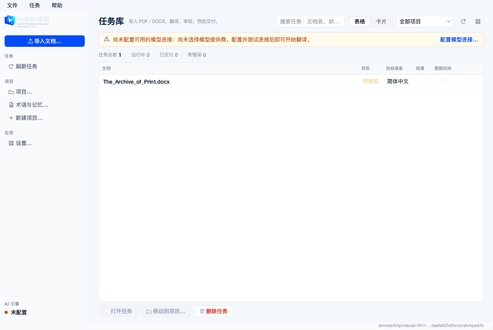 | 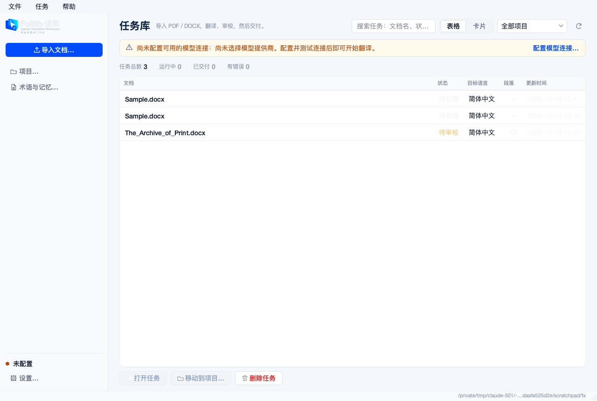 |
| 译前准备 | 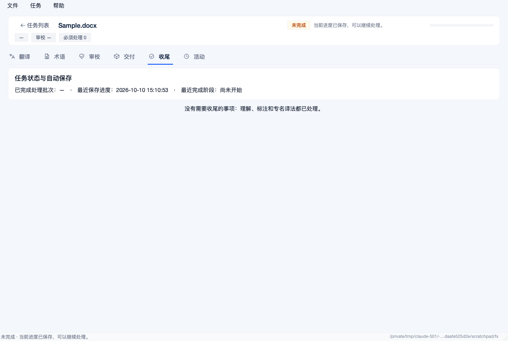 | 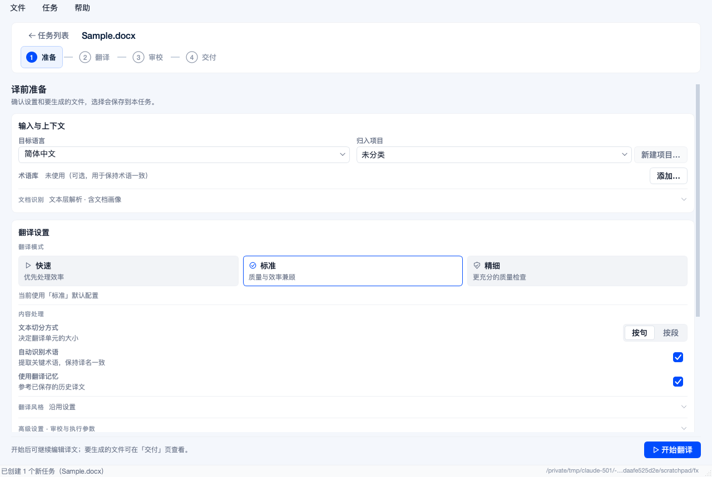 |
| 翻译 | 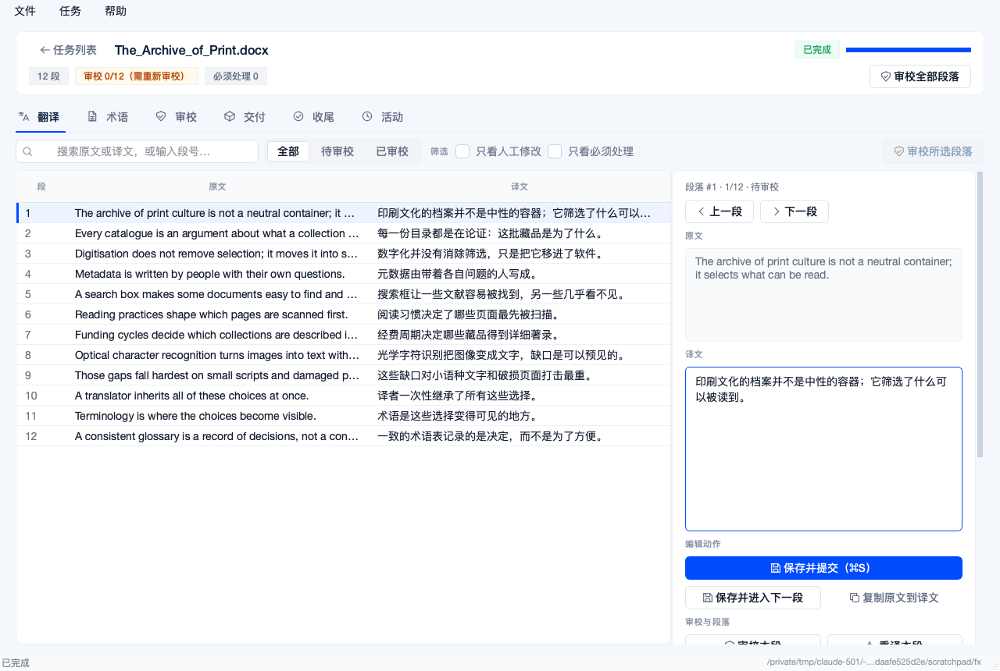 | 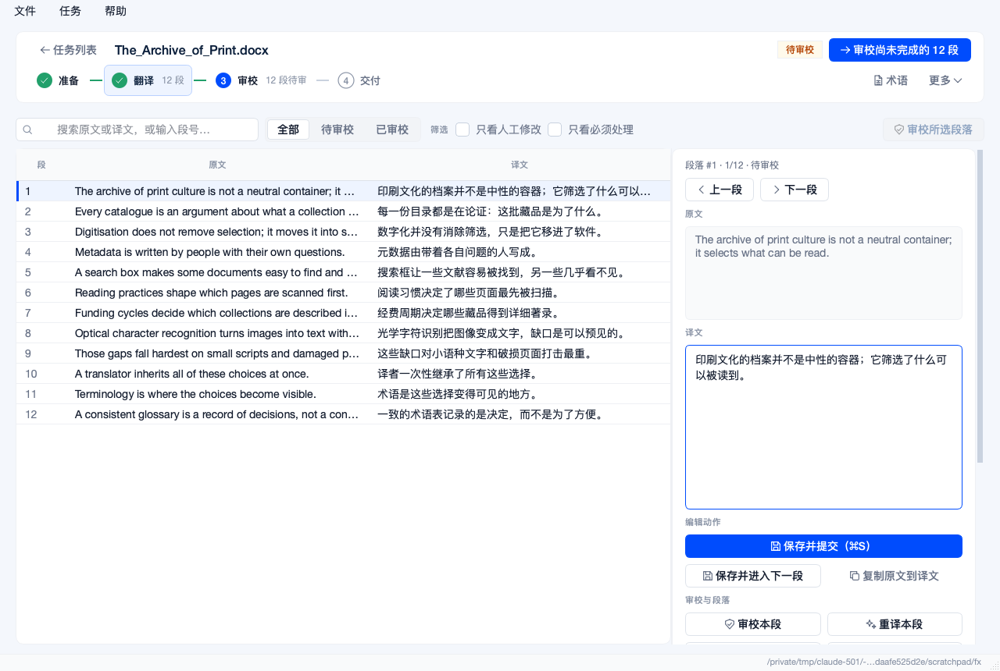 |
| 审校 | 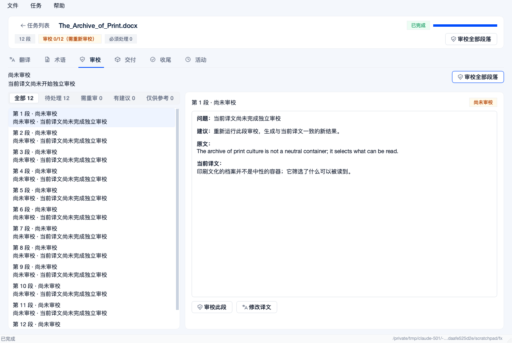 | 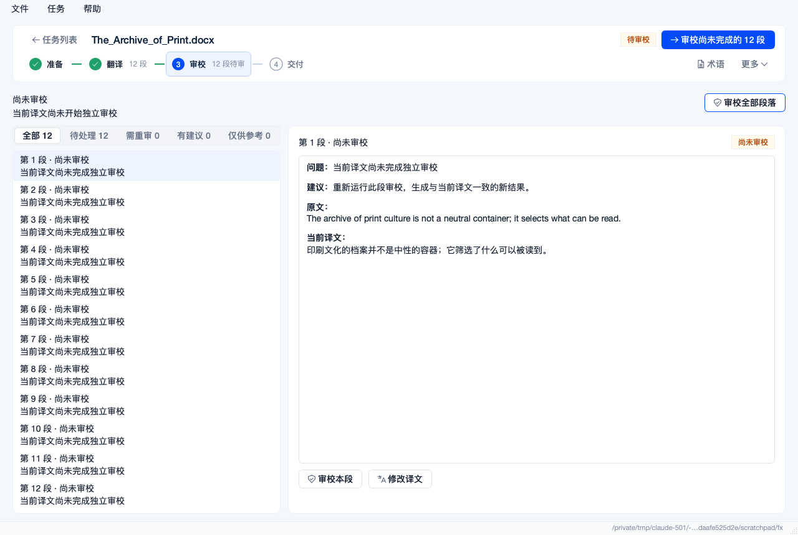 |
| 交付 | 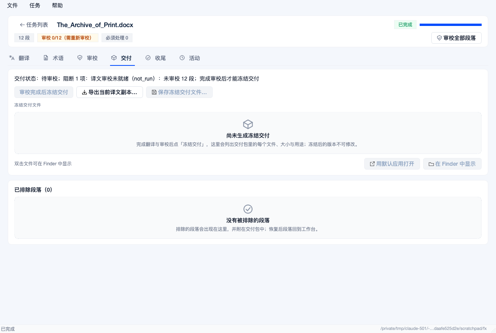 | 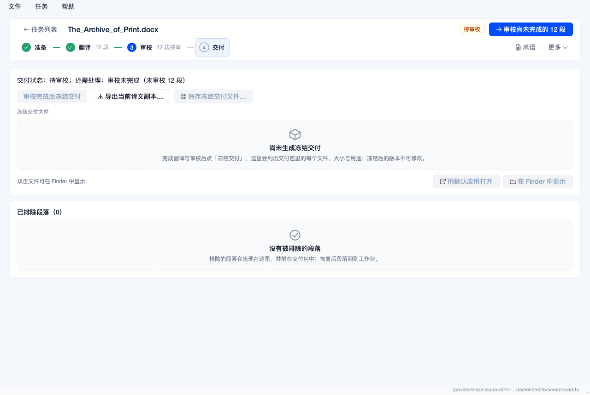 |
| 检查与修复（原"收尾"） | 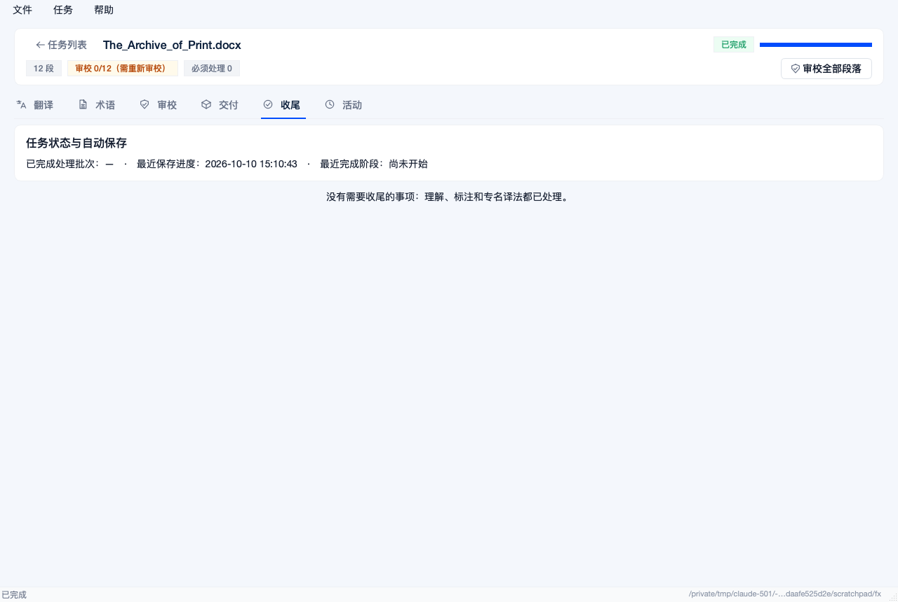 | 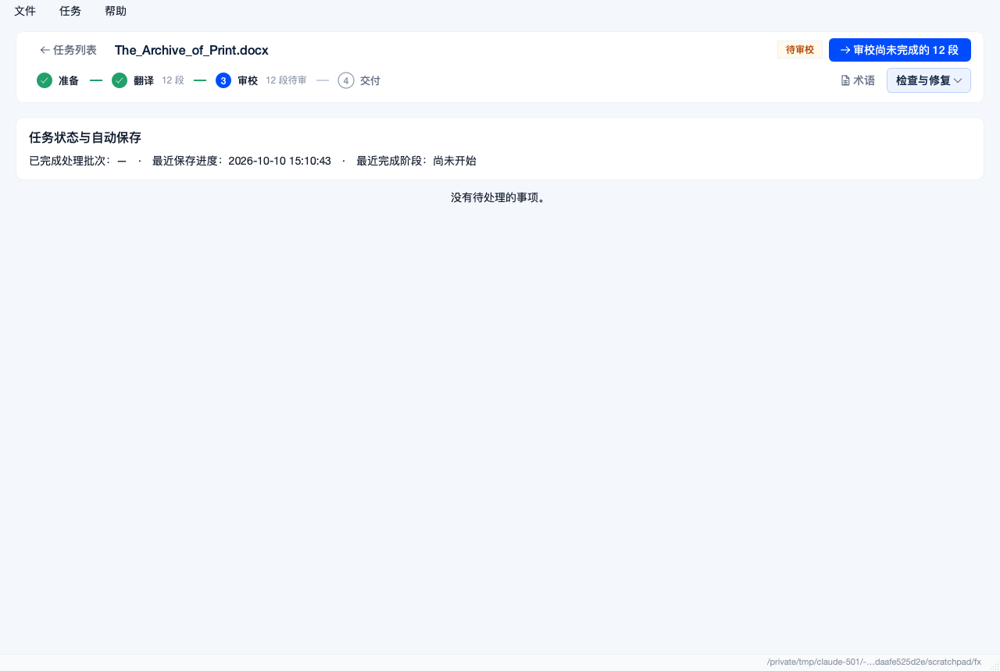 |
| 设置 | 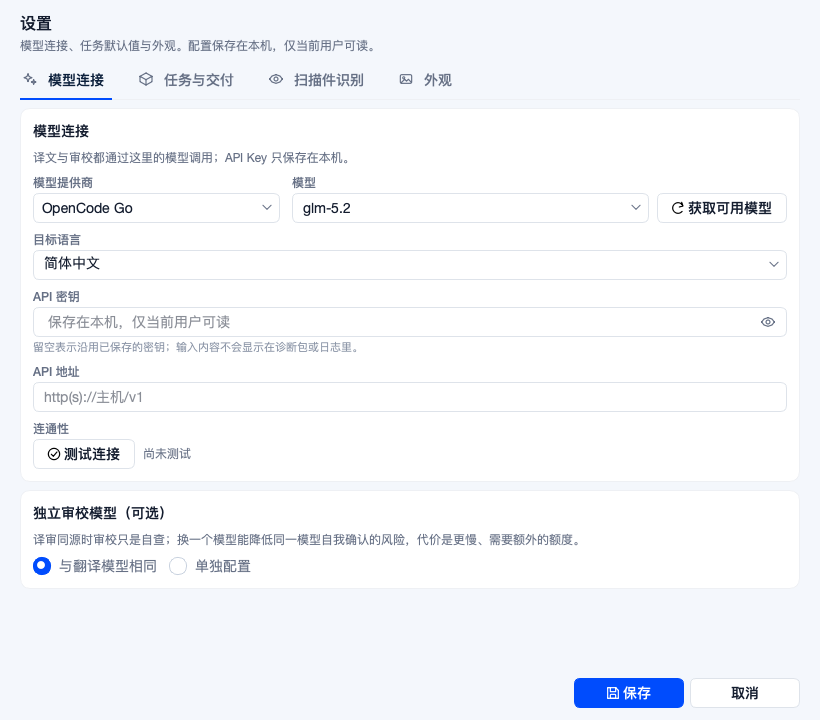 | 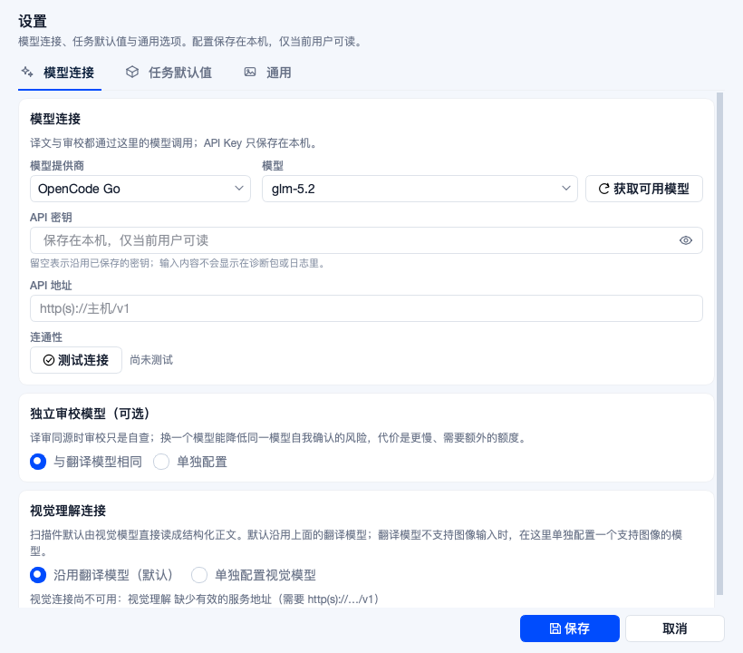 |

## 四、文案

只改中文原文；其余四种语言沿用旧译文（目录键随中文原文一起改名，值不动）。新增的字符串给了四种语言的译文。

- 去掉内部枚举：`译文审校未就绪（failed）：…；完成审校后才能冻结交付` → `审校未完成（审校失败 22 段）`
- 去掉重复：审校列表第二行不再重复标题里已有的状态词
- 统一动词：`新增术语` / `新建术语…` → `添加术语`；`审校此段` → `审校本段`；`重新翻译`（审校页）→ `重译本段`
- 页面名：`收尾` → `检查与修复`，`活动` / `任务活动` → `运行记录`，`任务与交付` → `任务默认值`
- 缩短：术语页提示、运行记录提示、项目对话框提示、译前准备副标题与脚注

## 五、行为变化（给测试与验收看）

- 工作台的 `tabs` 仍是页面容器，但标签栏隐藏；跳转一律走 `WorkbenchView.show_page(page_id)`。
- 换任务时总是回到翻译页，不再带着上一个任务停留的页。
- 首页 `refresh_button` / `project_button` / `setup_button` / `settings_icon_button`、窗口的 `create_project`
  已删除；工作台的 `chip_progress` / `chip_review` / `chip_blocking` / `review_all_button` 已删除
  （对应断言改为读步骤条：`workbench.stage_bar.steps[...]`）。
- 状态栏不再复述稳态（任务跑完后核心说"已完成"，而头部说"待审校"）；只在运行中/出问题时说话。

## 六、验证

```bash
venv/bin/python -m pytest tests/qt_stage_test.py tests/qt_followup_test.py tests/qt_client_window_test.py -q
```

`qt_acceptance_kit_test`（3 项）与 `qt_release_plumbing_test`（1 项）在改动前的 `HEAD` 上就失败：
构建产物（`dist/qt-desktop`）比源码旧，候选身份与 sha256 对不上。重建候选后重跑
`scripts/qt_acceptance_kit.py --write` 即可，与本次改动无关。

## 七、没有做的

- 术语与记忆页仍是整页切换（没有侧栏），与任务库的导航外壳不同。
- 审校页自己的标题块（"审校未完成 / 部分段落…"）和"审校全部段落"按钮与头部状态、推荐动作有部分重叠，这次没有动。
- `setup_panel.py` 里约 40 条上一轮新增的字符串在 en/es/ru/ar 目录里本来就缺（`scripts/qt_i18n_coverage.py` 可见），本次没有补。
