# Qt 客户端 · 整体设计审校

日期：2026-10-16 · 分支：`feat/0.6-native-workbench`（含未提交改动）· 离屏渲染 1280×820，浅色 + 深色

截图全部来自**合成夹具**（`User Manual.docx`，5 段，2 段已审校，模型未配置），由同目录的
`capture.py` 生成：

```bash
QT_QPA_PLATFORM=offscreen venv/bin/python docs/ui-audit/40-design-review-2026-10-16/capture.py /tmp/shots light
```

没覆盖到的：新手指南、浮窗类（任务详情、运行记录，离屏 `grab()` 截不到独立窗口）、纸面/翠绿主题、窄窗、
运行中的任务。

---

## 一、结论

单看每一块并不差：准备页的分组行、翻译网格、设置的顶部页签都已经有不错的完成度。**割裂感不来自某个
组件丑，而是来自三件事**：

1. **没有页面模板。** 7 个主要界面用了 6 种骨架，每页的宽度、标题层级、操作放在哪都不一样。
2. **组件变体失控。** 样式表里有 25 种 `QPushButton#…`、5 种 `QToolButton#…`、37 种 `QFrame#…`；
   圆角有 12/13/14 三档肉眼分不出来，又混着胶囊形和圆角矩形。每做一块新界面就长出一个新变体
   （`primaryAction` / `heroAction` / `panelPrimary` / `inspectorPrimary` 是同一个意思）。
3. **状态和操作在多处重复出现。** 同一条事实说三四遍，同一个动作放两三个按钮，读的人不知道该信哪一个、
   该点哪一个。

所以建议**不要再逐页修**，而是先收拢基础（第三节），再套到页面模板上（第四节），最后处理流程问题（第五节）。
逐页修只会继续加变体。

---

## 二、逐页问题

### 1. 任务库（首页）

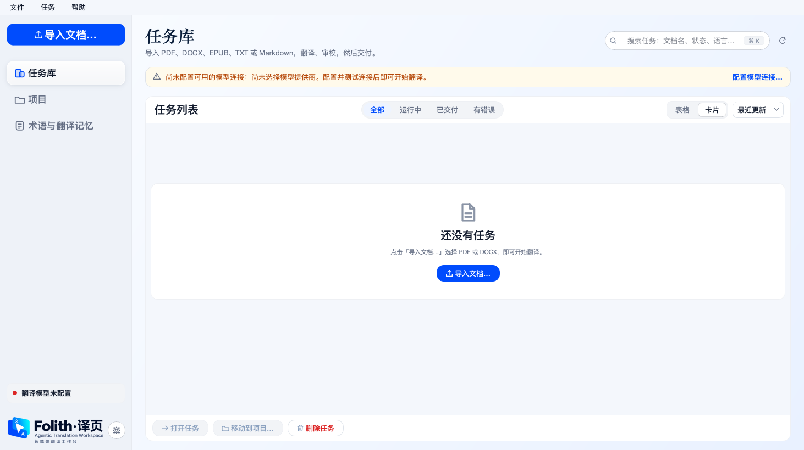
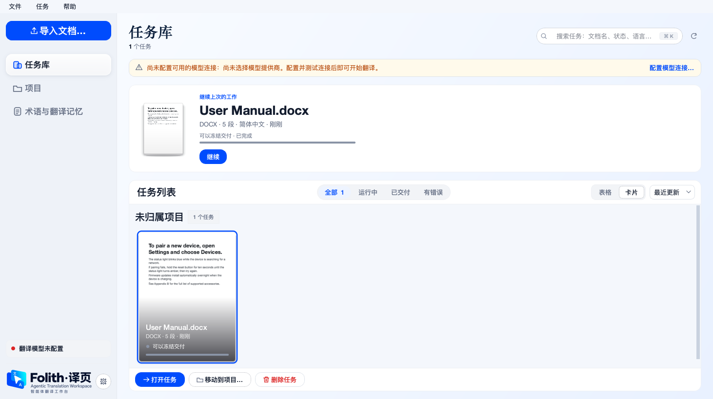

| # | 问题 | 级别 |
|---|---|---|
| 1.1 | **两个标题叠在一起**："任务库"（26px）下面紧跟一张卡片，卡片标题"任务列表"（20px），里面又有分组标题"未归属项目"（20px）。三层标题说的是一件事，后两个同号 | 高 |
| 1.2 | **"模型未配置"说了三遍**：顶部黄色横幅、侧栏底部红点"翻译模型未配置"、（进任务后）准备页底部橙字。横幅一条就够；侧栏状态在已配置时才有信息量 | 中 |
| 1.3 | **底部常驻操作栏**（打开任务 / 移动到项目… / 删除任务）是 Windows 早期的做法。空列表时三个按钮仍在，"删除任务"仍是红字。卡片视图里双击卡片就能打开，这一栏基本只为删除存在 | 高 |
| 1.4 | **导入按钮两个**：侧栏顶部的主按钮 + 空状态里的主按钮，同一屏两个蓝色主按钮 | 低（空状态可保留，但改成次级按钮） |
| 1.5 | **卡片套卡片**：空状态是一张卡，放在"任务列表"卡里；"继续上次的工作"卡下面的列表里又出现同一个任务 | 中 |
| 1.6 | 筛选芯片（全部/运行中/已交付/有错误）**居中漂在卡片标题栏里**，和左边标题、右边视图切换不对齐，看不出属于谁 | 中 |
| 1.7 | 任务卡片 200px 宽，1280 窗口里一行能放 5 张，但只有 1 个任务时左上角一张孤零零；浅色主题下卡片底部是深灰渐变，和整页的浅色玻璃语言不一致 | 低 |
| 1.8 | 状态文案"可以冻结交付 · 已完成"：两个状态并排，且"冻结"是内部术语 | 中 |

### 2. 准备页

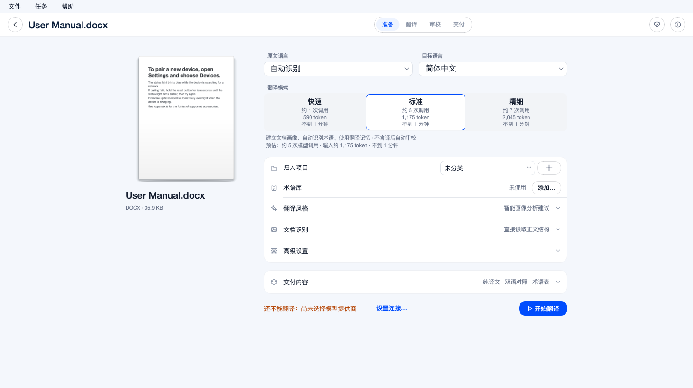

这是全应用**最好的一页**：左预览右设置，设置用分组行（图标 + 名称 + 右侧值 + 折叠箭头），接近 macOS 系统设置。
建议把它当作表单的标准（见第三节）。仍有的问题：

| # | 问题 | 级别 |
|---|---|---|
| 2.1 | **"还不能翻译"时"开始翻译"仍是可点的蓝色主按钮**。应当禁用，或者把主按钮换成"设置连接…" | 高 |
| 2.2 | 三张模式卡每张 3 行小字数字，下面又写一遍"预估：约 5 次模型调用 · 输入约 1,175 token · 不到 1 分钟"——同一组数字出现两次 | 中 |
| 2.3 | 分组行右侧的控件不统一：下拉框 + "+"按钮、文字 + "添加…"胶囊按钮、文字 + 折叠箭头、只有箭头。四种右侧形态 | 中 |
| 2.4 | 文件名出现两次（标题栏 + 预览图下方） | 低 |
| 2.5 | 头部右侧两个圆形图标按钮（盾牌、i）没有文字，在准备阶段也没有可看的内容 | 低 |
| 2.6 | 导入后的 Toast 盖在头部正中，**正好挡住阶段步骤条和语言选择**，切页后仍留在原处 | 中 |

### 3. 翻译页（工作台核心）

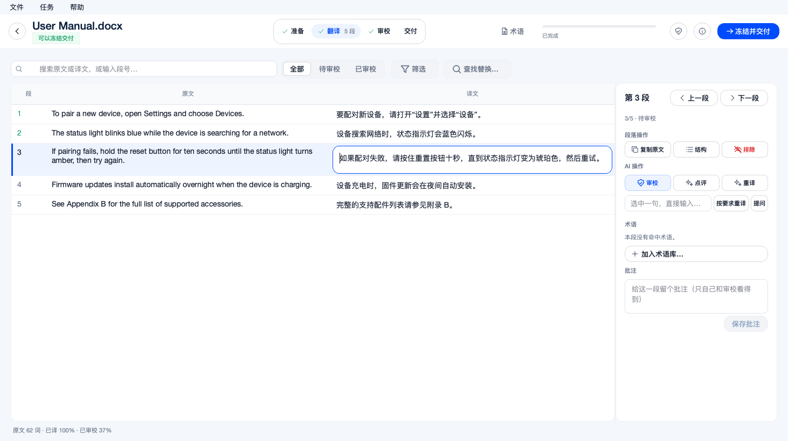

| # | 问题 | 级别 |
|---|---|---|
| 3.1 | **头部进度条显示"已完成"但条是空的**（`views.py` 约 4425 行：不在运行且没有阶段进度时 `setValue(0)`）。任务结束后这一条应当整个隐藏——步骤条已经说了完成 | 高 |
| 3.2 | **头部挤了 7 样东西**：返回、标题 + 状态芯片、步骤条、"术语"、进度条、两个图标按钮、主按钮。"术语"夹在步骤条和进度条之间，看起来像第五个阶段又不是 | 中 |
| 3.3 | 检查器（右栏）字号 11px 加粗，3×3 按钮网格；"按要求重译""提问"被挤成两个窄按钮；"审校"按钮用了选中态的蓝底，看起来像开关已打开 | 高 |
| 3.4 | 工具条三种按钮皮肤：分段控件（全部/待审校/已审校）、灰底胶囊（筛选）、灰底胶囊带图标（查找替换…） | 中 |
| 3.5 | 段号列约 70px 宽，只放 1 位数字；段落状态只靠段号的绿色表达，色盲用户分不出 | 中 |
| 3.6 | 页面底部状态文字"原文 62 词 · 已译 100% · 已审校 37%"，和头部芯片、步骤条"5 段"是第三处进度 | 低 |

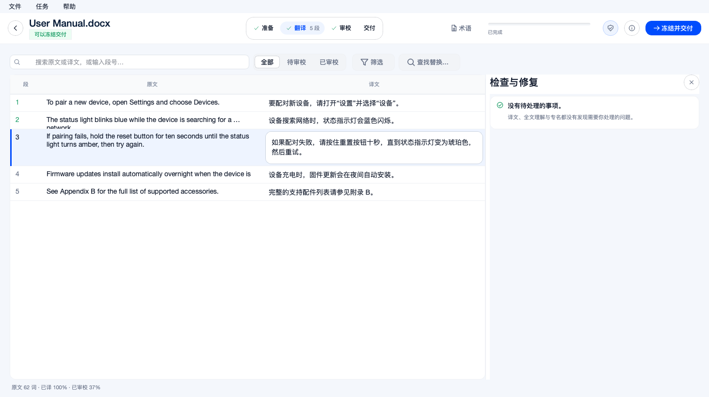

| # | 问题 | 级别 |
|---|---|---|
| 3.7 | ~~打开"检查与修复"抽屉后网格行高不重算~~ **复核后不成立**：截图恰好落在列宽变化后、行高重算前的一瞬。行高在 120 ms 防抖后重算（`_height_resize`，为长书保留），150 ms 内全部恢复。动画期间会有一两帧裁切，属可接受的过渡 | — |
| 3.8 | 抽屉直接替换掉检查器，宽度也不同（抽屉 ~440，检查器 ~300）；右栏是"一个位置两种宽度"，切换时整个网格跳动 | 中 |

### 4. 审校页

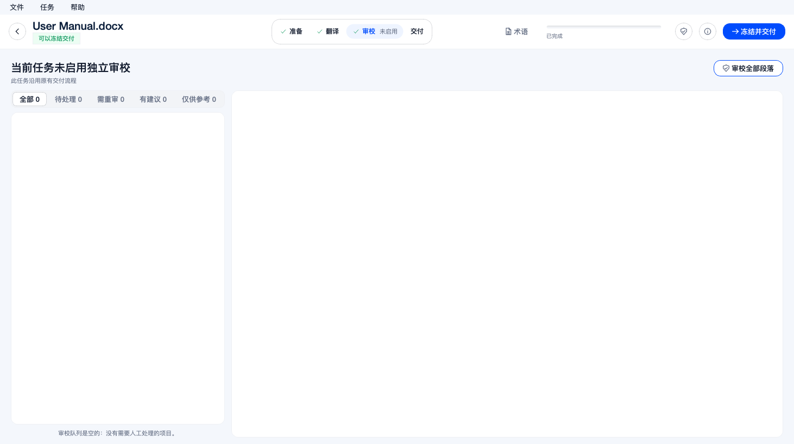

| # | 问题 | 级别 |
|---|---|---|
| 4.1 | **未启用审校时仍然画出完整的双栏结构**：五个 0 计数的筛选芯片、一个空列表、一个占 2/3 宽的空白面板。应当是一个居中空状态 + 一个按钮 | 高 |
| 4.2 | 步骤条上"审校 · 未启用"前面打着 ✓——"完成"和"未启用"同时成立 | 高 |
| 4.3 | 页内"审校全部段落"（描边按钮）与头部"冻结并交付"（主按钮）同时出现，下一步是哪个不明确 | 中 |

### 5. 交付页

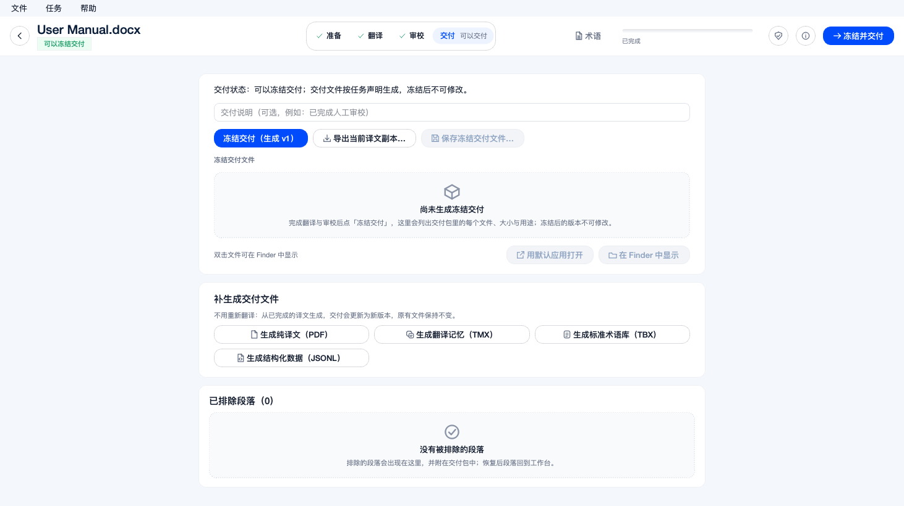

| # | 问题 | 级别 |
|---|---|---|
| 5.1 | **两个主按钮做同一件事**：头部"冻结并交付"、页内"冻结交付（生成 v1）" | 高 |
| 5.2 | 内容是居中 820px 的一列卡片；翻译页、术语页是通栏；准备页是居中两栏。同一个工作台里三种页面宽度 | 中 |
| 5.3 | 还没生成时，"保存冻结交付文件…""用默认应用打开""在 Finder 中显示"三个禁用按钮已经摆出来 | 中 |
| 5.4 | 虚线空状态框放在卡片里（卡套卡）；"补生成交付文件"四个按钮 3 列排、第 4 个孤行 | 低 |
| 5.5 | "冻结""补生成""交付状态：可以冻结交付；交付文件按任务声明生成"——一页里内部术语最密 | 中 |

### 6. 术语（任务内）与 术语与翻译记忆（全局）

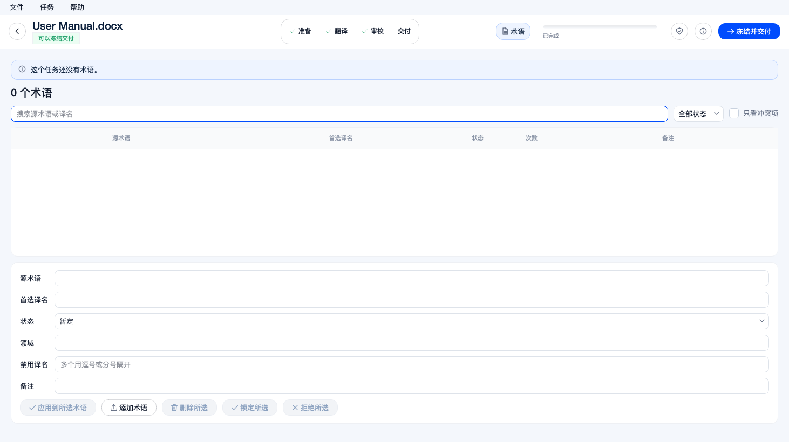
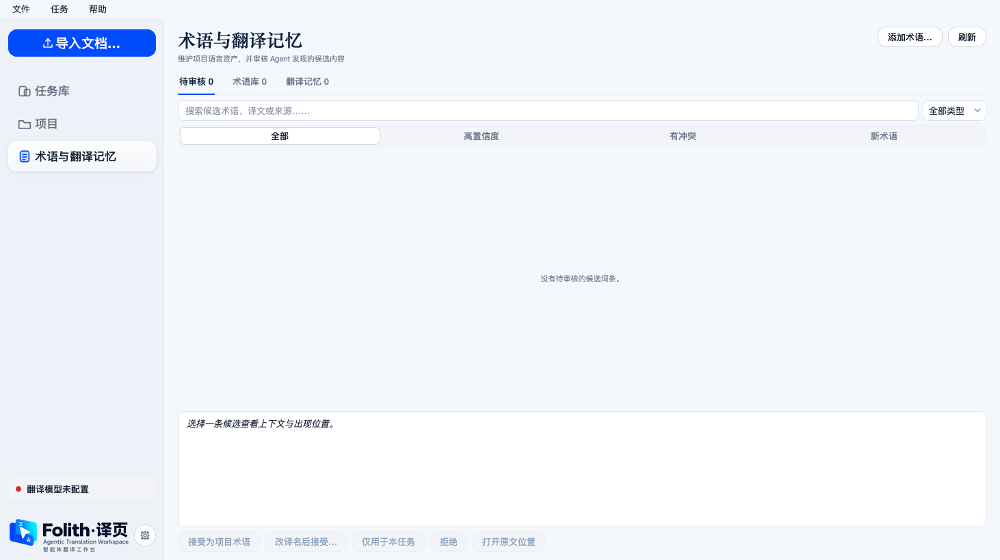

| # | 问题 | 级别 |
|---|---|---|
| 6.1 | **同一类内容两套完全不同的界面**：任务内是"表格 + 常驻 6 字段表单 + 5 个按钮"；全局是"下划线页签 + 等分分段控件 + 下拉 + 表格 + 详情框 + 底部 5 个按钮" | 高 |
| 6.2 | 任务内术语为 0 时：蓝色提示条"还没有术语" + 标题"0 个术语" + 空表格 + 完整新建表单 + 4 个禁用按钮，同一个"空"说了四遍 | 高 |
| 6.3 | 全局页一个筛选维度用了三种控件：页签（待审核/术语库/翻译记忆）、通栏分段（全部/高置信度/有冲突/新术语）、下拉（全部类型） | 中 |
| 6.4 | 表头文字居中，单元格内容左对齐 | 低 |
| 6.5 | 详情区占位文字用斜体（中文斜体是机器倾斜，难看），整页其他地方没有斜体 | 低 |

### 7. 设置

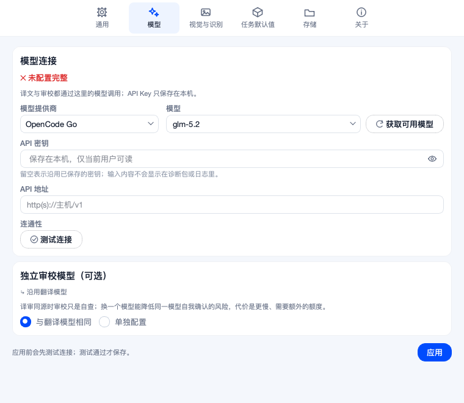
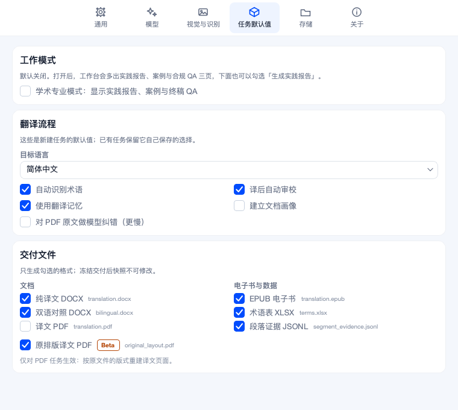

| # | 问题 | 级别 |
|---|---|---|
| 7.1 | 顶部图标页签是 macOS 形态，**内容却是网页表单**（标签在上、控件通栏、白卡分组）；准备页已经是"左标签右控件"的分组行，两处设置长得不像一个应用 | 高 |
| 7.2 | **生效方式不一致**：通用页即改即生效，模型页要点"应用" | 中 |
| 7.3 | "任务默认值"里"译后自动审校"默认勾选，而准备页"标准"模式写着"不含译后自动审校"——同一开关两个入口、两个答案（与 acceptance-feedback P0 的预设失效是同一个根因） | 高 |
| 7.4 | "未配置完整"用红色 ✕；"↳ 沿用翻译模型"用了制表符号 | 低 |

### 8. 深色主题

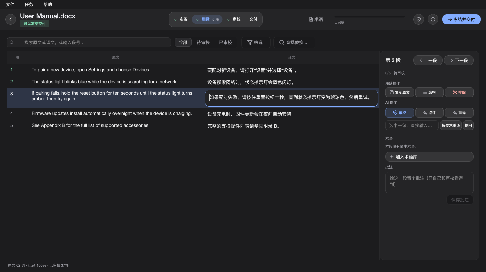

| # | 问题 | 级别 |
|---|---|---|
| 8.1 | 浅色下段落网格是白卡，深色下网格**没有卡面**直接贴背景，而右侧检查器有卡面——同一屏两种表面 | 中 |
| 8.2 | 模式卡、分段控件的轨道底色在深色下几乎不可见，未选中的两张模式卡看不出边界 | 中 |

---

## 三、基础层：先收拢，再画页面

现有 token（`folith/qt/theme.py`）本身是有的，问题是档位太多、太近，样式表又在 token 之上再长变体。

| 维度 | 现状 | 建议 |
|---|---|---|
| 字号 | 12 档（10/11/11/12/13/14/15/17/20/26/30/30），`caption` 与 `label` 同号，`display` 与 `metric` 同号 | **7 档**：11 说明 · 12 标签 · 13 正文/控件 · 14 阅读区 · 17 卡片/面板标题 · 22 页面标题 · 28 展示（只首页空状态用）。层级靠字重和颜色补 |
| 圆角 | `md 12 / control 13 / lg 14` + 胶囊 + QSS 里 2/4/7/8/9/13/14/16 的字面量 | **3 档**：6（小控件、芯片内元素）· 10（按钮、输入框、卡片、面板）· 胶囊（只给分段控件、筛选芯片、状态芯片）。按钮全部用 10，不再混胶囊 |
| 按钮 | 25 + 5 个变体 | **4 种 × 2 尺寸**：主要 / 次要（描边）/ 朴素（无框）/ 危险；常规 30 / 小 26。`inspectorPrimary`、`panelPrimary`、`heroAction` 等全部映射到这 4 种；每屏最多 1 个主要按钮 |
| 表面 | 37 个 `QFrame#…` | **3 种**：窗口底 · 分组面（准备页那种白色圆角组，内部用发丝线分行）· 浮层（Popover/Toast/菜单）。"卡里不再放卡"：空状态、虚线框直接放在分组面里或替代分组面 |
| 表单 | 3 种写法（准备页分组行 / 设置页上下堆叠 / 术语页左标签） | **统一为准备页的分组行**：左边标签（可带图标），右边值或控件，长内容向下展开。设置、术语编辑、交付选项都用它 |
| 间距 | 16 种字面量 `setContentsMargins`，`setSpacing` 里有 1/2/3/6/10 | 只用 `SPACE` 阶梯；页面外边距统一 24，分组面内边距 16，行高 44 |

落地方式：在 `components.py` 里给按钮做一个 `button(kind, size)` 工厂、给分组面做一个 `FormGroup`/`FormRow`，然后逐个把旧 objectName 迁过去，迁完一个删一条 QSS。可以加一个测试：`style.py` 里 `QPushButton#` 选择器的数量只减不增。

---

## 四、页面模板：6 种骨架收成 3 种

| 模板 | 用于 | 结构 |
|---|---|---|
| **A. 列表页** | 任务库、项目、术语与翻译记忆 | 侧栏 + 页面标题（22px，一行）+ 右上角搜索与唯一主按钮 → 工具条（左：筛选；右：视图、排序）→ 内容。**选中后的操作放在行内悬停按钮和右键菜单里**，不要常驻底部操作栏；批量操作在多选时才出现 |
| **B. 工作区页** | 翻译、审校、术语（任务内） | 统一工具栏（固定）→ 通栏内容 + **一个固定宽度 320 的右栏**。检查器、检查与修复、术语详情都在这一个右栏里切换，宽度不变，网格不跳 |
| **C. 文档列页** | 准备、交付、设置各页 | 居中 720px 单列，分组面 + 分组行；页底一个主按钮。准备页左侧预览可保留为这一模板的变体 |

工作台头部同时减负：

- 留：返回、文件名、步骤条（居中）、**一个**随阶段变化的主按钮。
- 移走：状态芯片（步骤条已经表达）、运行结束后的进度条（只在运行时出现，且出现在步骤条下方而不是挤在右边）、"术语"（并入步骤条右侧的"更多"或做成第 B 模板里的右栏页签）、两个图标按钮（合进"更多"菜单）。

---

## 五、流程与文案

1. **一件事只在一处说。** 状态的唯一出处已经有了（`stage.py` 的 `stage_view()`），但头部芯片、进度条文字、页面底部统计、首页卡片文案还在各自拼。规则：步骤条说阶段状态，主按钮说下一步，其余地方不再复述。
2. **每屏一个主按钮。** 交付页去掉页内"冻结交付"，或者头部在交付页时隐藏主按钮；审校页"审校全部段落"做成头部主按钮在审校阶段的形态，而不是页内第二个。
3. **空状态替换结构，而不是填在结构里。** 审校未启用、术语为 0、语言资产为空、任务库为空：显示一个居中的说明 + 一个按钮，不画表格、筛选、表单和禁用按钮。
4. **隐藏优于禁用。** 前置条件不满足就看不到的操作（打开/在 Finder 中显示还没生成的文件），隐藏；只有"做不了但用户会找它"的操作才禁用，并在旁边说原因（如"开始翻译"）。
5. **内部术语换成用户语言。** "冻结交付" → "生成交付版本"；"可以冻结交付" → "可以交付"；"补生成交付文件" → "生成其他格式"；"沿用原有交付流程"、"画像"等也需要一轮清理。这和 39 号审校"术语改中文、其他语言保留旧译"的约定一致：改的是 catalog 的键，五份 `qt-*.json` 一起改。

---

## 六、建议的工作顺序

| 顺序 | 内容 | 为什么先做 | 规模 |
|---|---|---|---|
| P0 ✅ | 3.1 空进度条、4.2 ✓+未启用、2.1 不能翻译时主按钮仍可点、5.1 重复主按钮（3.7 复核后不成立）。见下方"P0 处理记录" | 都是"界面在说错话"，每个改动小 | 小 |
| P1 ✅ | 第三节基础收拢：字号 7 档、圆角 3 档、按钮 4 种、`FormRow`。见下方"P1 处理记录" | 后面所有页面都依赖它；不先做，改页面只会再加变体 | 中 |
| P2 ✅ | 工作台头部减负 + 右栏固定宽度（模板 B）。见下方"P2 处理记录" | 用户停留最久的地方 | 中 |
| P3 ✅ | 空状态统一（审校、术语、语言资产、任务库）。见下方"P3 处理记录" | 第一次使用时看到的都是空状态 | 小 |
| P4 | 设置与术语编辑改用分组行（模板 C）；任务内术语与全局术语页统一 | 结构改动，依赖 P1 | 中 |
| P5 | 首页：去掉常驻底部操作栏，改行内操作与右键菜单；标题层级合并 | 依赖 P1 | 中 |
| P6 | 文案一轮（冻结等内部术语） | 改 catalog 键，五个语言文件，最好单独一个改动 | 小 |
| P7 | 深色主题表面与轨道对比度 | 等表面收成 3 种后一次性校 | 小 |

和已有待办的关系：7.3 与 `docs/qt-beta/acceptance-feedback-2026-10-14.md` 的 P0（预设开关不生效）同根；
`docs/open-claude-ui-learnings.md` 里"卡片里不放带框按钮"、"分段控件滑块"可以直接并入 P1。

---

## 七、P0 处理记录（2026-10-16）

| # | 改法 | 位置 |
|---|---|---|
| 3.1 | 运行结束（tone = `done`）时进度条和百分比一起收起，只留"已完成 · N 分钟"一行，仍可点开运行记录 | `views.py` `_render_runtime` |
| 4.2 | 新增步骤状态 `skipped`：没启用独立审校时审校步显示灰色"审校 · 未启用"、不打勾；照样放行交付，连线照样算通 | `stage.py`、`stagebar.py` |
| 2.1 | 模型连接有问题时「开始翻译」禁用，提示里写原因；旁边的"设置连接…"是唯一可点的去处 | `setup_panel.py` `set_connection_problem` |
| 5.1 | 头部"下一步"主按钮在交付页、且下一步就是交付时收起，交付页只剩页内的「冻结交付」 | `views.py` `_sync_stage_action` |

测试：`tests/qt_design_review_p0_test.py`（3 条，窗口级）、`tests/qt_stage_test.py`、`tests/qt_project_memory_test.py`；
`tests/qt_client_window_test.py` 里两条原本断言审校步为 `done` 的用例改为 `skipped`。


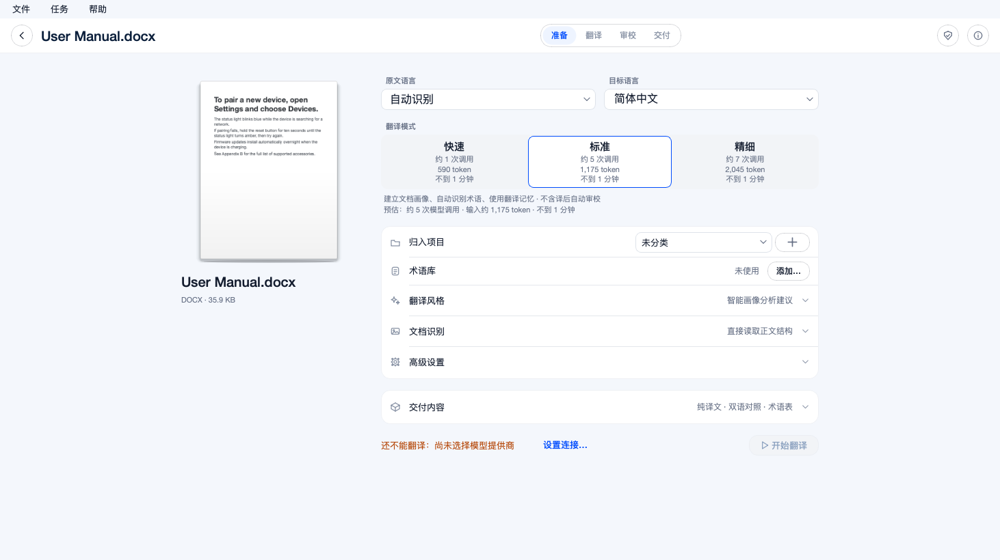

---

## 八、P1 处理记录（2026-10-16）

| 维度 | 之前 | 之后 | 位置 |
|---|---|---|---|
| 字号 | 12 个键、10 种值，QSS 里还有 `±1` 的算术 | `FONT_STEPS = (11, 12, 13, 14, 17, 22, 28)`；键保留为用途名，值只能取这 7 档；算术全部改成最近的一档 | `theme.py`、`style.py`、`stagebar.py` |
| 圆角 | `xs/sm/md/lg/control` 五个键 + `±1/±2` 算术 | `RADIUS = {sm: 6, md: 10, pill}`：嵌套小元素 6，控件与面 10，胶囊只给芯片/进度/搜索框（写半高） | `theme.py`、`style.py`、`dialogs.py`、`components.py` |
| 动作按钮 | 14 个按位置起名的变体（`primaryAction` `heroAction` `panelPrimary` `inspectorPrimary` `ghostAction` `linkAction` `dangerPrimary` `rowAction`…） | `style.set_button(button, kind, small=)`：primary / secondary / plain / danger × 常规 30 / 紧凑 26；46 处调用迁移，87 行旧 QSS 删除 | `style.py` 及 14 个界面模块 |
| 表单 | `SettingsGroup` / `_icon_row` 只在准备页里 | `components.FormGroup` / `FormRow`（图标可选、可带一行说明、行高 44），准备页改用它们；P4 的设置与术语编辑直接用 | `components.py`、`setup_panel.py` |

几处有意的取舍：

- 侧栏「导入文档…」不再是 40px 的特大按钮，和其他主按钮一样高。"唯一的主行动"靠位置与颜色表达，不靠尺寸。
- 破坏性确认（如删除任务）从实心红改为红字描边，与 macOS 的破坏性按钮一致；默认焦点在"取消"（P0 已修），所以不靠颜色防误按。
- 检查器的「审校」从浅蓝"像已按下"改为普通紧凑按钮，图标保留强调色以示它是本段主操作；一屏唯一的实心主按钮在头部。
- 链接按钮并入 plain：有了常规内边距，悬停有底色，不再是下划线文字。
- 非动作按钮的对象名保留：导航项、分段、卡片、折叠头、图标按钮、筛选芯片都是另一种控件。

守护测试：`tests/qt_design_tokens_test.py`：样式表里的字号只能取 7 档、圆角只能取 3 档或胶囊半高、`QPushButton#` 只能是上面那几种非动作控件，Python 里不能再出现旧按钮名。


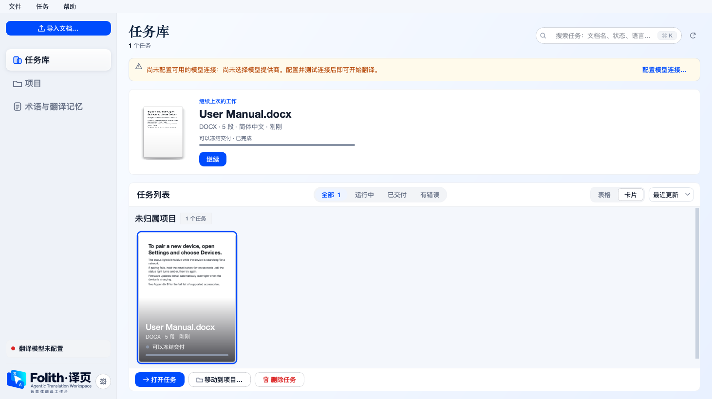

---

## 九、P2 处理记录（2026-10-16）

头部从 9 样东西减到 4 样：**返回 · 文件名 · 步骤条与「更多」· 一个主按钮**。

| 之前 | 之后 |
|---|---|
| 文件名下的状态芯片（"可以冻结交付"） | 去掉。任务状态由步骤条说，下一步由主按钮说 |
| 运行状态组（进度条 + "已完成"）常驻 | 只在有话说时出现：运行中、等模型、重试、停滞、失败、暂停，或一次操作的结果提示。跑完/空闲时收起 |
| 步骤条右边的「术语」按钮 | 进「更多」，是菜单里的第一页；在术语页时「更多」写成"术语"并亮起 |
| 「检查与修复」盾牌图标常驻 | 平时在「更多」里（有待处理时写成"检查与修复 · N 项待处理"）；有待处理项或抽屉开着时，头部才出现这枚带角标的提醒图标 |
| 「任务详情」ⓘ 图标 | 进「更多」，浮窗锚在「更多」下面 |
| — | 「更多」菜单分两段：页面（术语、学术模式的报告/案例/合规，可勾选）· 分隔线 · 面板（检查与修复、运行记录、任务详情，不勾选） |

右栏（模板 B）：检查器与检查与修复**共用一个宽度**（默认 320，原来检查器 300、抽屉 360–440）。打开抽屉时网格列宽不变、不重排；拖动分割条改的是这一个宽度，双击恢复 320。保留了拖动（上一轮专门做的分割条手感），只是不再有"两种宽度"。

与审校文档第四节的差异：

- 文档建议运行中的进度条放到步骤条**下方**。这一轮仍放在右侧原位：只在运行时出现以后，头部平时已经足够空；挪到下方要改头部高度，等运行中的界面一起看。
- 文档建议两枚图标都进「更多」。「检查与修复」保留为**条件出现的提醒**：它带角标，是"有事要处理"的信号，完全藏进菜单会丢掉它。
- 已知小问题：提醒图标出现/消失时，居中的步骤条会左右移 20px 左右。

测试：`tests/qt_design_review_p0_test.py`（新增头部与右栏两条）、`tests/qt_stage_test.py`（「更多」菜单的两段结构）。

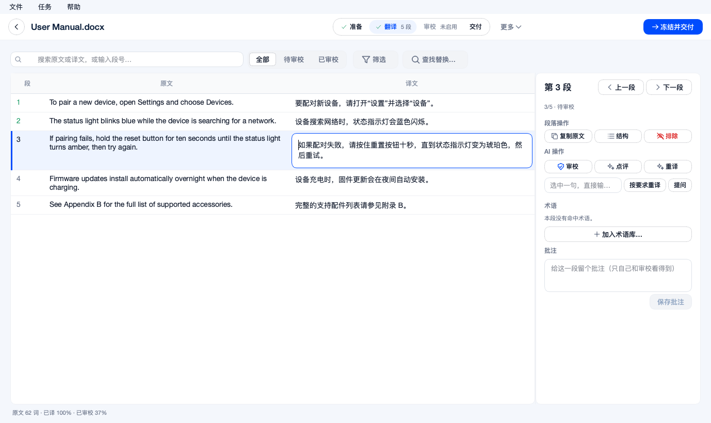
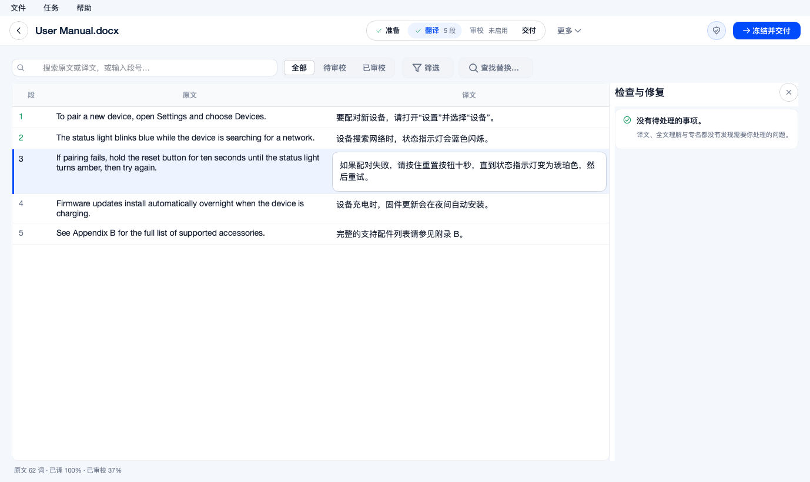

---

## 十、P3 处理记录（2026-10-16）

`style.EmptyState` 增加 `page=True`（直接放在页面底色上，不是虚线卡）和唯一的 `action`。四处"空"改为**替换结构**：

| 位置 | 之前 | 之后 |
|---|---|---|
| 审校页（未启用 / 队列为空） | 标题 + 五个 0 计数的筛选 + 空列表 + 2/3 宽的空白详情 | 一个空状态：审校就绪的标题与说明 + 「审校全部段落」；审校已完成时不给按钮 |
| 任务内术语（0 条） | 提示条 + "0 个术语" + 空表格 + 6 字段表单 + 4 个禁用按钮 | 一个空状态 +「添加术语…」；点了以后只露出新建表单，表格与筛选在有第一条术语后出现 |
| 术语与翻译记忆（每个页签） | 搜索 + 分段筛选 + 空表格 + 斜体占位详情 + 禁用的动作栏 | 每个页签整个为空时一个空状态（术语库带「添加术语…」）；翻译记忆保留项目选择，好切换项目 |
| 任务库（0 个任务） | 「任务列表」卡（筛选、视图、排序、底部三个禁用按钮）里套一张空状态卡 | 整张列表卡让位给页面上的空状态；按钮是次级的，主行动仍是侧栏的「导入文档…」 |

"这个筛选下没有"仍然保留结构，只在列表位置说一句（任务库的筛选空态也改成了"这个筛选下没有任务"，原来错写成"还没有任务"）。

**隐藏优于禁用**一起落在这几页：任务库的打开/移动/删除、术语页的应用/删除/锁定/拒绝、语言资产的接受/拒绝/跳转/编辑/删除，没选中就不出现；候选详情的占位文字不再用斜体。

测试：`tests/qt_empty_states_test.py`；`tests/qt_library_test.py` 里四处"禁用"断言改为"隐藏"。

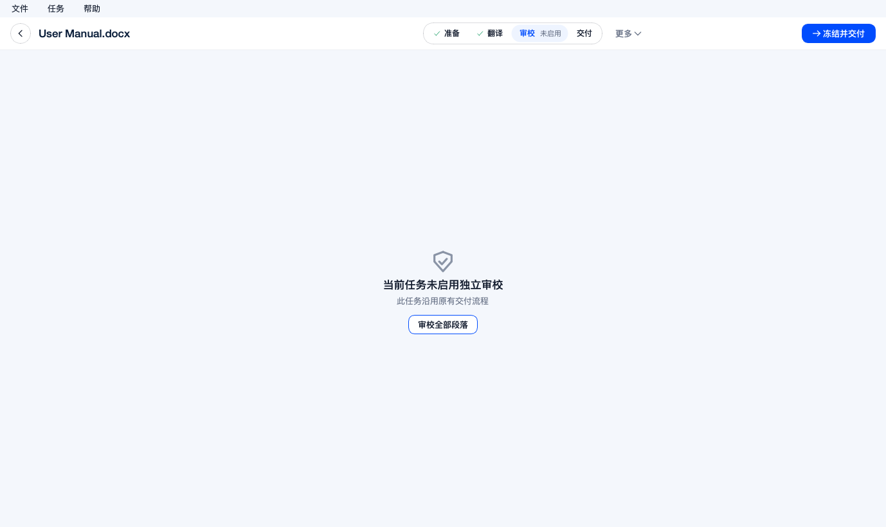
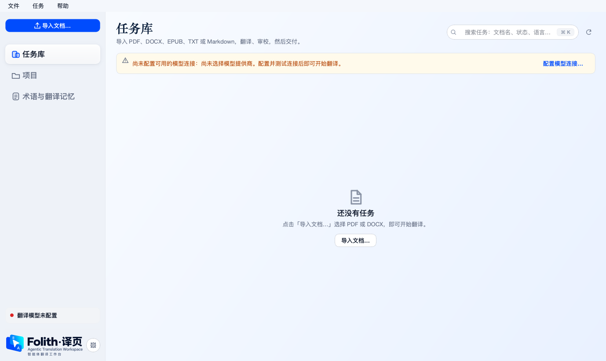

---

## 十一、色彩（2026-10-16 补审）

第一轮审校只看了结构和组件，**没有审颜色**——这是遗漏。用户的反馈是"颜色有点扎眼、整页不协调"。
量化工具：同目录 `colour_audit.py`（token 的 OKLCH 取值、对比度、每屏饱和色面积）。

### 先说结论

饱和色的**面积**其实很小：任何一屏都不到 1.5%。扎眼不是因为颜色多，而是因为**每一处颜色都太响**，
而且几种颜色来自不同体系、响度不一致；同时灰色文字又偏淡。"太响的点 + 发虚的面"放在一起，就是不协调。

### 问题

| # | 问题 | 证据 |
|---|---|---|
| C1 | **主色是 logo 的钴蓝，饱和度接近屏幕极限** | `accent = #004CFD`，OKLCH 彩度 C = 0.267，是成功绿（0.133）的两倍。按钮、链接、选中描边、筛选文字、焦点环都用它，小面积也会"发颤"。`docs/brand.md` 自己写着"品牌蓝只属于 logo"，纸面与夜间主题都遵守了，**只有日间主题把 logo 色直接当界面色** |
| C2 | **语义色不是一套** | 成功 `#22A06B`（L .63 / C .13）、警告 `#B54708`（L .54 / C .16）、危险 `#DC2626`（L .58 / C .22）、信息紫 `#6F4BDC`（L .54 / C .21）：明度差 0.09、彩度差 0.09。红和紫跟主色一样响，绿反而弱；紫色是第五个色相，界面里几乎没有它的必要 |
| C3 | **冷暖对撞** | 页面底是偏蓝的 `#F4F7FC`，首页还有一层渐变到 `#E9F1FF` 的蓝雾；正上方是一条暖黄底（`#FFFAEB`）橙棕字的警告横幅，右端再接一个蓝色链接。蓝与黄是互补色，这是首页最刺眼的一处 |
| C4 | **任务卡封面的黑色磨砂** | `CoverArt` 的底部遮罩是写死的近黑（`QColor(0,0,8)`），所有主题都一样。浅色主题下、白色文档上，它是一块发灰发脏的深色带，是浅色首页上面积最大的深色 |
| C5 | **灰字太淡** | `text-muted #8A94A6` 在页面底上只有 2.85:1（正文要求 4.5:1）；说明、时间、元信息大量用它。字发虚，衬得彩色更跳 |
| C6 | **主色出现的地方太多** | 首页一屏有 8 处蓝：导入按钮、导航当前项图标、"继续上次的工作"小标题、继续按钮、筛选"全部 1"、卡片选中描边、打开任务按钮、"配置模型连接…"链接。蓝色应该只说"这是主行动 / 这是当前选中"，现在它在装饰 |

### 建议的日间色板（已在真实界面上渲染对比）

把界面色和 logo 色分开：logo 保持 `#004CFD` 不动，界面主色取**同一色相、降低彩度**；语义色统一到同一明度、相近彩度；中性色去掉蓝雾。

| token | 现在 | 建议 | 说明 |
|---|---|---|---|
| `accent` / `hero` | `#004CFD` | `#2B5FD1` | 同色相 263°，彩度 0.267 → 0.185；白底对比 5.7:1 |
| `accent-hover` / `-active` | `#003FD6` / `#0034B0` | `#2352B8` / `#1D469D` | |
| `accent-soft` / `bg-selected` | `#EEF4FF` | `#EEF4FD` | |
| `accent-border` | `#B9D1FF` | `#C0D2F3` | |
| `success` | `#22A06B` | `#25855B` | 四个语义色统一到 L 0.55 |
| `warning` | `#B54708` | `#9D621E` | 琥珀棕，不再是橙 |
| `danger` | `#DC2626` | `#BD423A` | 砖红，仍然一眼是"危险" |
| `info` | `#6F4BDC` | `#7761B0` | 降彩度；更好的做法是不再用紫，信息态改用中性灰 |
| `bg-page` | `#F4F7FC` | `#F4F6F8` | 几乎中性，只留一点冷 |
| `bg-gradient-end` | `#E9F1FF` | `#EFF3F8` | 首页的蓝雾减到若有若无 |
| `text-muted` | `#8A94A6` | `#7E8796` | 3.6:1；只给图标、占位文字用，说明文字改用 `text-secondary`（4.97:1） |

（落地后的对比图见下方"处理记录"。）

### token 之外要一起改的

1. **任务卡封面遮罩跟主题走**：浅色主题用浅色磨砂（白 70–85%）配深色文字；深色遮罩只留给夜间主题。（C4）
2. **警告横幅改成中性面 + 琥珀色图标**：底色用 `bg-surface`，只有图标和一个"配置模型连接…"按钮带颜色；同一件事侧栏已经有红点，横幅不需要整条着色。（C3）
3. **主色只用在三种地方**：主按钮、当前选中（导航、分段、选中行/卡）、焦点环。"继续上次的工作"小标题、筛选计数、普通链接改用 `text-secondary` 或 plain 按钮。（C6）
4. **侧栏"模型未配置"的红点**改用警告色：未配置不是错误。

### 处理记录（2026-10-16，用户同意改日间主色）

| 项 | 改法 | 位置 |
|---|---|---|
| C1 主色 | 日间界面主色 `#2B5FD1`（hover `#2352B8` / active `#1D469D`）；`brand-logo-blue` 仍是 `#004CFD`。日间侧栏 logo 不再着色，与原图逐像素一致 | `folith/ui/theme_tokens.py`、`folith/qt/views.py`、`docs/brand.md`；Web 端 `:root` 与 Streamlit 主色同步（`folith/ui/styles.py`、`gui.py`） |
| C2 语义色 | 按上表统一到 L 0.55 | `theme_tokens.py` |
| C3 横幅 | 所有提示条（信息/警告/成功）改为中性面 + 正文色，语气只在图标颜色上；错误条保留浅红底 | `style.NoticeStrip`、`strip_rules` |
| C4 封面 | 浅色主题用浅色磨砂（`bg-surface` 88%）配正文色；夜间保留暗玻璃配白字；玻璃上的进度轨道随之换色 | `components.CoverArt`、`ProgressLine`、`style.py` 的 `cover*` |
| C5 灰字 | `text-muted` → `#7E8796`；页面底 `#F4F6F8`、首页渐变 `#F6F8FA → #EFF3F8` | `theme_tokens.py` |
| C6 主色范围 | "继续上次的工作"小标题改用次要文字色；"模型未配置"从红色改为警告色（红色只给连接失败） | `style.py`、`connection_status.py` |

测试：`tests/qt_design_system_test.py`（主色与 logo 色分开、日间侧栏 logo 不着色）、`tests/brand_assets_test.py`、`tests/gui_launcher_test.py`；
`folith/ui/themes.py` 的夜间/纸面"品牌蓝泄漏"检查认可新的焦点环默认值（与原来的钴蓝焦点环同一位置，由主题 `:root` 覆盖）。

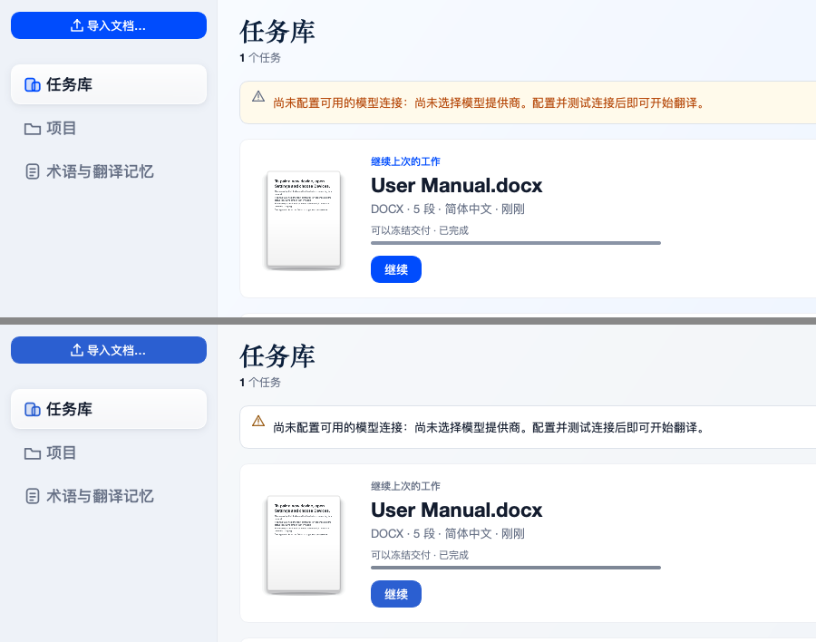

上：改前；下：改后（同一界面）。

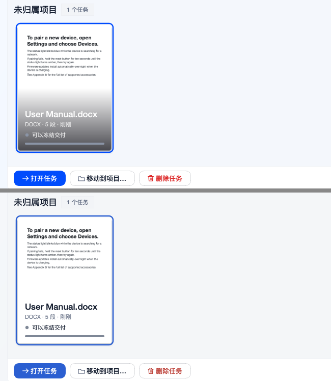
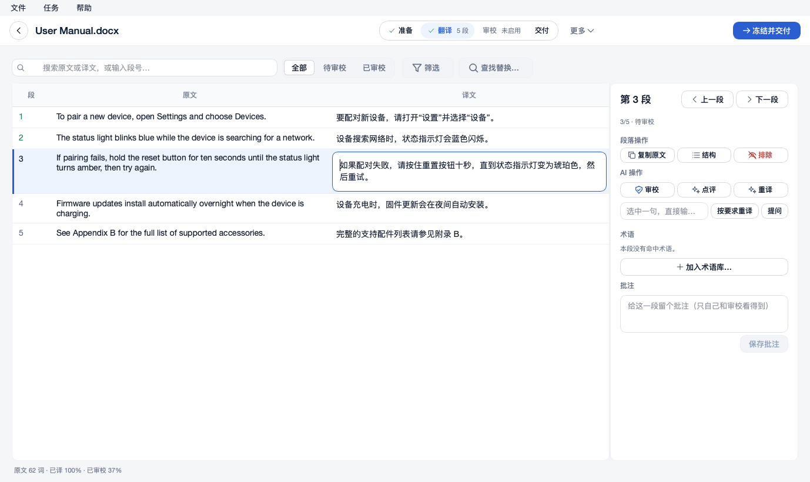
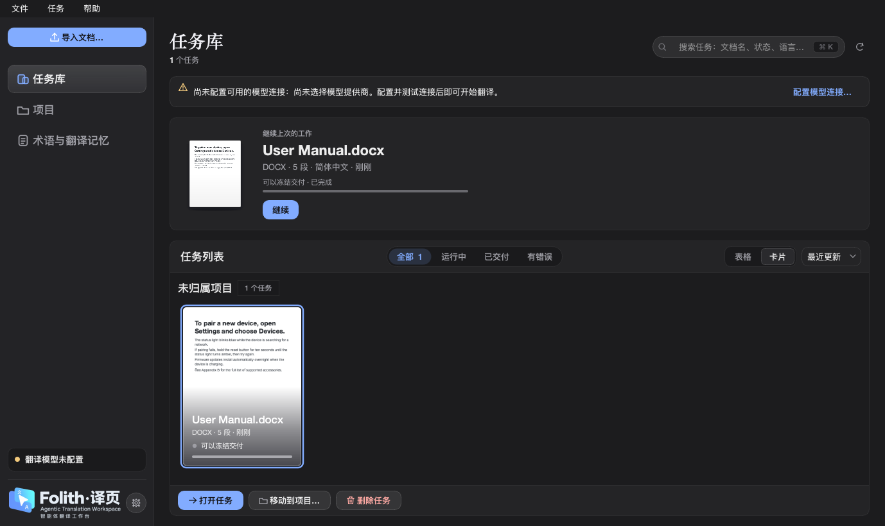

夜间主题：横幅同样是中性面；任务卡保留暗玻璃。

## 十二、E 层次 v2：三层表面、投影、文字角色、统一状态（2026-10-16）

画布「Folith 层次 · 全界面」（任务库 / 准备 / 翻译 / 审校 / 交付 / 语言资产 / 设置）定稿后，先把它的基础收进 Qt，再逐个界面套用。

| 约定 | 做法 | 位置 |
|---|---|---|
| 三层表面 | 外壳（窗口底 + 侧栏，`bg-shell-*`）< 页面（`Sheet`）< 卡片（`bg-surface`）。**卡片不画描边**，层级只靠投影与亮度 | `theme.ELEVATION`、`style.Surface` / `Card`、`components.Sheet` |
| 投影 | 几层叠加的圆角矩形模拟模糊：静止 `raised`、悬停/弹出 `floating`；墨色取各主题 `shadow-sm`，夜间加深。卡片在自己的矩形里留出 `ELEVATION_PAD` 画影子，布局边距不用改 | `style.paint_elevation` |
| 选中 | 白色间隙 + 45% 主色环，替代 2px 实心粗边 | `style.paint_selection_ring`（任务卡、`Surface.set_selected`） |
| 文字角色 | 页面标题 22/600、卡片标题 17/600、区块与名称 14/600、正文 13、标签 12/500、元信息 12 次要色、时间 12 弱色、状态 12/500；页面标题不再一页衬线一页无衬线 | `theme.TEXT_ROLES`、`QLabel[textRole=…]`、`style.set_text_role` |
| 统一状态 | 只有"6px 圆点 + 同色文字"一种，五种语气：进行中 / 需处理 / 完成 / 错误 / 未开始 | `theme.STATUS_TONES`、`components.StatusLabel`（设置里的连接状态已换用） |

套用到的界面：段落表放上卡片（与右侧检查器同一层级）；准备页的分组、交付页、设置页、指标卡都换成投影卡；任务库"其他任务"直接放在页面上（不再是卡片里的卡片）；继续卡标题降到卡片标题档。

测试：`tests/qt_surface_layers_test.py`。

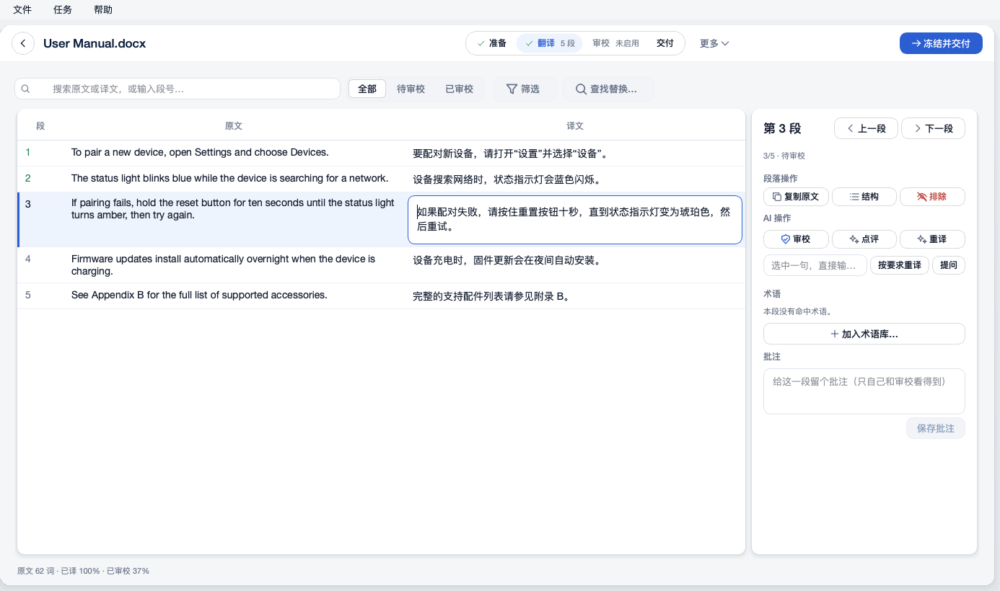
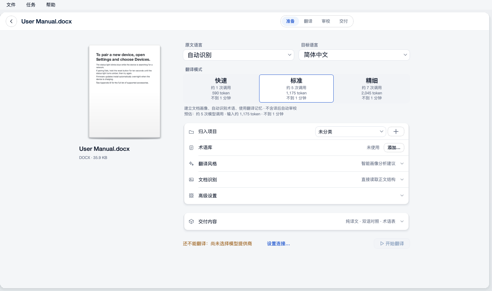
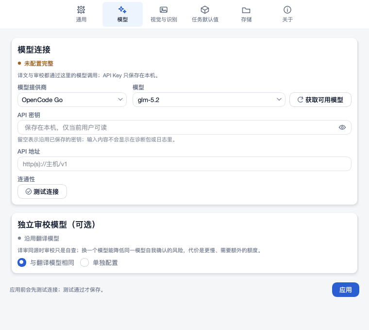
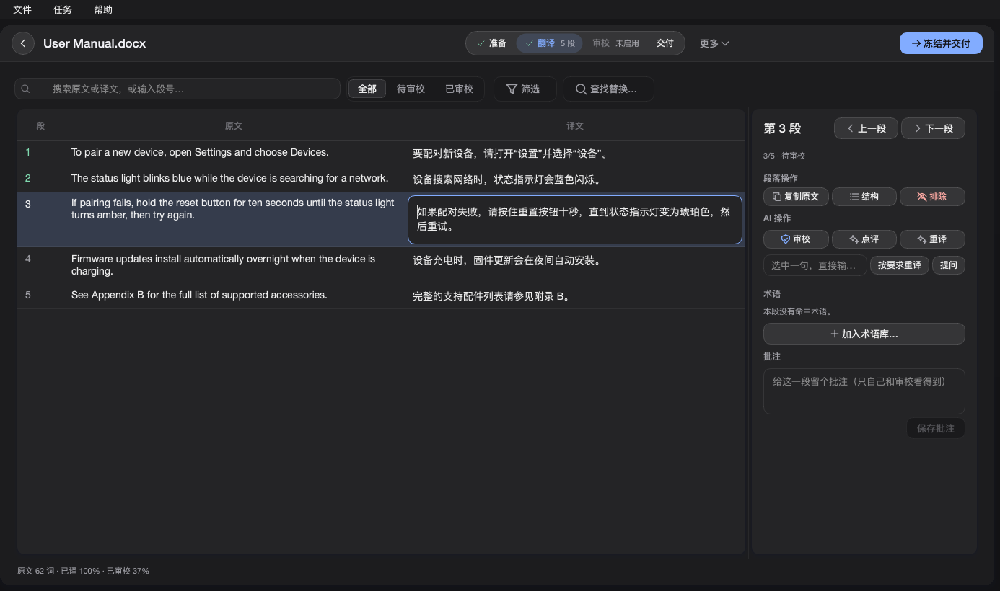

**还没做**：Qt 的 QLabel 不支持 `line-height`，中文行高只能在富文本里统一；段落检查器里的状态（"3/5 · 待审校"）、交付状态行、术语候选的情况列还没换成 `StatusLabel`；任务库卡片里的状态点仍按旧的语气表取色（颜色一致，代码未合并）。
