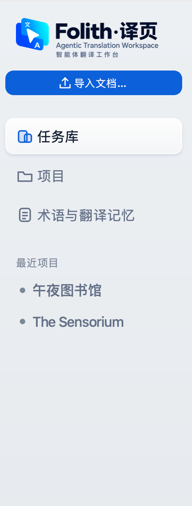
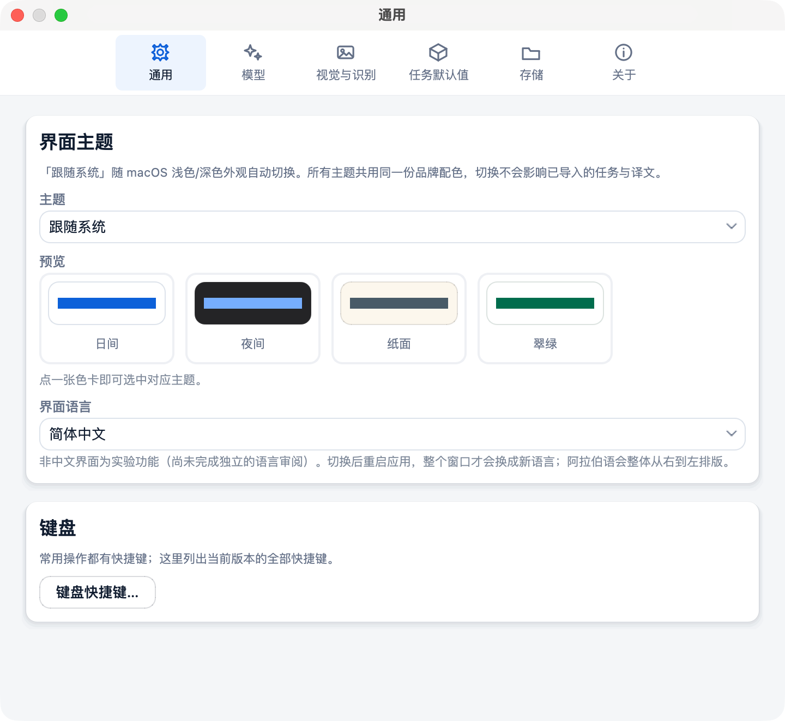
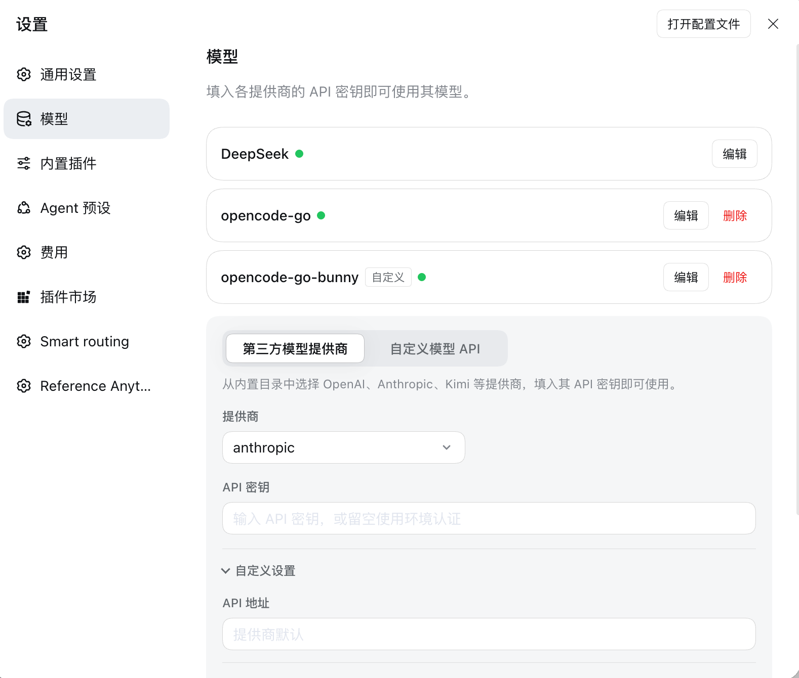
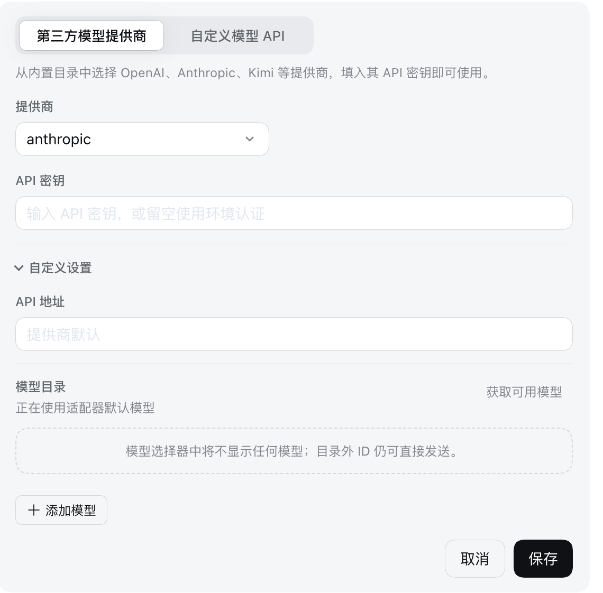
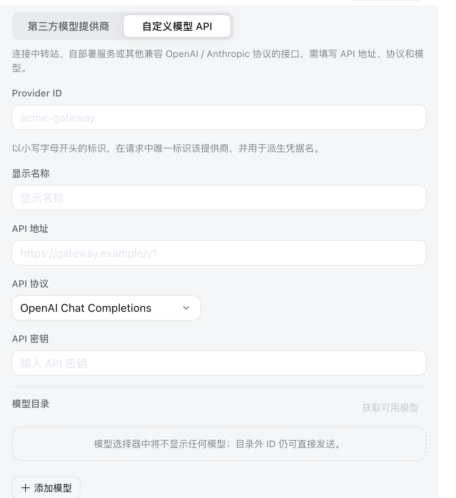
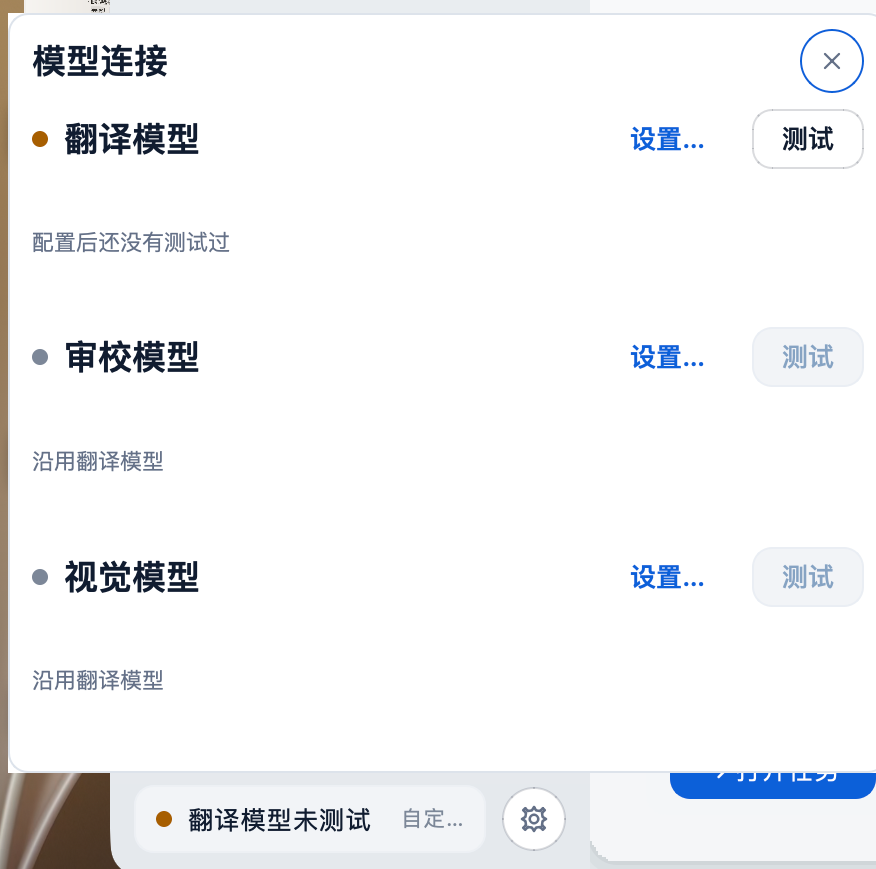
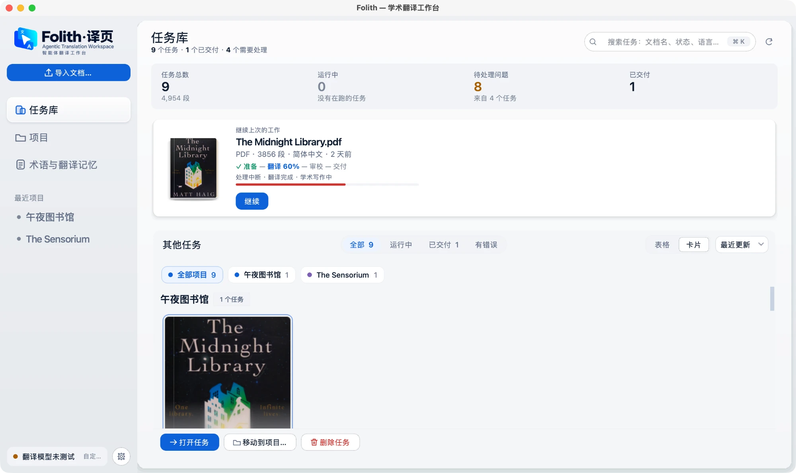
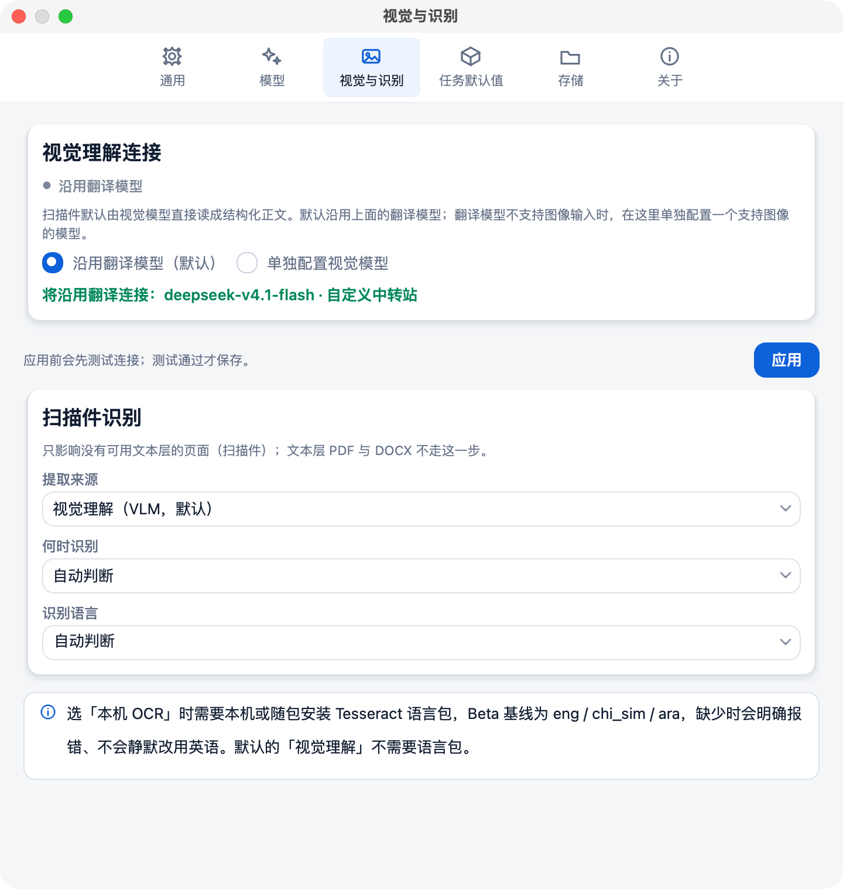
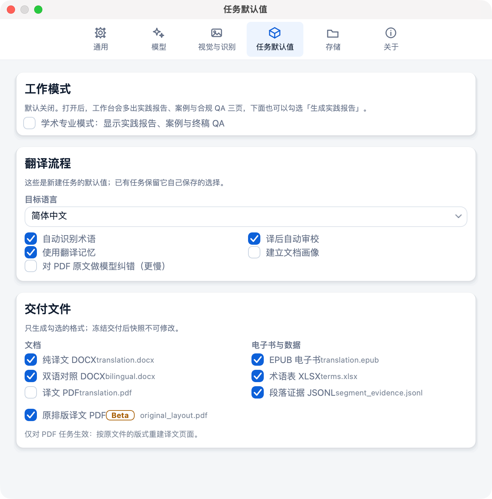
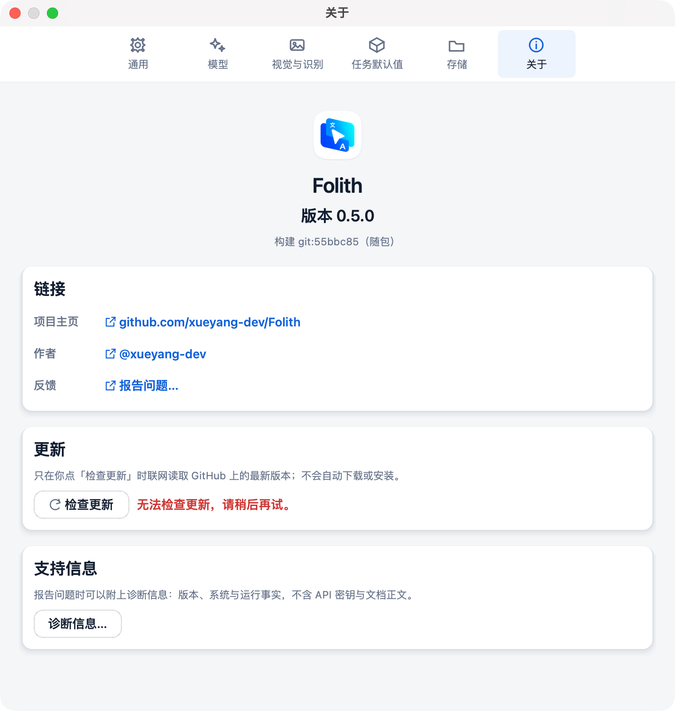

# 试用反馈（2026-10-16，01c94e9 / ec42e81 之后）

用户试用最新版后记下的问题。**先记录，不动手**：用户试用完以后一起改。

## 1. 侧栏比例

- 导航项（任务库 / 项目 / 术语与翻译记忆）和「最近项目」下的项目名**字太大**。
- 相比之下顶部「导入文档…」按钮**显得小**。两者的比例要反过来：导航收小，导入按钮做大。

## 2. 左上角 logo 与品牌名（按界面语言）

| 界面语言 | 显示 |
|---|---|
| 中文 | Folith + 中文名 + 「智能体翻译工作台」；**去掉** "Agentic Translation Workspace" |
| 英语 | 只保留英语 |
| 阿拉伯语 | 只用阿拉伯语：Folith 音译；「译页」**意译**，让阿语用户一眼看懂 |
| 俄语、西班牙语 | 同阿拉伯语：Folith 音译 + 「译页」意译 |

**后来改定**：阿、俄只音译名字（فوليث、Фолит），不带「译页」；西语写 Folith。副标题是一句简短清晰的意译（见 [整改计划](remediation-plan.md) 阶段 0 记录）。

（品牌名本身不改，见命名决定 2026-10-16；这里只是各语言的字标写法。）

## 3. 设置 · 通用

- **去掉小字解释**：板块名写清楚，用户看一眼就懂。
- 「主题」下拉和「预览」色卡**重复**。
- **主题结构要拆成两层**：
  - **外观**：日间 / 夜间 / 自动（跟随系统），和其他软件一样三选一；
  - **主题（高光色）**：只换界面里的强调色，与外观不在同一层级。
  - 现在的「日间 / 夜间 / 纸面 / 翠绿」把这两件事混在一个列表里。

## 4. 设置 · 模型

- 小字解释太多，删掉。
- **机制要完善：可以保存多个 API**，参考 DeepSeek harness 的设计：

- 已保存的提供商是一列卡片：名称 + 连接状态绿点 + 「编辑」/「删除」，自定义的带「自定义」标签；
- 下面是添加区，分段切换「第三方模型提供商 / 自定义模型 API」：

- 第三方：从内置目录选提供商，填 API 密钥（可留空用环境认证）；「自定义设置」折叠里放 API 地址；「模型目录」可「获取可用模型」或「添加模型」；底部「取消 / 保存」。

- 自定义：Provider ID、显示名称、API 地址、API 协议（OpenAI Chat Completions 等）、API 密钥、模型目录。

要想清楚的：翻译模型 / 独立审校模型 / 视觉模型怎么从"已保存的多个连接"里选；现有单连接配置怎么迁移；密钥仍然只存本机。

## 5. 侧栏「模型连接」浮窗

- **太大、内容太空**：三行（翻译 / 审校 / 视觉）各占一大块，每行只有一句状态。
- 改成**一张小卡片**：写清楚**现在用的是哪个模型**；只用了一个模型（审校、视觉都沿用翻译模型）时，**只显示这一个模型的状态**，不列三行。
- 最好能显示**用了多少 token**。现成的数据：`folith/usage.py` 每次运行记一份用量账本——提供商返回用量时记真实值，否则记标明"估算"的字符折算（约 4 字符 / token）。浮窗里要汇总的话得决定统计范围（今天 / 本任务 / 全部），并在估算时写明是估算。
- **边角处理不好**：浮窗右上和左下露出直角 / 被截的边，要做成平滑圆角（浮层自己画圆角和投影，不靠窗口矩形）。

## 6. 任务库：数字说了三遍、封面没地方

- **重复**：同一组数字出现三次——标题下的小字（"9 个任务 · 1 个已交付 · 4 个需要处理"）、概览条的大字（任务总数 9 / 运行中 0 / 待处理问题 8 / 已交付 1）、筛选分段里的计数（全部 9、已交付 1）。
- **概览条做小、并到标题那一行**：它太占地方，实际用处不大。标题下只保留一行紧凑的数字（可点，点了就是筛选），不再单独占一块大面。
- **把空间还给封面**：任务库最重要的是下面的封面卡片，现在一屏连一张完整封面都放不下（截图里封面只露出上半截，被底部动作栏压住）。整体布局要让至少一排封面完整可见。
- **删掉「其他任务」四个字**：筛选那一行左侧留空即可。

## 7. 设置 · 视觉与识别

- **太复杂、字多、抓不到重点**：两张卡片 + 一条提示条都在解释，真正要选的只有"扫描件用什么读"。
- **翻译模型与视觉模型可以分开——这是真的**：2026-10-10 的 `5ab1388`（"configure the vision connection used for scanned pages"）加的。原因：翻译模型如果不支持图像输入，扫描件提取会直接失败、没有出路，所以允许单独配一个视觉模型，默认沿用翻译连接。存在核心的 online-OCR 配置里（0600 权限）。和第 4 条"保存多个 API"合并考虑：视觉模型应当是从已保存的连接里**选一个**，而不是再填一遍地址和密钥。
- **本机 OCR 没装怎么办**：现在下拉里能直接选「本机 OCR」，没装 Tesseract 也能选，要到处理扫描页时才报错。OCR 不打包进 Folith，作为可选的额外项目。拟定的处理（待用户确认）：
  - 默认永远是「视觉理解（VLM）」，不需要任何安装；
  - 设置里先检测（已有 `core._find_tesseract` / `ocr_backends.backend_report`）：**没装**时「本机 OCR」显示为不可选，旁边一个「如何安装…」链接；**装了**才可选，并显示检测到的版本和语言包；
  - 曾经选了本机 OCR、后来卸载了：任务开始前提示"本机 OCR 不可用，本次改用视觉理解"，并在状态里写明，不静默切换；
  - 以后如果做成可下载的「OCR 扩展」，入口也放在这里。

## 8. 设置 · 任务默认值

- **「工作模式」加默认翻译方式**：快速 / 标准 / 精细三选一。这**不是**"点开始翻译就直接翻"，只是在准备页**预先选好**用户常用的那一档。
- 下面一排可选的小字选项，把 **MTI 相关的东西**（实践报告、案例与合规、终稿 QA，现在的「学术专业模式」）放进去，不再单独占一块。
- **交付文件小字太多**：每个格式后面的文件名（translation.docx、bilingual.docx…）和底部说明去掉或收起。

## 9. 设置 · 关于

- 「反馈」加一种方式：**邮箱 xydev@outlook.sa**（与"报告问题…"并列）。

## 10. 整个设置窗口的共同问题

第 3、4、7、8 条都指向同一件事：**说明文字太多、重点不突出**。统一做法——每块只留板块名 + 控件，说明只在真正会出错的地方留一句，其余删掉。
