# 试用反馈实现的整改计划（2026-10-16）

另一个 agent 按 [README](README.md) 第 1–10 条做了实现（未提交，26 个文件 +671/−555，新增 `folith/model_connections.py`、`folith/qt/connection_library.py`、`tests/qt_trial_feedback_test.py`），截图在 [implemented/](implemented/)。

**结论**：功能层基本可用，界面层要返工。

- **保留**：多连接存储与按用途选择（`connections` / `connection_roles`）、旧配置迁移、本机 OCR 检测与"本次改用视觉理解"的回退、token 用量汇总、各语言字标。相关测试（`qt_trial_feedback_test` 22、设置 23、视觉连接 12）都通过。
- **返工**：几乎每一处都是"把字删了，但没有重新设计"。三类问题：
  - 选择题用了下拉框（外观、高光色、默认翻译方式）；
  - 一页上有好几个保存按钮；
  - 布局用 hack 硬塞（窗口不够高就把"继续"卡藏起来）。

## 一、检查结果（按界面）

### 侧栏与字标（第 1、2 条）

| # | 问题 | 证据 |
|---|---|---|
| S1 | 字标缩到约 13px，品牌在左上角几乎看不见；导入按钮又做成 48px 高的大蓝块，**矫枉过正**，比例从"导航太大"变成了"按钮太大、品牌太小" | home-1200 |
| S2 | 俄语字标折成 5 行（"Фолит · Страница перевода / Рабочая среда агентного перевода"），阿语 3+2 行，图标与文字错位；"译页"被直译成"翻译页"，又长又没有意思 | home-ru、home-ar |
| S3 | 导航标签被截断："Terms and translation mem"、"Термины и память перево"、"Импортировать докумен…" | home-en、home-ru |

### 任务库（第 6 条）

| # | 问题 | 证据 |
|---|---|---|
| H1 | **窗口高度 < 720 时直接隐藏"继续上次的工作"卡**（`views.py`：`and self.height() >= 720`）。最常用的入口在小窗口里无声消失，是用 hack 换封面空间 | home-980-selected |
| H2 | 拖入文档格独占第二行，并且被底部截掉一半 | home-1200、home-en |
| H3 | 问题角标压在文件名上（"产品使用说明.docx" 被遮） | 所有 home 截图 |
| H4 | 未翻译的中文混在外语界面里："拖入文档"、"未归属项目" | home-en、home-ru、home-ar |
| H5 | 列表区又是一块浅灰底的面，加上常显的粗滚动条，形成"页面里再套一层"，和 E 层次"其他任务直接放在页面上"相反 | home-1200 |
| H6 | "继续"卡去掉进度条之后，"继续"按钮孤零零地停在最右边，中间一大片空白 | home-1200 |

### 模型连接浮窗（第 5 条）

| # | 问题 |
|---|---|
| C1 | 方向对了（变小了），但有三处问题：浮窗不需要关闭按钮 ×（点外面就会关）；"配置后还没有测试过"和状态点说的是同一件事；"本任务：1,200 tokens · 其中估算 200"读不懂 |
| C2 | 只写模型名（deepseek-flash），没写是哪个连接 / 提供商 |

### 设置 · 通用（第 3 条）

| # | 问题 |
|---|---|
| G1 | 外观、高光色、界面语言是三个一样的全宽下拉框。外观三选一应该是**分段控件**（日间 / 夜间 / 自动），高光色应该是**色点**——下拉框藏住了选项，也看不到颜色 |
| G2 | 说明没有删干净，只是挪进了括号："主题（高光色）"、"界面语言（重启后生效）" |
| G3 | "键盘"整张卡里只有一个按钮 |

### 设置 · 模型（第 4 条）

| # | 问题 |
|---|---|
| M1 | 已保存的连接每条占一整张卡，只有名字：没有提供商、没有模型，状态点是灰的；"删除"和"编辑"长得一样（应是危险色文字按钮） |
| M2 | **一页三个保存**：「保存用途」、添加表单的「保存」，再加上原来的「应用」逻辑。添加表单常驻展开，页面很长 |
| M3 | 自定义 API 表单："Provider ID" 没翻译；"多个模型用逗号分隔"输入框 + 全宽「添加模型」+ 全宽「测试连接」，全宽次要按钮看起来像输入框；参考设计里模型目录是一块空状态 + 一个小「+ 添加模型」 |
| M4 | 用途分在两个标签页：翻译 / 审校在「模型」，视觉在「视觉与识别」 |

### 设置 · 视觉与识别（第 7 条）

| # | 问题 |
|---|---|
| V1 | 精简了（好），但卡片外面右下角漂着一个「保存用途」按钮，名字和这页无关 |
| V2 | 截图里看不出本机 OCR 未安装时的样子（代码里有"如何安装…"），需要补截图核对 |

### 设置 · 任务默认值（第 8 条）

| # | 问题 |
|---|---|
| D1 | 默认翻译方式是下拉框；它和准备页的「快速 / 标准 / 精细」是同一个选择，应该用同一种分段卡样子 |
| D2 | MTI 被塞成复选框网格里的一项，和"自动识别术语"等并列；用户要的是**默认翻译方式下面一排小字可选项**。另外原「翻译流程」卡被并进「工作模式」，目标语言、流程开关、MTI 混在一张卡里 |

### 设置 · 关于（第 9 条）

| # | 问题 |
|---|---|
| A1 | 邮箱那一行没有左侧标签，图标是"外链"而不是邮件 |
| A2 | 更新、支持各占一整张卡、各一个按钮 |

## 二、整改计划

原则：先在画布上定样子，再改代码；每一处都用 E 层次已有的积木——分段控件、`Surface` 卡片、`StatusLabel`、`FormGroup` 行——不再新造变体。

### 阶段 0 · 先修硬伤（不需要设计决定，约半天）

1. H1：去掉 `height() >= 720` 的隐藏逻辑；空间问题在阶段 2 用布局解决。
2. H4、M3：补齐"拖入文档 / 未归属项目 / Provider ID"等漏翻译的词条（五种语言）。
3. H3：问题角标移到封面右上角，不压文件名。
4. S3：导航标签改为省略显示并带完整提示；导入按钮文字过长时缩短。
5. M1：「删除」改危险色文字按钮，并且要二次确认（沿用已有的安全确认）。
6. A1：邮箱行补标签"邮箱"，换邮件图标，点了是 `mailto:`。
7. V1：「保存用途」从视觉页挪走，或改名为这一页自己的动作。

### 阶段 1 · 画布定稿（在「Folith 层次 · 全界面」里加板，等用户确认）

| 板 | 要定的东西 |
|---|---|
| 侧栏 × 5 种语言 | 字标两行以内：图标 28px + 名称 15/600 + 副标题 11 次要色；导入按钮 40px 高；导航 14/500；外语字标给出具体写法（俄 / 西 / 阿的"译页"意译要短，候选词一并给出） |
| 任务库 1200 / 980 两档 | 封面一排完整可见；拖入格跟在最后一张封面后面（同一排，宽度可窄）；"继续"卡压成一行高（缩略图 56 + 名称 + 阶段 + 按钮），在小窗口里也保留 |
| 模型连接浮窗 | 状态点 + 连接名 · 模型；一行 token（"今天 12,400 tokens，含估算"）；「测试」「设置…」两个小按钮；不要 × |
| 设置 · 通用 | 外观三段分段控件 + 高光色色点一排 + 界面语言下拉；删掉"键盘"卡，快捷键入口挪进帮助菜单 / 关于 |
| 设置 · 模型 | 一张卡里是连接列表（每行：状态点、名称、提供商 · 模型、"自定义"标签、编辑 / 删除）；下面一行「＋ 添加连接」，点了才展开表单（或弹出面板）；**用途**是一张 `FormGroup`：翻译、审校、视觉三行，每行一个下拉，从已保存连接里选；整页只有一个保存动作 |
| 设置 · 视觉与识别 | 只剩扫描件怎么读：来源（视觉理解 / 本机 OCR，未安装时那一项置灰并附"如何安装…"）+ 何时识别；视觉模型的选择挪到模型页的用途组 |
| 设置 · 任务默认值 | 第一张卡：默认翻译方式（与准备页同款的三段卡）+ 下面一排小字可选项（MTI：实践报告 · 案例与合规 · 终稿 QA）；第二张卡：目标语言 + 流程开关；第三张卡：交付文件 |
| 设置 · 关于 | 品牌、版本 + 一张"链接与支持"卡：项目主页、作者、邮箱、报告问题、检查更新、诊断信息 |

### 阶段 2 · 按画布改代码

- 只动界面层：`settings_pages.py`、`connection_library.py`、`connection_status.py`、`views.py`（侧栏、任务库）、`branding.py`。保留 `model_connections.py` 和 adapter 里的迁移逻辑。
- 截图核对：五种语言 × 日间 / 夜间，任务库 1200 / 980 两档，本机 OCR 已装 / 未装两种状态。
- 测试：沿用并补充 `qt_trial_feedback_test`；`qt_design_tokens_test` 守住"不新增按钮变体"。

### 需要用户先决定的

1. **另一个 agent 的改动怎么提交**：
   - 建议：先把它的功能层（连接存储、迁移、OCR 回退、token 汇总、翻译词条）单独提交作为基线，界面返工另起提交，审阅时分得开；
   - 另一种：整体返工完再一起提交。
2. ~~**外语字标里"译页"的意译**~~：已定：阿、俄音译名字 + 短的意译副标题，见阶段 0 记录。
3. **token 统计范围**：今天 / 本任务 / 全部。浮窗只放一个数，建议"今天"。

## 三、阶段 0 处理记录（2026-10-16）

基线：另一个 agent 的实现已单独提交为 `b9d0d53`。

| 项 | 改法 |
|---|---|
| H1 | 去掉 `height() >= 720` 时隐藏的逻辑。窗口低于 720 时，"继续"卡收成一行（名称 + 阶段 + 按钮，隐藏缩略图、小标题和元信息），不再消失；第一排封面仍完整可见 |
| H4 / M3 | 补齐 26 条漏翻译的词条（多数是更早几轮的空状态和拖入格文案），外加"未归属项目 / 未命名项目 / 提供商 ID"和本轮新增的 3 条；五种语言覆盖率 1300/1300。新增测试：`scripts/qt_i18n_coverage.py --strict` 必须通过 |
| H3 | 问题角标移到封面右上角，不再压住文件名 |
| S3 | 新增 `style.ElideButton`：侧栏导航和导入按钮放不下时显示"…"，悬停看完整文字，`text()` 仍是全文；侧栏底部的连接状态也改为可省略 |
| M1 | 连接的「编辑」是小号次要按钮；「删除」是小号危险按钮，点了先确认（默认焦点在取消上），确认文案说明用到它的用途会改为未选择、密钥一并删除 |
| A1 | 邮箱单独一行，有"邮箱"标签和信封图标（新增 `mail` 图标），点击打开 `mailto:` |
| V1 | 视觉页的保存按钮放进卡片底部，名字改为「保存」；模型页仍是「保存用途」 |
| 省略号 | 「导入文档」去掉"…"：侧栏按钮、文件菜单、空状态提示，五种语言都改 |
| S2 | 外语字标（用户改定）：阿、俄用本文字音译名字，不带「译页」——فوليث、Фолит；西语保持 Folith。副标题是一句短的意译：阿 ترجمة بالوكلاء الأذكياء、俄 Перевод с ИИ‑агентами、西 Traducción con agentes de IA。另外去掉了字标行里分走一半宽度的弹簧，副标题不再提前折行。五种语言都是两行 |
| H2（部分） | 拖入格包一层占位格，尺寸取自封面卡（含同样的内边距），拖入格撑满占位格：宽、高、顶边都和封面一致（选中的封面会上浮几像素，属于选中效果） |

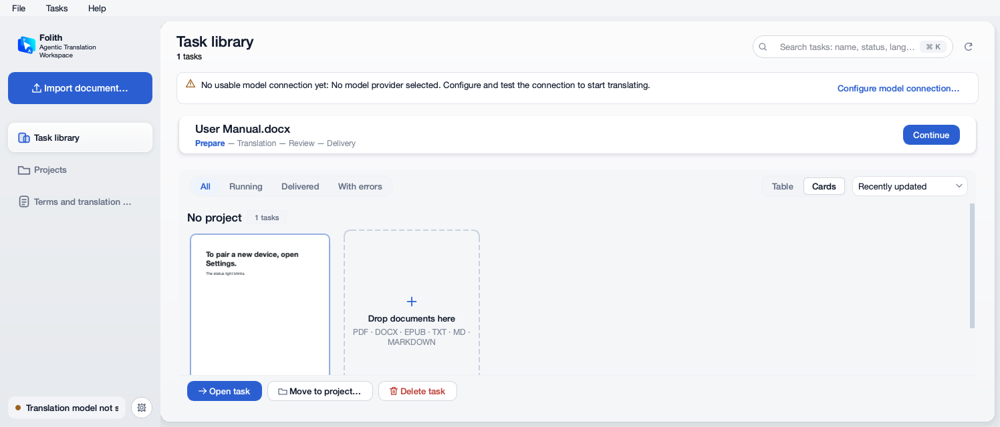
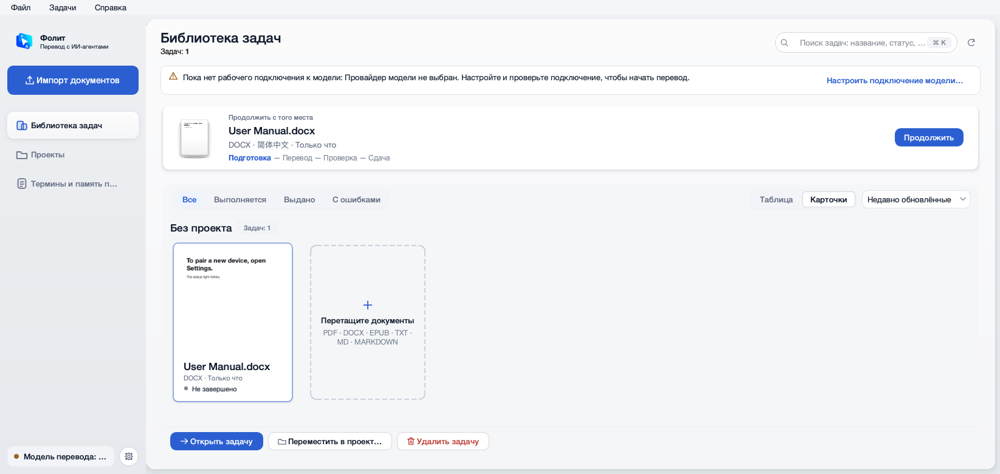
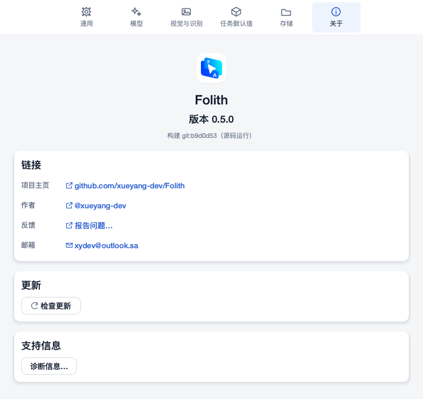

**阶段 0 后仍可见、留给阶段 1 / 2 的问题**：

- 英文"1 tasks"单复数不对；
- 列表区仍是一块浅灰底的面（H5）；
- 外语界面里的文件格式行出现"MD · MARKDOWN"重复；
- 980×640 选中任务时，封面下半截被动作栏挡住（H2 剩下的部分）。

**基线遗留的测试失败**（`b9d0d53` 上就失败，阶段 0 已修）：

| 失败 | 原因 | 修法 |
|---|---|---|
| 首次引导崩溃（`qt_onboarding_test` 3 项、`qt_client_style_test` 1 项） | 引导页还在调已删除的主题色卡 `_build_theme_previews` | 改为外观三段（跟随系统 / 日间 / 夜间），和设置里的「外观」是同一个值；对应测试换成"三段和下拉互相跟随" |
| 引导里「测试并保存」永远报"尚未选择模型提供商" | 新的连接库只认已保存的连接；首次运行列表为空，编辑区填好的内容被忽略 | 编辑区里看得见、还没单独保存的连接也算数：没有翻译连接时它就是翻译连接，正在编辑时以编辑区为准；测试通过并落盘后，连接列表跟上、编辑区清空 |
| 模型发现 4 项、推理强度 1 项 | 编辑区一打开是空白的"添加连接"：旧配置里只有密钥没选模型时，提供商、密钥、地址在界面上看不到，一保存就丢；改了模型或推理强度也要另点一次「保存」 | 没有翻译连接时，编辑区先填上已有的设置；测试改为先点「编辑」打开正在用的连接（和用户操作一致）；删掉已不存在的审校「获取模型」按钮那条断言 |

全套测试（249 个文件逐个跑）另查出 1 项：`red_team_acceptance_test` 的 URL 扫描发现另一个 agent 写死的两个地址。Tesseract 安装说明挪进 `support.py` 和其他帮助链接放在一起；OpenAI 官方地址和 DeepSeek、OpenCode Go 一样列入官方接口白名单。修完后全部通过。

打包：`build_qt_desktop.sh --no-ocr` 原先不生效——上一次构建留下的 OCR 载荷会被照样打进应用；现在 `--no-ocr` 会先删掉它。

`qt_acceptance_kit_test` 的 1 项依赖本机 `build/qt-desktop/dmg_record.json`，属于环境问题，没有改。

## 四、阶段 2 处理记录（2026-10-16）

按「Folith 层次 · 全界面」画布里的 10 块阶段 1 板改代码（用户已确认画布）。截图在 [stage2/](stage2/)。

| 界面 | 改法 |
|---|---|
| 侧栏 | 字标：图标 28px + 名称 15/600 + 副标题 11 次要色，字标文案统一放在 `branding.WORDMARKS`；导入按钮 40px、14/600（高度写在样式表里，QSS 的 min-height 会盖过 setFixedHeight）；导航 14/400，选中 14/500，图标 18px、行高 36；外语导航标签缩短（Terms & memory / Термины и память / Términos y memoria / المصطلحات والذاكرة，俄西阿的「任务库」用「任务」）；底部一行改为「连接名 · 模型」，状态交给圆点颜色和悬停提示 |
| 任务库 | 统计并到标题右边；「继续」卡一行：缩略图 40×52 · 名称 / 元信息 + 阶段 · 按钮，去掉小标题和进度条；任务列表直接放在页面上（列表卡不画面，页面栈透明）；分组标题的数量是普通小字 |
| 连接浮窗 | 不要标题和 ×；每个**不同的**连接一行（圆点 · 连接名 · 状态 / 模型 · 用到它的用途）；「今天 N tokens」+ 估算说明；「测试」（多个连接时「全部测试」）与「设置…」；浮窗与侧栏左对齐。新增按天累计的用量（`folith/usage.py` 的 `today_usage`，存在数据目录的 `usage-daily.json`，只有日期和两个数字） |
| 设置 · 通用 | 一张分组卡：外观三段（跟随系统 / 日间 / 夜间）、主题色色点（新组件 `AccentPicker`）、界面语言 + 「重启后生效」；删掉「键盘」卡（快捷键在帮助菜单里）。下拉框仍是保存时的数据来源，只是不显示 |
| 设置 · 模型 | 「连接」分组：每行圆点 · 名称（自定义标签）/ 提供商 · 模型 · 等 N 个模型 · 状态 · 编辑 · 删除，右上角「添加连接」；「用途」分组：翻译、审校、**视觉**三行（视觉从视觉页挪来）；整页只有一个「测试并保存」 |
| 添加连接 | 单独的面板（点「添加连接」或「编辑」才出现）：类型分段、提供商 / 名称 / 密钥（自定义 API 多出提供商 ID、地址、协议），模型目录是一列（对勾 = 默认模型），「获取可用模型」「手动添加模型」，「测试并添加」，失败时给「仍然保存」。首次引导直接把这张面板嵌在「连接一个模型」那一步 |
| 设置 · 视觉与识别 | 一张「扫描件」分组：读取方式两张选项卡（视觉理解，显示所用连接 · 模型；本机 OCR，未安装时不可选并给「如何安装…」）· 何时识别三段 · 本机 OCR 时才出现识别语言；没有保存按钮（立即生效）。PaddleOCR 不出现在界面上 |
| 设置 · 任务默认值 | 默认翻译方式三张卡（与准备页同一组预设，卡上一排四步：画像 / 术语 / 记忆 / 审校，亮 = 会做）；下面一排 MTI 小选项；目标语言 + 「PDF 原文先做模型纠错 · 更慢」开关；交付文件两列复选框，不列文件名。翻译流程的四个开关由翻译方式决定，这页不再重复（控件仍在，保存时原样带回） |
| 设置 · 关于 | 图标 + 字标名称 + 版本 · 构建一行；一张分组：项目主页、作者、邮箱、报告问题、更新、诊断信息 |

**与画布不同的地方**：

- MTI 一排是「实践报告 · 案例与合规 · 终稿 QA」一个开关（打开 MTI 模式），外加「完成后生成实践报告」：核心里这三页是一起开关的，不能单独选；
- 筛选芯片沿用「运行中 / 有错误」：画布上的「需要处理」与标题行里的统计链接是另一回事（有问题的任务），没有改名。

**顺手修的**：

- 连接浮窗在基线里就打不开：`window.py` 用了 `QSize` 却没导入；
- 外语界面里一批从表里取的文案一直没翻译（外观三档、主题色、设置页签「视觉与识别 / 存储 / 关于」、交付格式名、识别时机等）：覆盖率脚本只认 `tr()` 里的字面量，看不到它们。补齐了，并加了一个测试专门检查这些表。

**组件**：新增 `components.OptionCard`（选项卡片）与 `components.AccentPicker`（主题色点）；`qt_design_tokens_test` 的按钮变体白名单相应加了 `optionCard`、`accentOption` 两项（后者取代已不用的主题色卡）。

**收尾（阶段 2 之后）**：

- 980×640 且显示「尚未配置模型连接」提示条时第一张封面被动作栏挡住：封面尺寸现在也按卡片区的可见高度收，第一排总是完整可见（新测试覆盖有提示条的情况）；
- 英文 / 西语单复数：新增 `i18n.tr_n`，数量为 1 时取目录里的「原文#one」（"1 task"、"1 tarea"）；覆盖率脚本与插桩脚本都认 `tr_n`；
- 拖入格的格式行不再出现「MD · MARKDOWN」；
- 侧栏「Terms & memory」曾显示成「Terms _memory」（按钮文字里的 & 是助记符）：`ElideButton` 转义 &；
- 滚动条变细（手柄 5px），列表不再像套了一层框。

**夜间与「本机 OCR 未安装」核对**（计划里写了，阶段 2 时没做）：

- 夜间的文字色是 `rgba(…, .92)`，Qt 富文本读不懂，标题行统计里的数字退成黑色、几乎看不见：新增 `style.html_color`，把颜色叠到底色上换成实色，统计行、字标副标题、默认翻译方式的四步都改用它；
- 统计行里的链接不继承标签颜色：显式写次要文字色，「需要处理」用警告色；换主题后统计行与字标副标题跟着重画；
- 选项卡片的标题在夜间全是灰的（QSS 的「父控件选中时的子标签」不可靠）：标题颜色由卡片自己写；
- 本机 OCR 未安装时：选项卡置灰、写「未安装」，右边「如何安装…」——与设计一致。

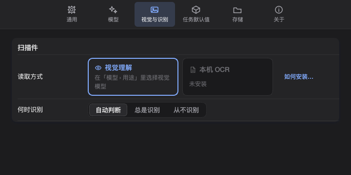

目标语言下拉与「继续」卡里的语言名（English、日本語、简体中文……）保持各自的本名，不翻译。

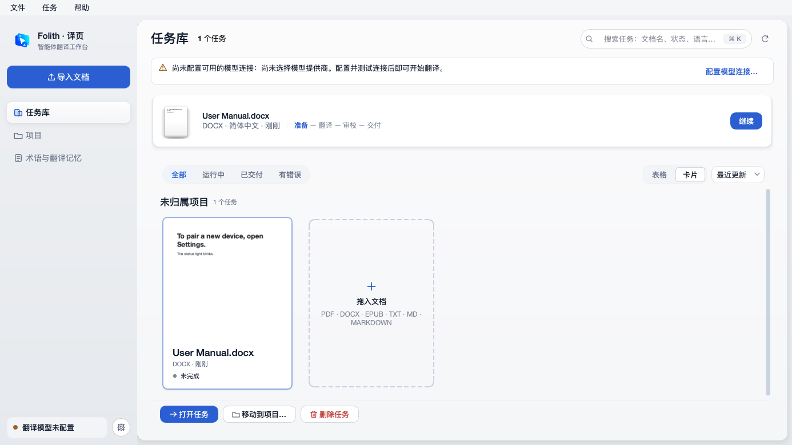
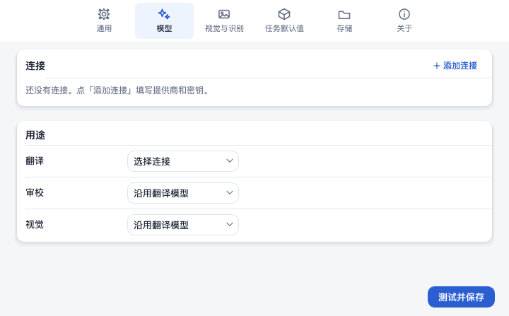
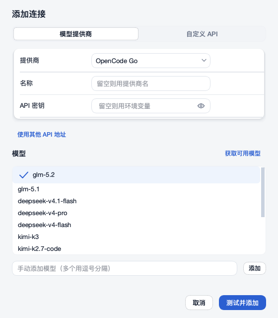
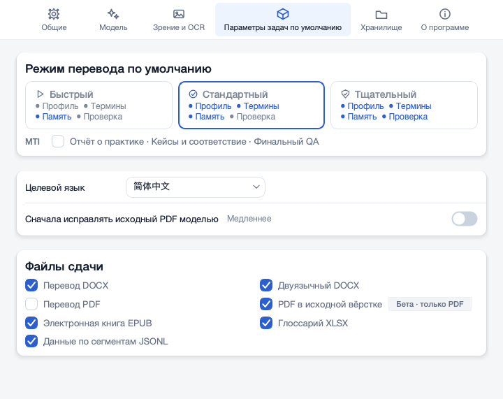
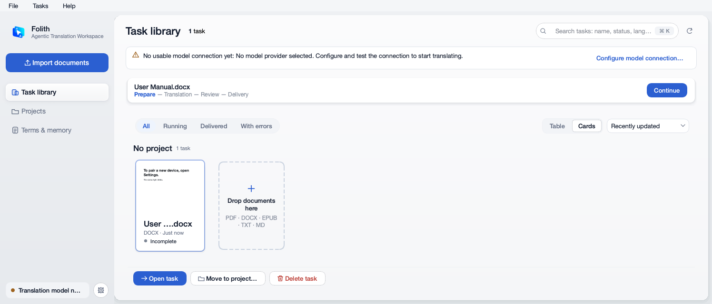

## 试用反馈第二轮（2026-10-16 晚）

- 任务库的窗口标题还是旧的「Folith — 学术翻译工作台」：改成与侧栏字标同一套名字与副标题（`branding.wordmark`，各语言一致），旧词条从五个语言包里删掉；
- 系统标题栏与顶栏之间断了一截（系统灰带 + 8px 外壳 + 页面）：macOS 上外壳铺到透明标题栏底下（`ExpandedClientAreaHint` + `NoTitleBarBackgroundHint`），内容只让出安全区高度；红绿灯与标题仍由系统画。轻提示也从安全区下面算起；
- 运行记录改成从进度条下面长出来的一块：居中对着状态组，状态组展开时与浮层同一层表面、底边方角接上浮层的颈部（内凹圆角）；去掉标题、副标题、关闭按钮与步骤详情区，只留滚动的状态时间线和底部的「在 Finder 中显示完整日志」，步骤说明放进悬停提示；
- 翻译时菜单栏闪、台前调度里的缩略图也闪：等待模型响应（以及重试、不确定进度）时，进度条上有一道 30 帧的扫光，每一帧都让整条祖先链重绘、整窗提交给系统，一次等待往往几分钟。去掉扫光，进度条不再自己动——等待写在状态行里并按秒计数。实测等待期间 2 秒内的重绘从 68 次降到 5 次（只剩换语气时的一次淡入）。排查时排除了：子进程 / 第二个实例（打包版跑真实流程，前台应用始终是 Folith）、菜单动作来回切换、主题反复重设、顶层窗口反复显隐。注意：自动化模式会关掉所有动画，所以之前的探针看不到它。

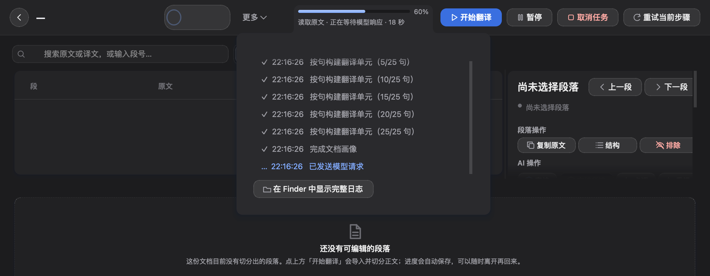
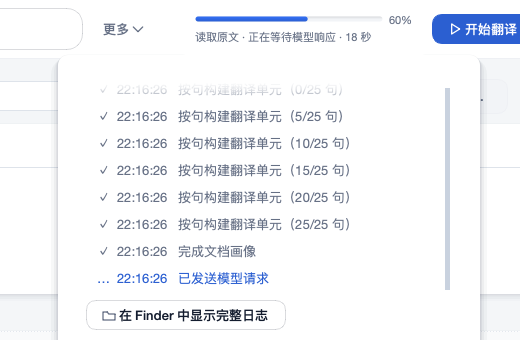
