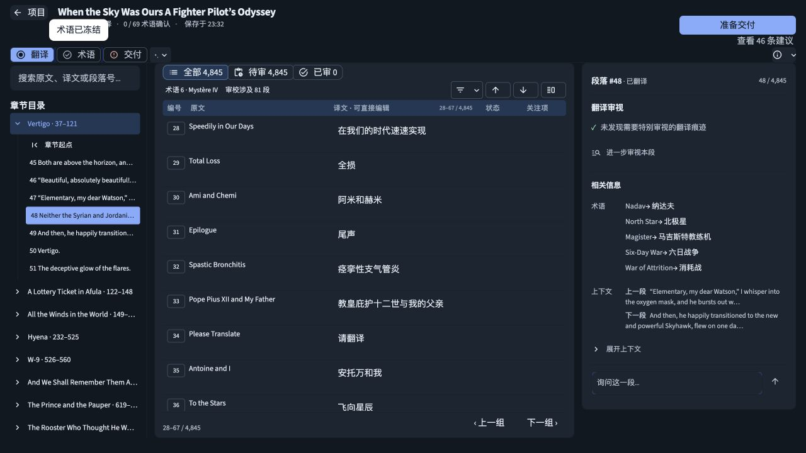
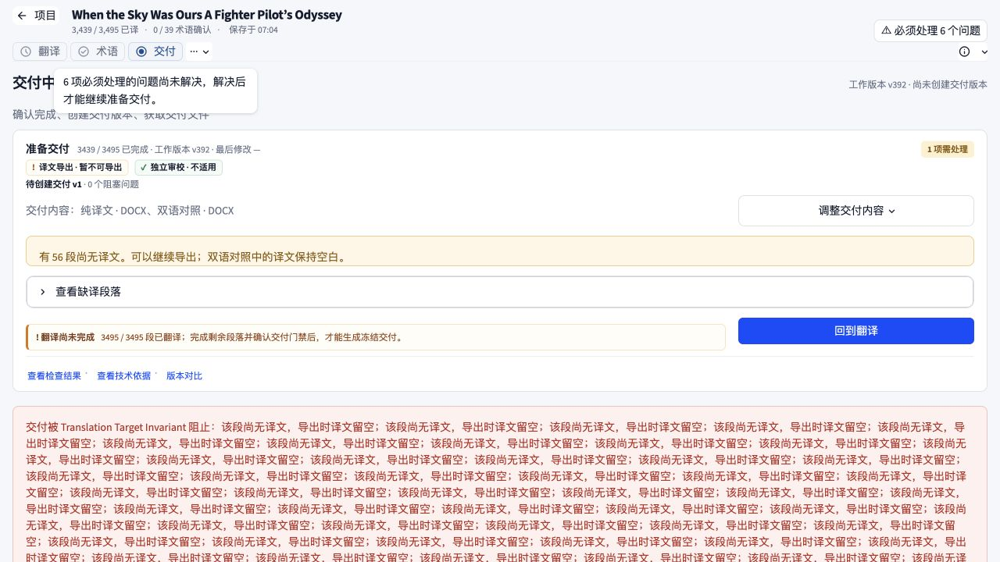

# Folith 三套方法联合 UI 审查

2026-10-02 更新：以下为修复前的审查记录。四项问题已修复，见[修复记录与复验截图](../combined-review-fixes-2026-10-02/README.md)。

审查时间：2026-10-01 至 2026-10-02。对象：本机 `http://127.0.0.1:8501/` 的现有界面与实际任务数据。只读审查，未修改产品代码、译文或交付配置，未启动模型任务、删除任务或创建交付版本。

**结论：Block。确认 4 项问题，其中 1 项 HIGH、3 项 MEDIUM。** 阻止通过的依据是夜间主题键盘焦点指示的低对比度。交付状态矛盾和定位滚动失败也应在下一轮完善中优先处理。这里的 Block 是审查结论，不表示应用完全不能使用。

## 方法与适用范围

- [better-interface](https://github.com/jakubkrehel/skills/tree/main/skills/better-interface)：按 accessibility、layout、writing、typography、colors、UI 六个领域检查，证据与具体位置优先，同根问题合并。
- [ui-state-expander](https://www.figma.com/community/skill/60839/ui-state-expander)：补查空态、筛选无结果、选中与定位、处理中断、缺译、可交付与交付阻塞之间的状态转换。
- [Superfuture design-review](https://github.com/Superfuture/design-review)：使用其公开检查表复核层级、密度、反馈、一致性与恢复路径。直接阅读规则并在本地应用，未安装这些项目或调用其远端分析服务。
- 同时采用 Product Design audit 的截图优先流程。截图、可访问性树、只读 DOM 测量和相关源代码相互佐证。

另行核对了用户提供的 [runem/web-component-analyzer](https://github.com/runem/web-component-analyzer)。它是提取 JavaScript/TypeScript Web Components 的属性、事件、插槽等接口文档的 CLI，不是视觉审查 skill。当前核心界面由 Python/Streamlit 渲染，因此本次未运行该工具，也未把它的静态文档输出当作 UI 审查证据。

## 合并后的发现

源文件行号对应审查结束时的工作区；页面在两天内出现过主题与代码更新，夜间截图代表 10 月 1 日捕获状态，浅色截图代表 10 月 2 日捕获状态。未将不同日期的建议数量变化当成缺陷。

| 严重度 | 领域 | 位置 | 当前行为（Before） | 建议结果（After） | 原因与证据 |
| --- | --- | --- | --- | --- | --- |
| HIGH | Accessibility / Colors | [styles.py:35](../../../folith/ui/styles.py#L35)、[styles.py:1068](../../../folith/ui/styles.py#L1068) | 夜间主题通过 Tab 聚焦“术语”，3px 焦点环使用 `rgba(0,76,253,.22)`，与背景的对比度约 **1.17:1**。 | 焦点轮廓使用经明暗主题验证的实色 token；透明色可保留作辅助光晕。 | [截图 11](11-keyboard-focus.png)。真实焦点样式已测量：透明按钮背景，底层 `#111820`，没有额外阴影。作者提供的焦点指示不足 3:1，键盘用户难以辨认所在位置；属于非文本对比度问题。并非声称完全没有 outline。 |
| MEDIUM | UI / Writing | [app.py:8169](../../../app.py#L8169)、[app.py:8298](../../../app.py#L8298)、[app.py:8432](../../../app.py#L8432) | 缺译任务同时显示“暂不可导出”“可以继续导出”；回到翻译提示用 pairs 长度写成“3495 / 3495 段已翻译”，实际非空译文为 3439 段。错误摘要直接展开大量相同技术错误。 | 在同一个实际门禁状态下生成摘要、计数和下一步文案；明确区分工作稿导出与冻结交付（若实际支持），非空译文计数保持一致；摘要合并同类错误，段落清单留在详情中。 | [截图 13](13-delivery-blocked.png)。用户无法判断能否继续。未认定“6 个必须处理问题”和“0 个审校阻塞项”本身就是计数错误：来源可能不同；应标清含义。实际导出仍被门禁阻止，未发现绕过保护。 |
| MEDIUM | Layout / UI | [app.py:4540](../../../app.py#L4540) | 从无结果搜索点击“定位第 48 段”后，搜索正确清除、章节正确展开、选中段落正确改变，但中央网格仍停在 28–36 段，目标行不在可见范围。 | 滚动真实的网格滚动容器，并相对于该容器的可见区域居中目标行。 | [截图 11](11-keyboard-focus.png)。测量时目标行顶部约 1568px；网格顶部约 188px、高 465px、`scrollTop=0`。脚本滚的是 `stMain`，它的内容高度等于视口且 `overflow:hidden`；网格本身 `overflow:auto`、滚动内容约 2888px。用户仍可手动滚动，但“定位”未完成其可见反馈。 |
| MEDIUM | Accessibility | [app.py:3858](../../../app.py#L3858)、[cat_grid.py:171](../../../folith/ui/workspace/cat_grid.py#L171)、[app.py:8522](../../../app.py#L8522)、[app.py:8558](../../../app.py#L8558) | 图标工具在可访问性树中显示 `picture_as_pdf`、`more_horiz`；多个下载按钮都只叫“↓”。`help` 提示未形成明确的按钮名称。 | 给按钮保留描述性名称，例如“查看本段 PDF 位置”“更多段落操作”“下载最终译文 DOCX”；复用现有紧凑按钮隐藏可见文字的方式，下载名称区分文件。 | [截图 03](03-translation.png)、[截图 06](06-delivery.png) 与运行时可访问性树。不是所有图标按钮都无名称：已有保留文字的紧凑导航按钮是正确实现。此项只覆盖实际观察到的上述控件。 |

## 复现与修复后的验收

1. **键盘焦点**：在夜间主题的翻译工作台，从“翻译”按钮按 Tab 到“术语”。测量实际合成后的轮廓与相邻背景，至少达到 3:1，并在浅色主题复查。失败时修正共享轮廓 token 或主题映射，而非逐按钮加新颜色。
2. **交付阻塞**：打开任务 `56b0ecebf5a56a2f` 的交付页。当非空译文仍为 3439/3495 时，完成量必须一致，提示必须与可用动作一致，同类缺译错误只汇总一次。无需为了复验生成交付文件。
3. **段落定位**：任务 `51e711938cd70f2c`，搜索 `zzzz_no_match_审校`，点击全局发现的“定位第 48 段”。搜索应清除并给出提示，同时第 48 段在网格中可见；目录高亮和右栏切换已经正常，应保留。
4. **按钮名称**：检查图标菜单、PDF 定位和不同文件下载按钮的可访问性树，确认名称描述操作并区分下载目标，再用屏幕阅读器验证。鼠标悬停提示可以继续保留。

## 已走查的状态与健康度

| 步骤 / 状态 | 健康度 | 实际观察 |
| --- | --- | --- |
| 新任务 / 未上传文件 | 本轮未发现问题 | 输入格式与大小说明可见，缺文件时下一步禁用。[截图 01](01-new-task.png) |
| 历史任务 / 已存在与中断 | 本轮未发现阻塞 | 可进入现有任务并继续查看。未点击删除、续跑或重试。[截图 02](02-history.png) |
| 翻译 / 有内容与选中 | 需修正 | 三栏职责与原译文并列清楚；焦点指示、图标名称和程序定位存在上述问题。[截图 03](03-translation.png) |
| 搜索 / 无结果 → 从全局发现恢复 | 部分正常 | 空态明确，没有假数据；点击定位会清除不相容搜索并说明原因，但目标行没有被滚入视野。[截图 04](04-search-empty.png) |
| 建议 / 打开与返回段落 | 本轮未发现切换失败 | 右侧建议面板实际可打开，返回段落入口可见。[截图 05](05-issues.png) |
| 交付 / 可准备 | 基本正常 | 内容选择、创建版本主按钮、成果分组清楚；下载名称需要补足。[截图 06](06-delivery.png) |
| 交付 / 缺译且被阻止 | 需修正 | 门禁实际生效，工作稿保留与回到翻译入口明确；状态文案、计数与错误摘要矛盾。[截图 13](13-delivery-blocked.png) |
| 1000px 窄桌面 / 建议面板 | 观察到适配 | 建议切为浮层，有返回入口；浮层覆盖内容本身是设计行为，不单独认定缺陷。[截图 07](07-translation-1000.png) |
| 320px 极窄宽度 | 有限制，未列发布阻塞 | 表头逐字换行、网格难以阅读。当前桌面工具范围不足以把手机布局直接判为必须修复；需先确定支持窗口范围。[截图 10](10-translation-320.png) |

640px 截图 09 捕获在布局尚未稳定时，**不作为证据**；截图 08 与 07 内容重复。320px 视口测试不等同于真实 200% 浏览器缩放。

## 六领域覆盖与值得保留的部分

| 领域 | 本轮覆盖与结论 |
| --- | --- |
| Accessibility | 实测 Tab 焦点、按钮名称与可访问性树，确认两项问题；完整键盘路径与屏幕阅读器尚未验证。 |
| Layout | 实测桌面三栏、内部滚动及窄窗口；确认定位问题。三栏本身和专业工具的紧凑密度不应被当成缺陷。 |
| Writing | 实测空态与交付提示，确认交付状态矛盾与重复技术错误。 |
| Typography | 观察桌面标题、正文、原译文与元信息层级，未确认独立缺陷；未检查全部语言与长文本组合。 |
| Colors | 实测夜间焦点对比度，其他文字与状态颜色仅做视觉检查，不宣称全站对比度合规。 |
| UI | 实测导航、建议打开、搜索恢复、交付正常和阻塞状态；未验证模型运行中的反馈或真实保存失败。 |

值得保留：原译文并排与右栏辅助信息的分工；搜索后定位会主动恢复正确上下文；交付成果按用途分组；交付失败仍明确保留当前工作稿并提供回到翻译的路径。应在这些结构上完善状态一致性与可访问性，无需为了审查而整体推翻布局。

## 未验证与边界

本轮没有运行完整 VoiceOver / axe 检查、真实 200% 缩放、减少动态效果偏好、全部语言、独立审校全流程、上传解析错误、模型排队与运行中断恢复、编辑保存失败、交付冻结及下载文件内容检查。没有修改代码，所以没有运行与本次诊断无关的单元测试。

审查期间工作区存在其他未提交更新；以上位置是结束时读取的源码，运行时结论以注明日期的截图和 DOM 实测为准。后续主题改动若覆盖夜间焦点样式，需要针对该项复验，不能直接把旧截图当成新版本结论。

## 核心截图

### 定位后的可见区域与夜间键盘焦点

### 缺译交付任务的矛盾状态

