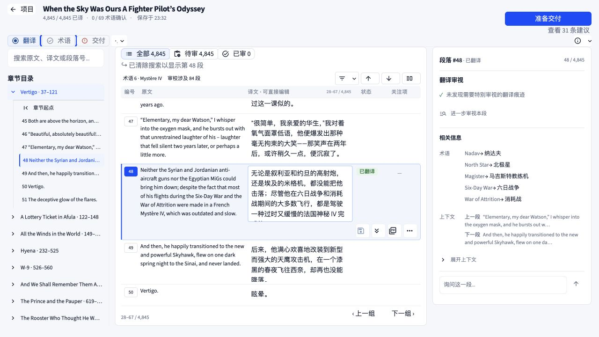
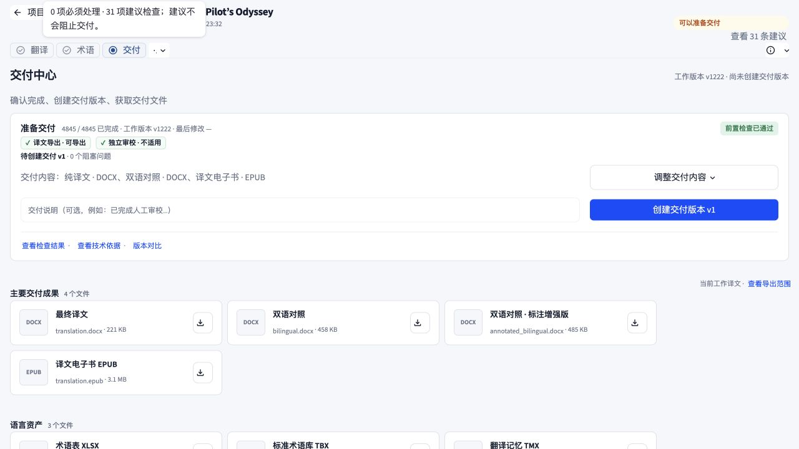
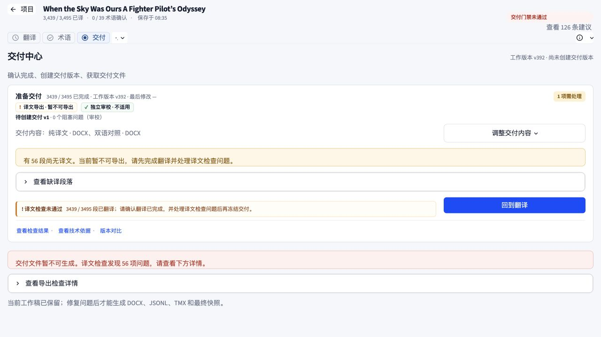

# 联合审查问题修复记录

2026-10-02：已修复原审查的四项问题。保留已有工作区、主题和交付门禁逻辑；未启动真实任务或创建真实交付版本。

| 问题 | 修复 | 验证 |
| --- | --- | --- |
| 焦点轮廓对比度低 | 轮廓使用各主题的实色强调色，透明 focus token 继续用于光晕与选区；设置中的主题选项也使用实色轮廓。 | 浅色主题实际 Tab 聚焦“术语”，computed outline 为 `rgb(0,76,253) solid 3px`。三种主题生成 CSS 均使用实色轮廓；对页面、侧栏、面板、选中及悬停背景计算的最低对比度为浅色 5.51:1、夜间 5.29:1、纸感 5.18:1。夜间与纸感未再做浏览器主题切换，不宣称完成全站可访问性认证。 |
| 交付状态与完成量不一致 | 提示跟随实际导出门禁；完成量统一统计非空目标文本。异常摘要只显示问题数量，逐段技术原因留在折叠详情。审校阻塞计数标注来源。新增文案覆盖五种现有语言。 | 实际缺译任务各处均显示 3439/3495，提示暂不可导出，错误由长篇重复信息变成一行。临时数据测试验证：允许缺译的任务仍能导出与冻结；包含非法模型响应的任务仍被阻止。 |
| 定位没有滚入视野 | 查找目标行的实际可滚动祖先，相对其可见区域居中；减少动态效果偏好下直接滚动。 | 无结果搜索→定位第 48 段：搜索清除，目录、右栏和网格一致。网格 scrollTop 为 1242；可见区域约 y212–651，目标行约 y350–513，完整可见。 |
| 图标按钮名称不明确 | PDF、更多段落操作、主要成果及语言资产下载按钮保留描述性文字。文字仅视觉隐藏，保留在可访问性树；下载目标包含名称与文件名。 | 实际 DOM 快照包含“查看本段在 PDF 中的原位置”“更多段落操作”及 7 个不同的文件下载名称，工具栏与卡片没有被文字撑宽。完整 VoiceOver 流程未验证。 |

相关代码：[app.py](../../../app.py#L4521)、[styles.py](../../../folith/ui/styles.py#L1075)、[theme_tokens.py](../../../folith/ui/theme_tokens.py#L318)、[cat_grid.py](../../../folith/ui/workspace/cat_grid.py#L171)。

相关测试共 71 个唯一用例最终通过：missing_translation_delivery、pdf_preview_ui、epub_export、ui_preferences、delivery_snapshot、cat_workspace_performance。新增测试验证真实阻塞输入与可导出缺译输入的区别、计数及摘要，未放宽后端门禁。最终文案和审校计数标签改动后再次验证了相关回归用例。测试输出仅有既有 PyMuPDF/SWIG 弃用警告。

浏览器验证在独立本机预览进程中进行，以确保加载更新后的 Python 模块，没有重启用户原来的应用进程。若原进程仍缓存旧样式或菜单，需重启应用加载全部修复。

## 验证截图

