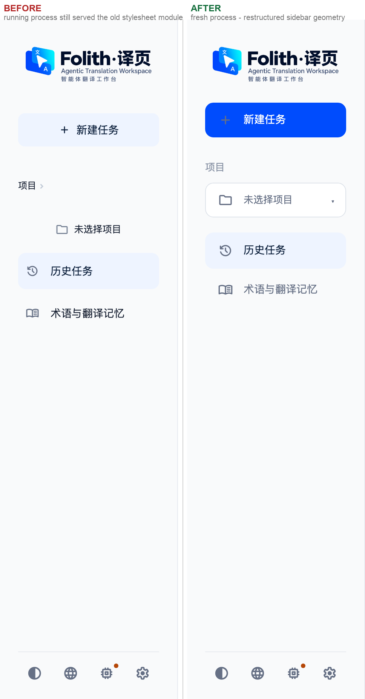

# Sidebar 中部几何修正 — 2026-10-02

本轮**只**改侧栏中部的几何关系：Project section label、Project Switcher、Navigation row
和它们之间的垂直节奏。Logo、Bottom Utility Bar、Tooltip、主题/语言/AI Popover、
Settings、主内容区一行未动（改动文件见文末）。



左：用户当时窗口里真正渲染的样子（进程仍在用旧样式表模块）。
右：本轮的渲染结果（新进程）。

---

## Root Cause：上一版为什么仍然出现巨大且不一致的空白

### ① 决定性原因：进程里的 CSS 模块从未被重新导入

`folith/ui/styles.py` / `folith/ui/themes.py` 是**被 import 的模块**。Streamlit 的文件
监视器只会重新执行 `app.py`（脚本文件），已进入 `sys.modules` 的模块不会重新导入 ——
所以只要进程不重启，**任何 CSS 修改都不会到达浏览器**。

实测证据（改动前，用户窗口所在进程 `:8501`）：

| 位置 | 浏览器里实际生效 | 工作区文件 |
| --- | --- | --- |
| `[class*="st-key-current_project_selector"] .stButton button` | `padding: 0 10px; font-size: 12.5px; border: 1px solid var(--tp-sidebar-line)` | 完全不同的一版（`height: var(--sidebar-switcher-height) !important` 等） |
| `[class*="st-key-project_section_header"]` | `margin: 18px 0 6px`（DOM 实测 `mt=18px mb=6px`） | `margin: 0 !important` |
| nav 行间距 | 8px | 6px（本轮改为 4px） |

浏览器里的那条规则与 `git show HEAD:folith/ui/styles.py` **逐字一致** —— 进程停留在
更早的版本上。`app.py` 因为每次 rerun 都会重新读盘，所以它反而是**新的**：这就是为什么
「未选择项目」后面已经没有 `▾`（新 app.py 去掉了标签里的箭头），但选择器仍然是一行
裸文字、也没有 CSS 的 chevron（旧 styles.py）。

> 上一轮的验收包 `docs/ui-audit/sidebar-rhythm-2026-10-02/` 是用**临时新进程**截的，
> 所以那里的截图看起来是"已修好"的；用户看的是自己那个没有重启的窗口 —— 两者都不是
> 假话，但它们描述的是两份不同的样式表。**改 CSS 之后必须重启应用进程**。

### ② 旧样式表里"谁负责间距"没有单一答案

旧规则把间距分散在四个地方叠加，所以每个元素都在各自漂浮：

| 来源 | 旧值 |
| --- | --- |
| `.st-key-project_section_header`（区块自己） | `margin: 18px 0 6px` |
| `.st-key-project_nav_group`（组容器） | `gap: 8–10px` + `margin-bottom: 24px` |
| 顶层 `stVerticalBlock`（Streamlit 默认） | `gap: 8px` |
| `.tp-brand` / New Task 区块 | 各自的 `margin-bottom: 18–24px` |

实测结果：`项目` 底边到 selector 顶边 ≈ 26px，且每个组之间的距离都不一样。
同一颗导航行还在三处被定义（48px / 40px / 36px），selector 的底色 / 边框又被主题共享层
`[data-testid="stSidebar"] button[kind="secondary"]`（无例外）刷成透明 —— 于是出现了
"空态是一行裸文字、selected 是一张更大的卡片"。

本轮的做法是**删掉重复来源**，而不是继续叠规则：几何只写在组容器和控件自己身上，
共享层那条 sidebar 规则改成 `:where(...)`（权重 0），谁有面、谁没有面由组件自己决定。

---

## Project Switcher（.st-key-current_project_selector）

| 属性 | Default | Hover | Open |
| --- | --- | --- | --- |
| width | `100%`（实测 187px，content box 含 padding） | 同左 | 同左 |
| height | 46px（`var(--sidebar-switcher-height)`） | 46px | 46px |
| box-sizing | `border-box` | — | — |
| padding | `0 14px`（`var(--sidebar-row-inset)`） | — | — |
| border | `1px solid var(--tp-line)` = `--border-subtle` | `var(--tp-border-strong)` | `var(--tp-border)` |
| background | `var(--tp-surface)`（Light `#fff` / Dark `#1b2531` / Paper `#fbf7ee`） | `var(--tp-tint-hover)` `#f7f9fc` | `var(--tp-tint-active)` `#eef4ff` |
| radius | `var(--sidebar-row-radius)` = 11px | — | — |
| 实测 RGB（Light） | bg `rgb(255,255,255)` / border `rgb(222,227,234)` | bg `rgb(247,249,252)` / border `rgb(201,210,223)` | bg `rgb(238,244,255)` / border `rgb(185,209,255)` |

- 内部固定为 `[icon 24px] [label flex:1，左对齐] [chevron]`，**不居中**：
  实测图标 `x=39`、文字 `x=75`（与两行导航完全同一条纵线）。
- dropdown affordance 是右侧 `::after { content:"▾"; flex:0 0 auto }`；打开时
  `rotate(180deg)`（实测 `transform: matrix(-1,0,0,-1,0,0)`）。folder 只表达 "project"，
  chevron 才表达 "this opens"。
- 未选中态（`.tp-nav-empty`）**只改字色** `var(--tp-sub)`，一条 `height` / `padding`
  都不写 —— 空态与已选态是同一个控件（契约测试会盯着这条）。
- 没有 `--tp-primary` 填充、没有阴影、没有左侧竖条；focus 只留一条 2px outline。

## Navigation Row（.st-key-library_nav）

normal / hover / selected **共用同一个组件**，几何由同一条规则给出：

| 属性 | normal | hover | selected `[kind="primary"]` |
| --- | --- | --- | --- |
| height / min-height | 48px | 48px | 48px |
| width | 100%（187px） | 同左 | 同左 |
| padding-inline | 14px | 14px | 14px |
| margin | 0 | 0 | 0 |
| border | `1px solid transparent` | transparent | transparent |
| radius | 11px | 11px | 11px |
| 图标列 / 图标文字间距 | 24px / 12px（图标 `x=39`，文字 `x=75`） | 同左 | 同左 |
| background | transparent | `var(--tp-tint-hover)` | `var(--tp-tint-active)` |
| color | `var(--tp-sub)` / 400 | `var(--tp-ink)` | `var(--tp-brand-ink)` / 500 |

selected **不改变高度、padding、border、margin、width**，所以它不会变成一张更大的卡片。
视觉优先级：`New Task`（`var(--tp-primary)` 实心 + `on-accent` 文字，46px）
> `Selected Navigation`（一层 `--bg-selected` tint）> `normal`（透明）。

## Vertical Rhythm

| 间距 | 值 | 定义位置（唯一来源） |
| --- | --- | --- |
| Logo → New Task | 28px | `--sidebar-gap-section`（brand markdown 容器 `margin-bottom`） |
| New Task → 项目 | 28px | `--sidebar-gap-section`（New Task 区块 `margin-bottom`） |
| 项目 → Project Switcher | 8px | `--sidebar-gap-label`（`.st-key-project_nav_group` 的 `gap`） |
| Project Switcher → Navigation | 20px | `--sidebar-gap-group`（同组容器 `margin-bottom`） |
| Navigation → Navigation | 4px | `--sidebar-gap-row`（`.st-key-library_nav` 的 `gap`） |
| 中部 → Utility Bar | flex spacer | `margin-top: auto !important`，**不是**固定 margin |

四种状态下实测（同一 viewport、同一路由切换）：

```
01 no project + History      28 / 28 / 8 / 20 / 4
02 no project + Terminology  28 / 28 / 8 / 20 / 4
03 project   + History       28 / 28 / 8 / 20 / 4
05 hover switcher            28 / 28 / 8 / 20 / 4
```

（`04 switcher open` 是就地展开的面板把下方内容整体下移，属于列表展开，不是间距变化；
`switcher → nav` 的**组间距仍是 20px**，多出来的是面板本身。另外在"项目详情 + 未分类
上下文"这一个状态里，组内会多一行说明文字 `正在查看未分类任务`，它同样属于组内内容。）

## 验收截图

| 状态 | 截图 |
| --- | --- |
| 1. 未选择项目 + 历史任务 selected | [01](01-light-history-empty.png) |
| 2. 未选择项目 + 术语与翻译记忆 selected | [02](02-light-terminology-empty.png) |
| 3. 已选项目（Midnight Library）+ 历史任务 selected | [03](03-light-project-history-selected.png) |
| 4. Project Switcher 展开（chevron 旋转、soft accent 面） | [04](04-light-switcher-open.png) |
| 5. Hover Project Switcher | [05](05-light-switcher-hover.png) |

五种状态共同满足：所有行高度不跳（46 / 48 / 48，与状态无关）、所有文字起点一致
（`x=75`）、selector 始终是有边框的控件、selected 不改变尺寸、section 间距恒定。

原始 DOM 实测数据见 [`measurements.json`](measurements.json)（含每个控件的 rect、
computed style、`::after` 与六段间距）。

## Regression

- **Bottom Utility Bar 未改**：before / after 实测同一位置 `y=837..884`（h=47，四个
  36px cell），贴底仍然靠 `margin-top: auto`（实测 flex 余量 454.9–460.9px）。
- **Logo / Tooltip / 主题·语言·AI Popover / Settings / 主内容区未改**。
- 侧栏「新建任务」三种态的高度统一为 46 / 40 / 40px（删掉了一处排在整张表最后、
  会把高度拽回 36px 的副本）；进入页面级 CTA 的场景仍然退成次级样式。
- 窄屏（≤767px）压缩一档 40px，已写回同一组选择器，不会被本轮更高权重的桌面规则吞掉。
- 测试（最终一次合并运行）：`sidebar_geometry_contract_test` /
  `sidebar_project_switcher_test` / `project_context_hierarchy_test` /
  `project_task_navigation_test` / `project_overview_structure_test` /
  `ui_preferences_test` → **189 passed**。新增契约测试
  `tests/sidebar_geometry_contract_test.py`（17 项）把本轮定下的几何关系钉死：
  四个控件共用一条左右栅格、导航三态同几何、selector 有面有边有 chevron、
  节奏数值、section label 对比度、三套主题无写死颜色、共享层 `:where()` 写法。

## ⚠️ 生效前提

样式改动位于 `folith/ui/styles.py` / `folith/ui/themes.py` —— 这两个是被 import 的模块。
**必须先重启运行中的应用进程**（`./start.sh` / `venv/bin/python gui.py`），浏览器刷新
对它们无效。本轮验收全部在一个新起的进程上完成（临时端口 8599，测完已关闭）。
