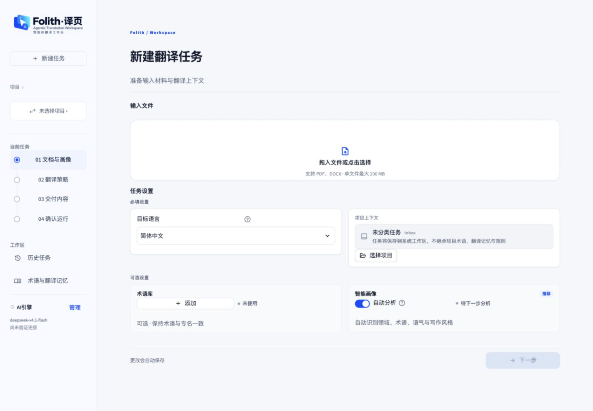
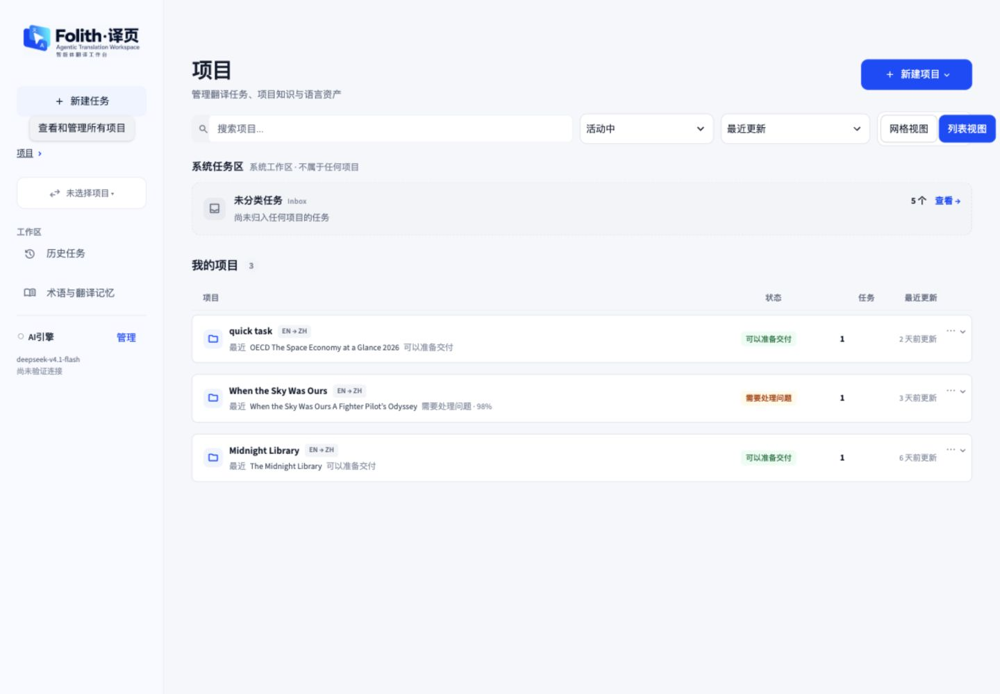
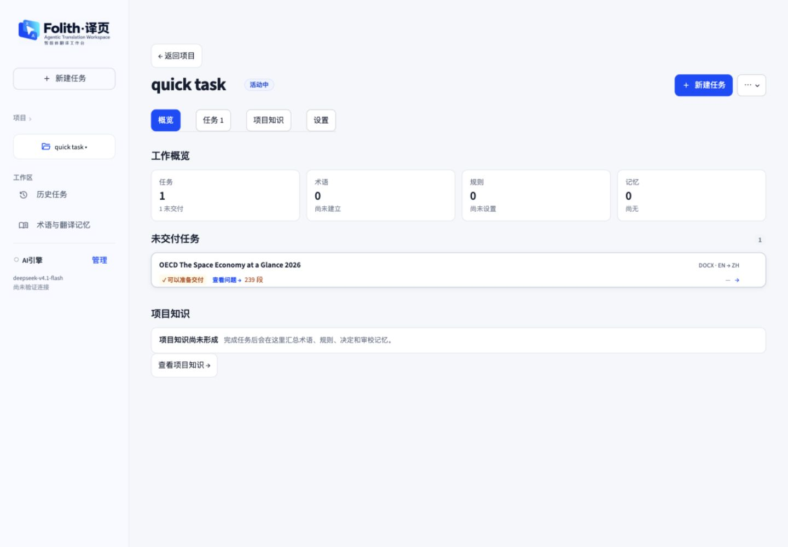
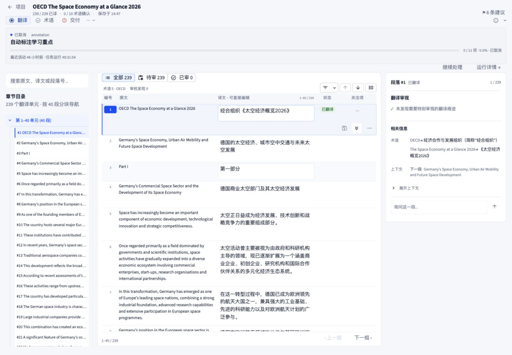
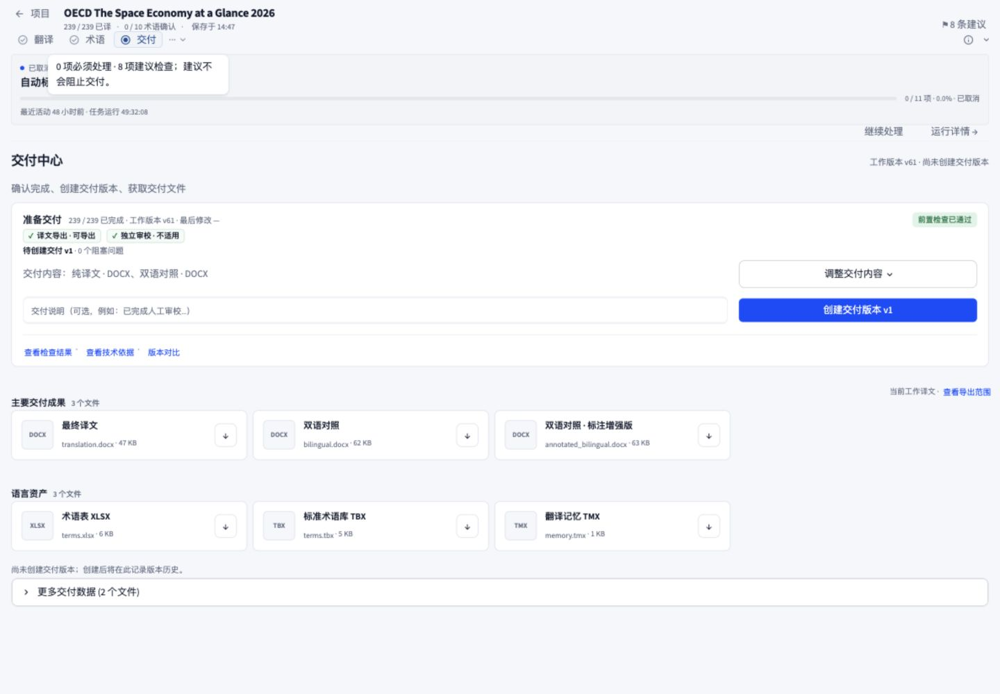
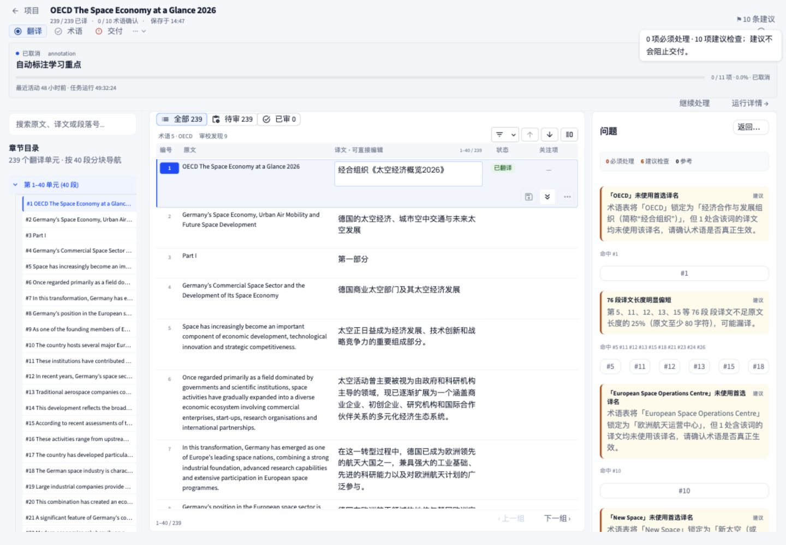
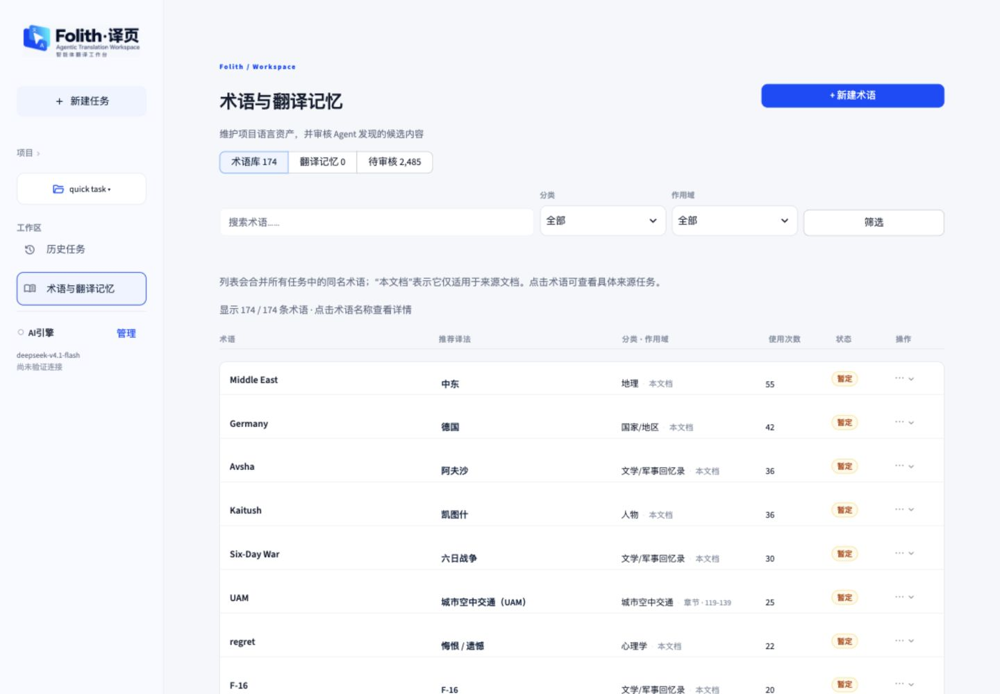
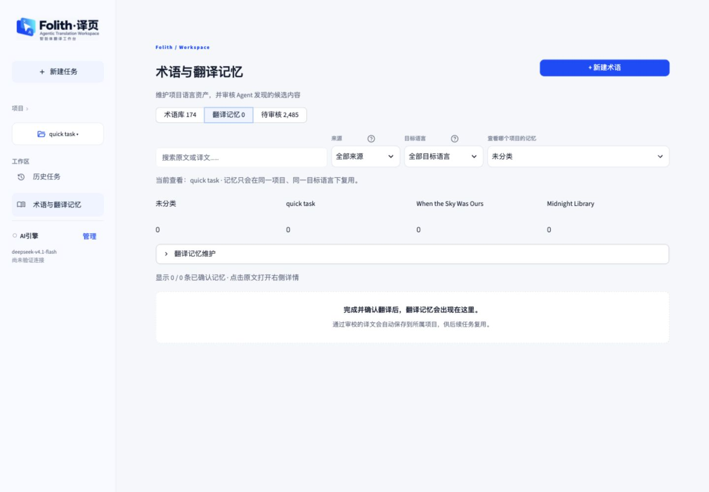

# Folith UI 审阅 · 2026-10-01

结论：现有品牌、蓝色主操作、项目分组和双语对照结构值得保留。优先修正状态一致性、问题定位和可访问名称，再做字体与留白调整。没有证据支持全面重做。

## 范围与方法

安装了 https://github.com/leonxlnx/taste-skill 的 `skills/taste-skill`，位置为 `~/.codex/skills/taste-skill`，frontmatter 名称为 `design-taste-frontend`。安装器下载方式遇到本机 Python 证书链错误，改用安装器 Git 方式成功，没有关闭证书验证。

该 skill 明确排除 dashboard、密集产品 UI、多步骤向导。因此尊重其适用范围，保留现有品牌并先审阅实际页面；产品流程依据 product-design:audit 审阅。未套用营销页的字体、卡片、动画或装饰禁令。

本轮在当前本地服务 `http://127.0.0.1:8501/` 采集截图，采用实际项目 quick task / OECD 239 段任务。检查桌面 1440×1000、紧凑窗口 980×900。只进行查看和导航；未编辑译文、调用模型、确认审校或创建交付版本。代码只读用于解释已观察问题。截图含当前本地文档名称，报告留在本机。

## 优先处理的问题

### 1. 问题总数与问题抽屉没有说明各自口径

截图 06 中，右上角显示 **10 条建议**，右栏汇总显示 **6 建议检查**，列表工具条显示 **审校发现 9**。进入任务时还曾显示 8 条建议，点击建议入口后变为 10，本轮未修改内容。

不同数字可能分别表示建议条目、命中段落和来自不同来源的问题，不能仅凭数字断定数据丢失。但用户点击总数后无法在抽屉内对应全部来源，页面也没有解释计数单位，影响审阅完整性的判断。

代码依据：`folith/task_overview.py:465` 将持久化审校建议与 planner 建议相加；`app.py:4990` 的问题抽屉只从 planner findings 构建；`app.py:4900` 显示的是 issue_indexes 数量。建议统一可浏览的数据范围，明确区分“建议条目”和“涉及段落”，解释其他来源或提供可达入口。

### 2. 980px 窗口下，问题定位按钮失去段落编号

截图 07：三栏继续并排，右栏长度检查的六个定位按钮被挤成 `#…`，返回按钮变成“返…”。用户无法从按钮识别将跳到哪个段落。主译文列也被压窄，增加长文对照时的换行和滚动。

代码依据：`app.py:5040` 附近把最多六个锚点等分成一行；`folith/ui/styles.py:3838` 定义 24px 高的紧凑按钮。建议编号按钮按最小宽度换行，在较窄窗口把问题栏改为可展开抽屉，优先保证双语内容宽度。页面根节点宽度与 scrollWidth 均为 980；没有观察到根页面横向溢出。

### 3. 翻译记忆项目选择与说明互相矛盾

截图 09：项目选择器显示 **未分类**，说明显示 **当前查看：quick task**，左侧当前项目也为 quick task。当前所有项目记忆数为零，无法由实际行数据确定最终筛选了哪个项目；可以确认 UI 自身不一致。

代码位置：`folith/ui/language_assets.py:938` 的项目 selectbox 与 `:942` 的当前项目说明。建议让选择器、说明和实际数据查询共同使用本次选择的返回值，在空状态也保持一致。

### 4. 已取消任务仍显示持续增长的“任务运行”时间

截图 04、05、06、07 同一任务一直显示“已取消”，最近活动为 48 小时前，但任务运行从 **49:31:54** 增加到 **49:33:06**。这使停止状态与耗时表达冲突；大型进度横幅同时长期占据翻译和交付页面顶部。

代码依据：`folith/ui/workspace/runtime_status.py:169` 使用当前时间减 started_at；只有存在 finished_at 且状态已结束时才冻结时间。建议在停止状态显示已记录的结束耗时；缺少结束时间时明确“结束耗时未知”，不要表达为仍在运行。停止横幅可收为摘要，保留明确的恢复入口。

### 5. 图标按钮的可访问名称暴露内部图标名

工作台页面结构中，下一段按钮名为 `arrow_downward`，布局按钮名为 `vertical_split`，保存并前进按钮名为 `keyboard_double_arrow_down`。DOM 检查发现这些按钮的 aria-label 为空、title 缺失。代码为部分按钮提供了 help 提示，但提示没有成为当前 DOM 中可理解的按钮名称。

建议为图标操作提供“下一段”“切换布局”“保存并前进”等明确的可访问名称，并核对重复译文输入框能否带上段落编号。此项基于当前 DOM 和可访问树；未使用实际读屏软件，不宣称完整无障碍合规结论。

### 6. 可交付任务的下一步被建议项抢占

截图 03 显示“可以准备交付”，旁边却突出“查看问题”；进入工作台后的右上角也只有建议入口。截图 05 已确认前置检查通过、0 个阻塞问题、独立审校不适用，创建交付版本按钮可用。因此这不是门禁故障，而是下一步优先级问题。

代码依据：`folith/ui/browser.py:218` 由 warning tone 显示“查看问题”；`app.py:3499` 存在任意 issue_total 时优先显示问题按钮。建议把“准备交付”保留为主操作，“查看建议”作为次操作，避免把非阻塞建议描述成必须修复的问题。

## 确认做得正确的部分

- 新建任务：文件类型与大小限制明确，目标语言、项目上下文和可选设置分组清楚；未上传文件时下一步禁用合理。
- 项目中心：搜索、状态、排序和网格/列表入口集中，未分类任务独立呈现，项目名称及状态可扫描。
- 工作台：原文与可编辑译文并列，选中段落有清楚的背景和边线，右侧相关术语与上下文有助于判断。
- 交付：区分工作版本和待创建交付版本，显示零阻塞和独立审校不适用；主按钮“创建交付版本 v1”清楚。
- 翻译记忆空状态：解释了如何产生记忆及项目/目标语言复用边界。项目选择冲突需单独修复。

## 本轮步骤与截图

### 01 新建任务 · 基础布局健康

只审阅未上传文件的第一步；未执行后续画像、策略或运行步骤。

### 02 项目中心 · 健康

搜索与状态分组明确；项目状态与最近任务行存在重复信息，可作为低优先级精简。

### 03 项目详情 · 下一步优先级需调整

可交付任务旁的“查看问题”容易让用户以为还存在强制阻塞。

### 04 翻译工作台 · 对照结构健康，运行摘要需修正

已取消状态与持续增长的运行时间并存；停止进度横幅仍占据顶部。

### 05 交付中心 · 可见门禁与主操作健康

检查通过，独立审校不适用，未实际创建或下载新版本。

### 06 审阅问题抽屉 · 计数与来源表达需修正

10 条建议、6 建议检查和审校发现 9 未解释口径；提供了段落锚点是正确方向。

### 07 紧凑工作台 980px · 有明确布局缺陷

段落锚点与返回操作文字被截断。左侧目录和右侧问题同时占位，挤压对照内容。

### 08 术语资产列表 · 基础结构健康

推荐译法、作用域、使用次数和状态分列清楚；本轮未审阅 2485 条候选审核流程。

### 09 翻译记忆空状态 · 说明有用，项目状态不一致

选择器为未分类，说明为 quick task。

## 尚未验证

未验证新建任务完整四步流程、运行中的加载/失败/恢复、审校写入、交付创建及文件内容、语言资产导入导出、历史任务页、阿拉伯语 RTL、实际键盘全流程、读屏与精确颜色对比。760px 捕获未得到完整核心内容视图，未作为缺陷证据纳入结论。没有运行功能测试，因为本轮没有产品代码变更。

建议先修复问题计数与入口、980px 锚点和项目选择一致性，再处理停止计时和按钮名称，最后调整辅助字号及顶部留白。
