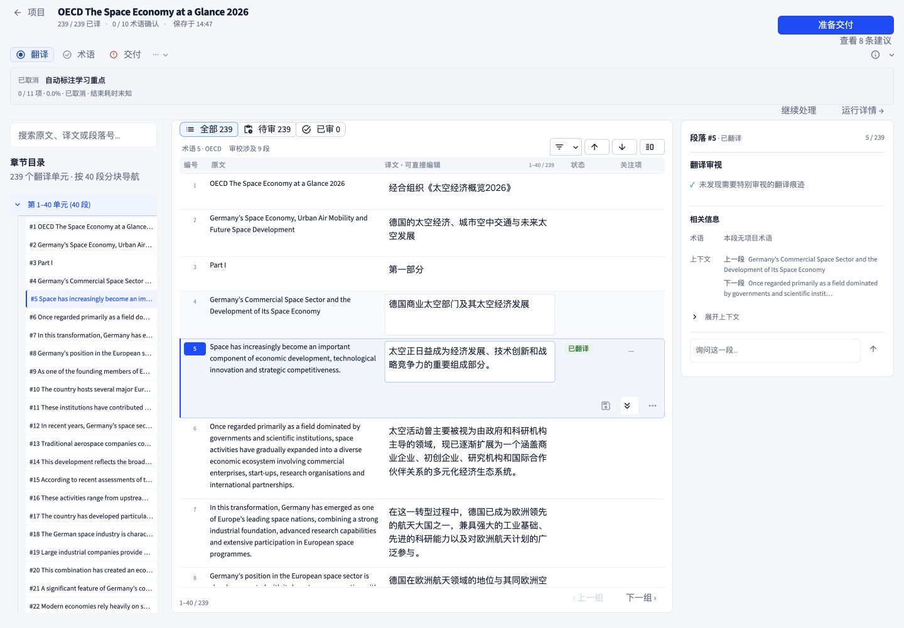
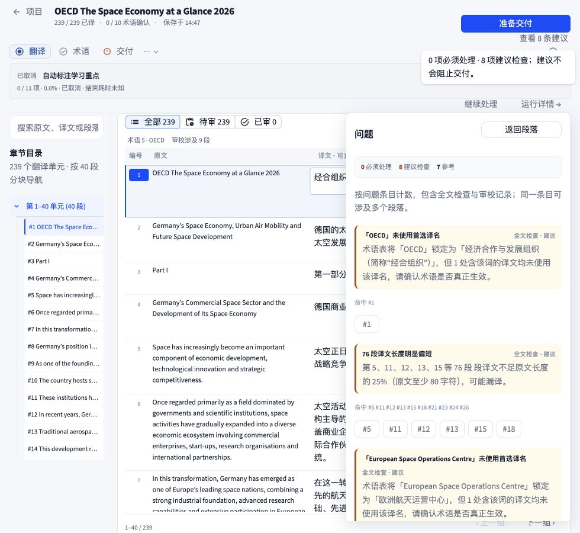
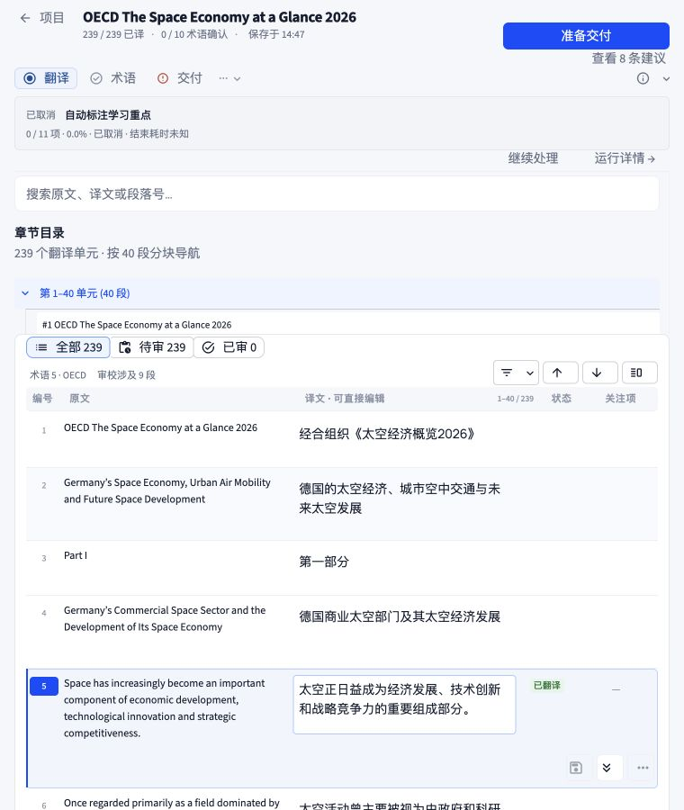
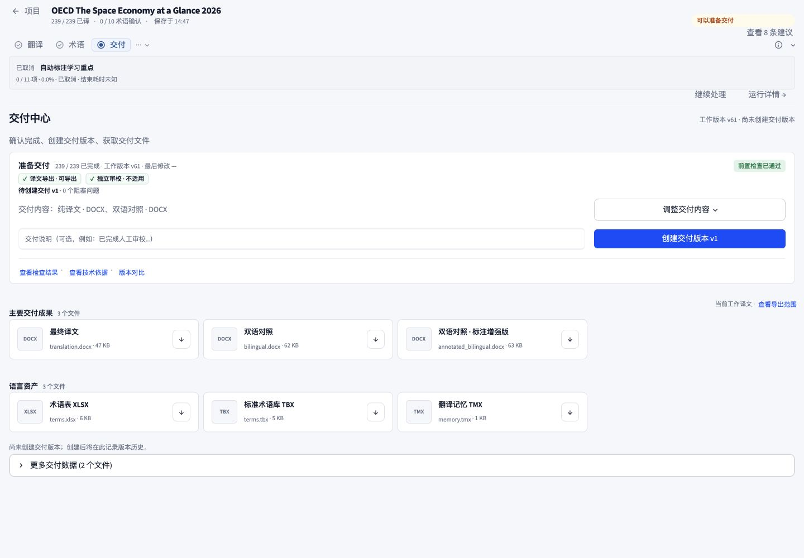
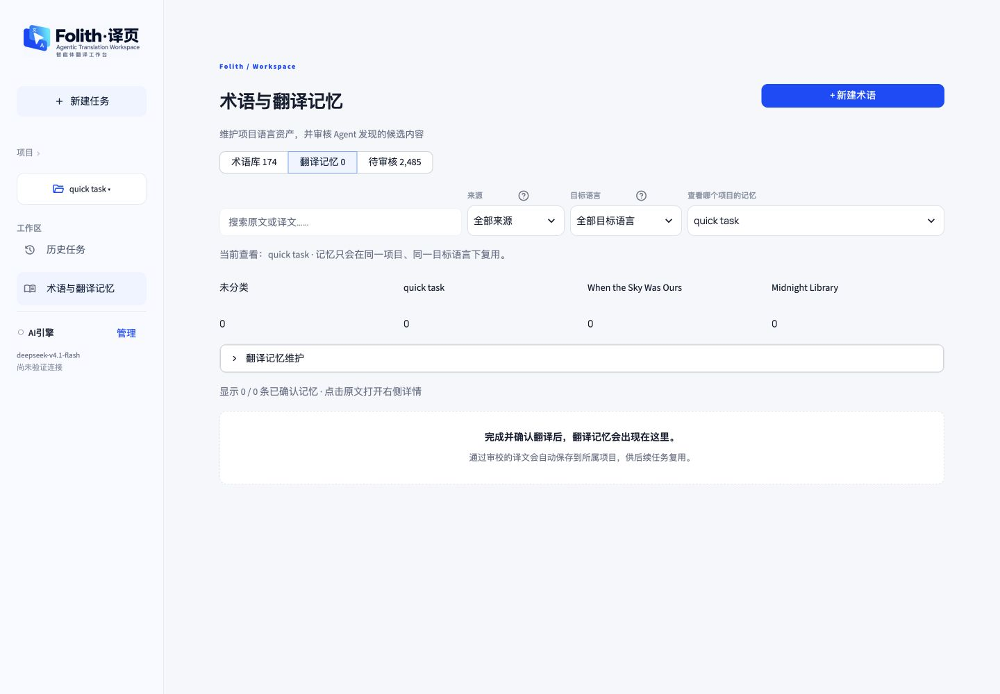

# Folith UI 修整结果 · 2026-10-01

依据上一轮完整报告完成六类修整，保留品牌、配色、工作台功能和交付门禁规则。

## 已完成

1. **建议口径与覆盖范围**：问题面板加入当前有效的持久化审校记录，与顶部总数采用相同来源；条目注明“全文检查”或“审校记录”，汇总说明一条问题可涉及多个段落。筛选按钮改为“审校涉及 N 段”，避免与条目数混淆。真实任务现为顶部 8 条建议、面板 8 条建议检查，另列 7 条参考。
2. **窄窗口**：980px 时保留目录和更宽的双语正文，上下文移到正文下方；点击建议时打开可关闭、可滚动的右侧抽屉。编号按钮按内容宽度排列并允许换行，不再等分压缩。760px 将目录与正文上下排列，目录高度限制为 180px；自然页面滚动替代桌面固定高度，核心内容不会被裁掉。1440px 保留原三栏工作模式。
3. **翻译记忆项目选择**：选择器首次挂载时显式选中当前项目；选择器、说明和数据均使用该项目。真实页面首次进入时均显示 quick task，回归检查覆盖切换到未分类。
4. **停止计时与横幅**：已取消/失败/完成的任务仅在开始、结束时间都有效时计算耗时，否则显示“结束耗时未知”，不会继续增长。已取消、失败和中断等停止状态改为紧凑摘要，保留恢复与详情入口；暂停和运行中展示保持原有行为。
5. **可访问名称**：上一段、下一段、显示或收起右栏、保存、保存并进入下一未确认段均提供中文按钮文字，紧凑图标呈现仍保留可访问文字。译文输入框名称加入段落编号，实际页面结构可读出“第 5 段译文”。部分 Material 图标名仍出现在浏览器结构文本中，但操作不再仅靠图标名识别；未使用真实读屏软件验证最终播报。
6. **下一步优先级**：可以准备交付时突出蓝色“准备交付”，非阻塞建议为次操作。已停止的可选后续处理不再遮掉交付入口。当前已经位于交付页时不再额外显示跳到当前页的按钮。项目任务行将这类非阻塞事项改称“查看建议”。

## 验证

- 初轮相关测试：128 通过，暂停横幅检查失败 1 项。已收回对暂停展示的额外修改，后续 runtime_hud 检查全部通过。
- 第二轮：runtime_hud、翻译记忆首次进入/切换项目、task_overview_ui、project_task_navigation、workspace_consistency，**128 通过**。
- 第三轮：混合来源问题抽屉、已取消可选处理的交付入口、agent_inspector_ui，**17 通过**。
- 最后一轮：混合来源问题抽屉、可选处理交付入口及当前页面不重复跳转、task_overview_ui，**25 通过**。这些轮次有重叠，不相加作为独立测试总数。
- 既有翻译网格编辑、保存流程、任务状态和语言资产检查在首轮通过；修改的 Python 文件通过编译检查。
- 浏览器验证 1440×1000、980×900、760×900。980 和 760 的页面 scrollWidth 均等于窗口宽度；目录、正文和上下文高度有效。实际点击 #5 后关闭建议抽屉并选中第 5 段；“准备交付”成功进入交付中心，未创建新交付版本。

新增回归检查守住：缺少结束时间不继续计时、已有结束时间冻结耗时；翻译记忆首次挂载和项目切换；问题面板同时展示全文检查与持久化审校且总数正确；可选操作取消后仍能进入交付。

## 最终页面证据

### 1. 桌面工作台

### 2. 980px 建议抽屉

### 3. 760px 双语正文与选中第 5 段

### 4. 交付中心

### 5. 翻译记忆项目一致性

## 边界

未在用户实际任务中调用模型、修改译文、写入审校决定或创建新交付版本。未验证实际读屏、完整键盘流程、精确对比度、RTL 与小于 760px 的手机布局。文件包含此前用户的未提交改动，本次没有提交或重置它们。
