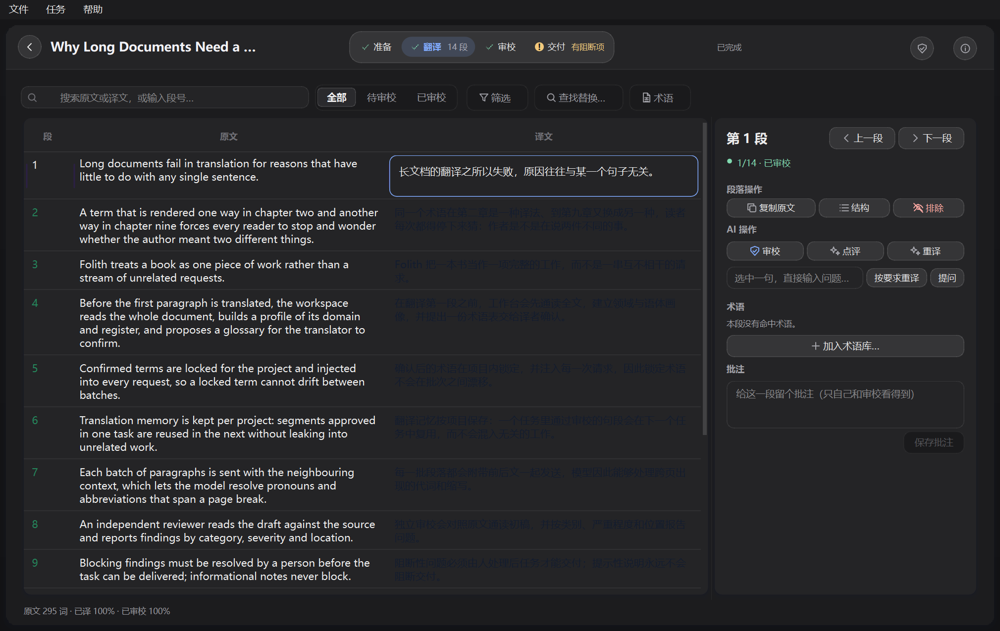
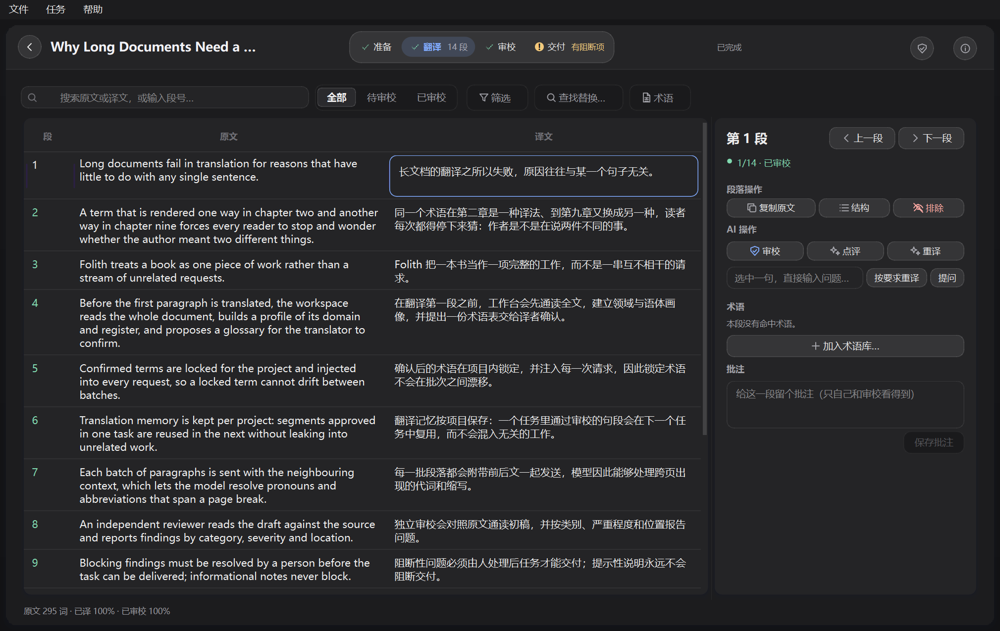

# Workbench theme foreground refresh (#119)

Windows, 2026-10-24. Baseline: `29285f5`. Fixed source: this change.

## Observed behavior

Changing Light to Dark while a translated task is open changed the background
and editor but left unselected target cells using the Light foreground. The
normal 90-switch probe captured this transient failure. Pausing the 1000 ms
poll after initial loading makes the missing immediate refresh deterministic:
`#131c2e` remained on Dark until `_render_segments()` ran again.

The fix explicitly repaints row brushes after applying the theme, including
accent-only changes. It uses the existing visible-first/chunked painting path
without reloading task state or remeasuring row heights.

## Native Windows evidence

Both images use Qt's real `windows` platform and synthetic showcase text. The
polling timer was paused after task loading. Settings followed the sequence
Light → Dark → Light → Dark. The fixed screenshot was taken before any explicit
row refresh. Foregrounds now follow each choice immediately:

| Appearance | Baseline target RGB | Fixed target RGB |
| --- | --- | --- |
| Light | `#131c2e` | `#131c2e` |
| Dark | `#131c2e` (wrong) | `#ffffff` (92% alpha) |

Before:

After:

## Native macOS evidence (2026-10-24)

Machine: Apple Silicon Mac, real `cocoa` Qt platform, real window shown on
screen (not offscreen). PySide6 6.11.2. Baseline: `origin/main` (2a08105).
Fixed source: this branch (5de350a). Same script for both runs
(`native_theme_check.py`): workbench loaded with 40 translated segments (one
untranslated, one draft, one human-edited), polling timer stopped, all
appearance and accent changes applied through the real settings dialog path
(`open_settings` → `theme_box` / `accent_box` → `flush_preferences`), row
foregrounds read immediately with no event-loop pump, no poll and no repaint
in between. Follow-system used the **actual OS appearance switch**
(`osascript` System Events dark-mode toggle), driving the real Cocoa
`colorSchemeChanged` signal — not simulated hints.

Baseline (`origin/main`): rows keep the previous theme's foreground after
every appearance change. Switching dark → light (settings or real OS switch)
leaves target text `#ffffff` on a light surface; accent-only switches leave
the old accent. Sequence ran Light → Dark → Light → Dark plus the OS toggles;
row checks failed at every light state (`baseline-results.json`).

This change: every check passed. Light → Dark → Light → Dark through the
settings path repaint all row foregrounds synchronously (dark target
`#ffffff` / 92% alpha, muted `#ebebf5`, draft `#ebebf5`), accent-only switches
(Green → Slate → Blue) follow immediately, the unsaved inline edit
("Translation 0 unsaved-native") and its dirty state survived every switch,
and follow-system resolved to the OS appearance and tracked both real OS
toggles (Dark → Light → Dark) with correct row colors — screenshots in
`macos/`, measurements in `macos/results.json` and
`macos/baseline-results.json`.

This closes the macOS side of the acceptance item "native Windows and macOS
clients and actual OS light/dark changes while following system". Manual
point-and-click interaction was not exercised; the sequence is driven
programmatically through the same settings path and signal delivery a user
interaction triggers.

## Automated coverage

The settings-path regression first failed against the baseline with the stale
foreground. It stops polling and checks colors without pumping the event loop,
covering normal translations, untranslated placeholders, drafts, and accent
colors. It also preserves unsaved text, cursor/selection, undo availability,
selected segment, dirty state and scroll offsets. Separate cases exercise live
follow-system changes and tables large enough to use chunked painting.

The theme suite is included in the shared Windows/macOS CI workflow. Its system
appearance signals are simulated; this is not real Cocoa or actual OS
light/dark-switch acceptance. Native macOS and actual OS appearance changes
remain to be verified. This evidence concerns #119, not the distinct white
inspector shown in an earlier user screenshot.
