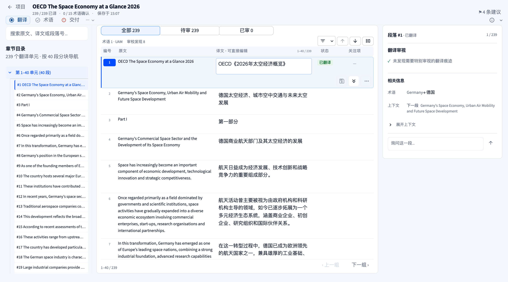
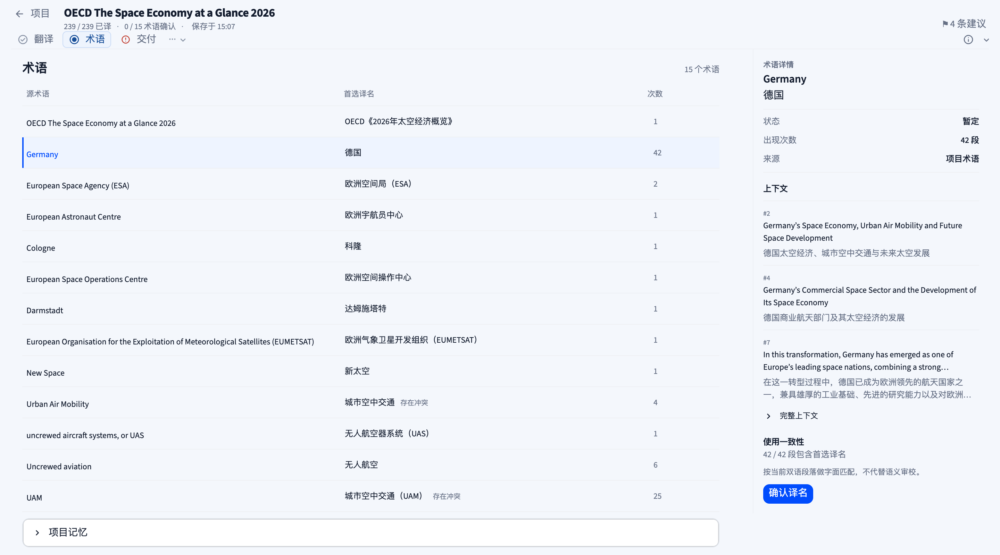
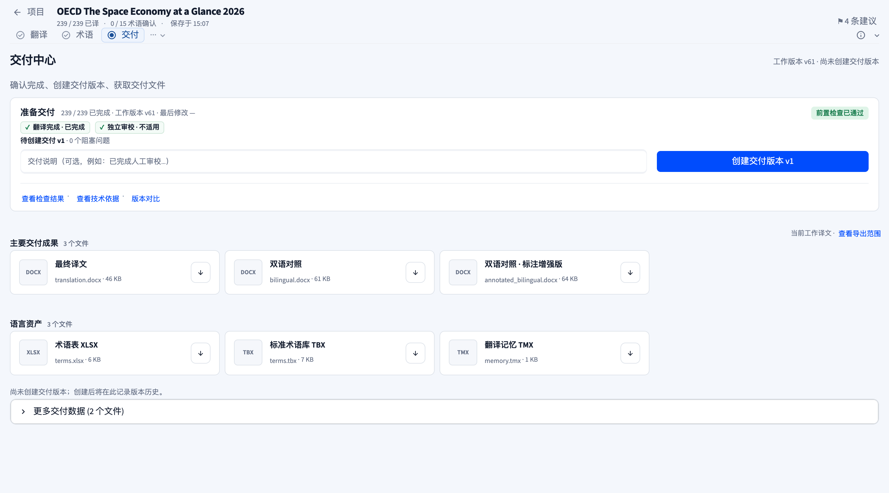
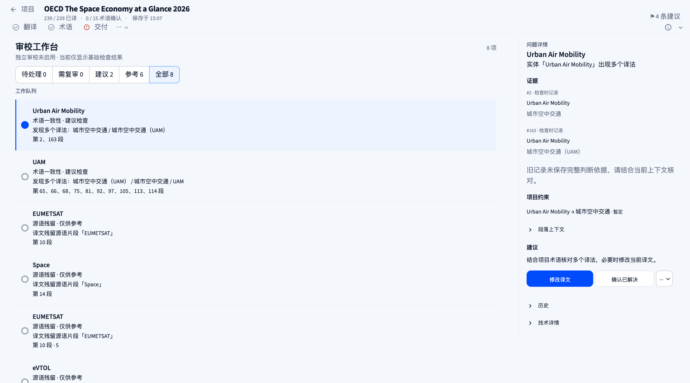
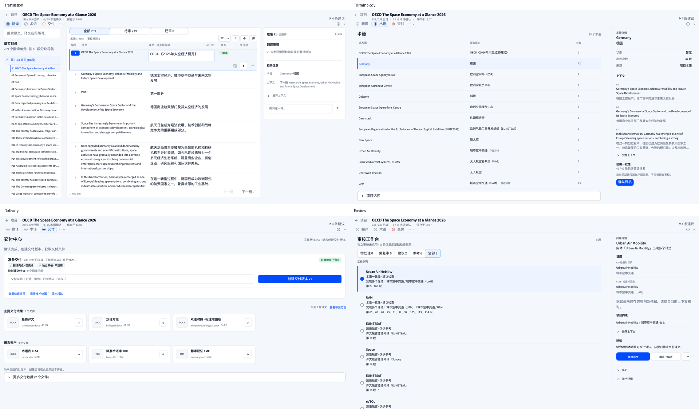

# Folith Workspace Consistency Pass

本轮保留已有 task shell、翻译段落逻辑、40-unit 分块导航和 Delivery Center 工作流。主要变化为共享密度、术语列表和 Inspector、审校队列及信息顺序。

## 1. Workspace consistency audit

| 项目 | 最终结果 |
| --- | --- |
| Header rhythm | 四页标题均从 y=8px 开始，共享顶部实测 63px。返回入口仍为「← 项目」，标题最醒目；metadata 和建议入口保持低权重。 |
| Inspector | Translation、Terminology、Review 统一 340px；Delivery 保留无常驻 Inspector 的现有 IA。 |
| Typography | 页面标题 18px；Inspector 主标题 16px；列表正文与证据 12px；辅助信息 10–12px。翻译正文保持原有较大的阅读字号。 |
| Row density | 术语行控制高度 44px，含分隔线实测 45px；审校行按问题正文自然增长，不强制裁掉证据；操作为 34px。 |
| Radius | 独立功能 surface 和紧凑操作使用 8px。术语/审校信息区使用分隔线和留白，避免层层卡片。 |
| Status color | 导航文字表示位置；交付 warning 仅由小图标表达。普通术语暂定状态在列表隐藏，冲突/锁定/需确认等例外保留。 |
| Translation | 选中段落常驻三项操作，主体译文仍最醒目。 |
| Terminology | 无 full-cell grid；选择行与实际术语详情关联，默认空态简短。 |
| Review | 去掉 hero、重复大说明和大动作面板；工作队列配合问题 Inspector。 |
| Delivery | 保留准备交付、创建版本、成果/语言资产和历史结构；只微调卡片、下载控件、文件名截断和间距。 |

验收 viewport：1280×800（MacBook 密度）、1440×800、1600×800。三种宽度均无横向溢出，任务标题未截断，Inspector 操作可访问。截图使用真实 OECD 239 段任务；浏览器仅执行选择、筛选和展开菜单，不确认真实术语或创建交付版本。

## 2. Density token definitions

定义位置：`folith/ui/workspace/density.py`，由 `styles.py` 的共享 CSS 入口加载。

| Token | 值 | 用途 |
| --- | --- | --- |
| `--ws-header-height` | 62px | 保留上一轮紧凑 shell，实测含边界 63px；不为达到建议 76–88px 而人为增加顶部空白。 |
| `--ws-toolbar-height` | 36px | 紧凑筛选/工具控件 |
| `--ws-section-gap` | 24px | 主要章节节奏 |
| `--ws-compact-gap` | 8px | 相邻控制/信息块 |
| `--ws-inspector-width` | 340px | 三个上下文栏 |
| `--ws-row-height` | 44px | 标准单行数据列表 |
| `--ws-compact-row-height` | 34px | 紧凑动作 |
| `--ws-card-padding` | 14px | 独立功能 surface |
| `--ws-surface-radius` | 8px | Surface/控件圆角 |

翻译行和多行审校问题保留内容驱动高度；密度系统不压缩或隐藏段落正文。

## 3. Translation refinements

选中段落仅常驻保存、保存并进入下一段、更多。重新翻译、术语相关结构操作、原文编辑、合并/拆分、插入/排除及草稿清理进入同一个有文字标签的 More 菜单；原有动作 key 和后端行为保留。恢复原译文后补上 UI rerun，使既有反馈及时显示。

## 4. Terminology refinements

- 源术语 / 首选译名 / 次数三列轻量列表，只保留横向分隔线和选中状态。
- 默认「暂定」不重复占行；需要确认、已锁定、拒绝或存在冲突才显示。
- Inspector 提供源词、首选译名、状态、来源、当前真实段落次数、三条上下文预览、完整上下文折叠区、使用一致性和确认动作。
- 未选择时显示简短提示；批量编辑/冻结、项目记忆保留为低优先级折叠操作。
- 次数来自当前段落的既有术语匹配逻辑。使用一致性是首选译名字面匹配，并明确说明不替代语义审校。
- 自动术语 fallback 只读，不能误写为已确认；真实项目术语确认调用已有状态接口。

## 5. Review IA before / after

| Before | After |
| --- | --- |
| 大型审校状态 hero | 标题 + 数量 + 一行 contextual 状态 |
| 独立的大筛选容器 | 36px segmented filter |
| 状态和大动作先于问题 | 主区工作队列；右侧严格为问题 → 证据 → 项目约束/段落上下文 → 建议 → 操作 |
| 多个大型动作同时呈现 | 根据问题提供主要动作，另有紧凑次要动作和 More |
| History 常驻占空间 | History 与技术详情折叠 |
| 嵌套面板/卡片 | 列表选择、分隔线、字号和留白 |

队列保留待处理、需复审、建议、参考、全部及既有优先级。检查时记录与当前译文区分标注；缺失完整判断依据的旧记录明确说明需要核对上下文。只有多个记录译法才使用「发现多个译法」文案。无完整建议译文的术语冲突使用「修改译文」作为主要动作，避免凭空生成自动替换；存在既有建议译文时保留应用建议逻辑。

## 6. Shared components / tokens

共享页面 heading、辅助状态行、Inspector facts、证据行、空态和动作密度。`presentation.py` 提供只读数据投影：`term_rows` 和 `review_evidence`。不引入新的分页、分段或交付后端。

## 7. CSS changes

`density.py` 集中管理本轮 workspace overrides：导航状态颜色、上下文栏宽度、列表/Inspector chrome、审校过滤与动作、More 菜单文字、交付 artifact 最大宽度和文件名省略。Delivery artifact 实测为 340×72px，超宽 viewport 不无限拉伸；下载按钮保持紧凑。

## 8. Modified files (this pass)

- `app.py`：术语列表/Inspector、审校队列/Inspector、动态动作呈现。
- `folith/ui/styles.py`：加载共享密度 CSS。
- `folith/ui/workspace/density.py`：共享密度 token 与 workspace styles。
- `folith/ui/workspace/presentation.py`：实际术语次数与审校证据投影。
- `folith/ui/workspace/cat_grid.py`：段落 More 菜单。
- `folith/ui/workspace/inspector.py`：恢复原译文后刷新反馈。
- `tests/workspace_consistency_test.py`：术语计数、历史/当前证据、选择与确认隔离测试。
- `tests/phase3_workbench_ui_test.py`：调整新信息顺序与当前动作定位，修正旧 mock 签名。
- `scripts/workspace_consistency_check.py`：只读浏览器截图与几何/交互检查。
- `docs/ui-audit/workspace-consistency/`：截图、geometry 数据和本报告。

工作目录原有大量其他修改，未将其归为本轮成果。

## 9. Tests and limits

相关套件：

```sh
python3 -m pytest tests/workspace_consistency_test.py tests/phase3_workbench_ui_test.py tests/translation_workbench_ui_test.py tests/segment_navigation_test.py tests/delivery_builder_ui_test.py -q --tb=short
```

结果：**40 passed**；最终文案/CSS 修正后，术语及审校相关测试再次 **16 passed**；5 个 SWIG 弃用 warning。覆盖术语确认只修改选中项、词边界计数、检查时记录与当前译文、建议应用/复审、源语确认 gates、段落导航和 Delivery 行为。

浏览器检查：三种宽度共 12 张最终截图，断言标题位置/可容纳性、无横向溢出、340px Inspector、三项翻译常驻动作、340px artifact 上限、审校队列行填满列表；另检查 More 展开和切换问题更新 Inspector。见 `geometry.json`。

扩展到独立 Language Assets workspace 的检查有 3 个 TM/库页面失败（metric、TM 选择行和空态断言），涉及本轮未修改的页面路径，尚未诊断；不宣称全仓库测试通过。没有执行真实任务的术语确认、译文修改、重新翻译或交付创建；这些变更行为由隔离测试验证。

## 10. Four final screenshots

统一为 1440×800；另有 1280 和 1600 版本。下列页面可直接横向比较同一 viewport 的 shell、间距与 Inspector：

| Translation | Terminology |
| --- | --- |
|  |  |

| Delivery | Review |
| --- | --- |
|  |  |

附加截图：`terms-empty.png`、`translation-more.png`。对照基线：`before-*-spacing.png`。

横向对照总览：


